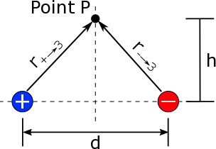
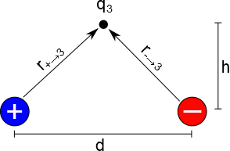

[In the last page of notes](/empcubed/notes/week-02-charges-superposition/superposition/), you read about how superposition applies in general for electric field and electric potential. These notes will go into more detail about how to calculate the electric field using superposition for the specific example of an electric dipole. (We are showing this example of electric field, rather than electric potential, because the [vector math](/empcubed/notes/week-01-charges-field-potential/math_review/#vector_notation) is more complicated and worth describing in more detail.)

### Electric Field between a Dipole

Problem setup: $r$ vectors between the charges in the dipole and point P

We will start by finding the net electric field at the location of Point P (shown in the figure to the right) using superposition. Here we have P positioned a height h above the two charges in the dipole and centered between the positive and negative charge horizontally. From the superposition principle, we know that the total electric field at Point P (${\overset{\rightarrow}{E}}_{net}$) should be equal to the electric field from the positive charge at Point P (${\overset{\rightarrow}{E}}_{+}$) plus the electric field from the negative charge at Point P (${\overset{\rightarrow}{E}}_{-}$):

$$
{\overset{\rightarrow}{E}}_{net} = {\overset{\rightarrow}{E}}_{+} + {\overset{\rightarrow}{E}}_{-}
$$

First, we will find the electric field from the positive charge, which is given by:

$$
E_{+} = \frac{1}{4\pi\epsilon_{0}}\frac{q_{+}}{(r_{+ \rightarrow P})^{3}}{\overset{\rightarrow}{r}}_{+ \rightarrow P}
$$

where ${\overset{\rightarrow}{r}}_{+ \rightarrow P} = \langle d/2,h,0\rangle$ because it points from the positive charge to the location of Point P. Note that this equation for the r-vector is highly dependent on your choice of origin. In this case, we have placed the origin in between the two point charges and a distance h below Point P.

In the electric field equation, $r_{+ \rightarrow P}$ is the magnitude of ${\overset{\rightarrow}{r}}_{+ \rightarrow P}$ so

$$
r_{+ \rightarrow P} = \sqrt{(d/2)^{2} + h^{2}}
$$

So this means that ${\overset{\rightarrow}{E}}_{+}$ is given by:

$$
E_{+} = \frac{1}{4\pi\epsilon_{0}}\frac{q_{+}}{(\sqrt{(d/2)^{2} + h^{2}})^{3}}\langle d/2,h,0\rangle
$$

Similarly, we can find the electric field from the negative charge:

$$
E_{-} = \frac{1}{4\pi\epsilon_{0}}\frac{q_{-}}{(r_{- \rightarrow P})^{3}}{\overset{\rightarrow}{r}}_{- \rightarrow P}
$$

where ${\overset{\rightarrow}{r}}_{- \rightarrow P} = \langle - d/2,h,0\rangle$ because it points from the negative charge to the location of Point P. In this equation, $r_{- \rightarrow P}$ is the magnitude of ${\overset{\rightarrow}{r}}_{- \rightarrow P}$ so

$$
r_{- \rightarrow P} = \sqrt{( - d/2)^{2} + h^{2}} = \sqrt{(d/2)^{2} + h^{2}}
$$

So this means that ${\overset{\rightarrow}{E}}_{-}$ is given by:

$$
E_{-} = \frac{1}{4\pi\epsilon_{0}}\frac{q_{-}}{(\sqrt{(d/2)^{2} + h^{2}})^{3}}\langle - d/2,h,0\rangle
$$

The net electric field is then found by adding the two electric fields together:

$$
{\overset{\rightarrow}{E}}_{net} = \frac{1}{4\pi\epsilon_{0}}\frac{q_{+}}{(\sqrt{(d/2)^{2} + h^{2}})^{3}}\langle d/2,h,0\rangle + \frac{1}{4\pi\epsilon_{0}}\frac{q_{-}}{(\sqrt{(d/2)^{2} + h^{2}})^{3}}\langle - d/2,h,0\rangle
$$

If we *assume the dipole charges are equal in magnitude* (but still opposite in sign) then this becomes:

$$
{\overset{\rightarrow}{E}}_{net} = + \frac{1}{4\pi\epsilon_{0}}\frac{q}{(\sqrt{(d/2)^{2} + h^{2}})^{3}}\langle d/2,h,0\rangle - \frac{1}{4\pi\epsilon_{0}}\frac{q}{(\sqrt{(d/2)^{2} + h^{2}})^{3}}\langle - d/2,h,0\rangle
$$

We can simplify the math some to find the general equation for the electric field between the two charges:

$$
{\overset{\rightarrow}{E}}_{net} = \frac{1}{4\pi\epsilon_{0}}\frac{q}{(\sqrt{(d/2)^{2} + h^{2}})^{3}}(\langle d/2,h,0\rangle - \langle - d/2,h,0\rangle)
$$

$$
{\overset{\rightarrow}{E}}_{net} = \frac{1}{4\pi\epsilon_{0}}\frac{q}{(\sqrt{(d/2)^{2} + h^{2}})^{3}}\langle(d/2 + d/2),(h - h),0\rangle
$$

$$
{\overset{\rightarrow}{E}}_{net} = \frac{1}{4\pi\epsilon_{0}}\frac{q}{(\sqrt{(d/2)^{2} + h^{2}})^{3}}\langle d,0,0\rangle
$$

So this final result is the net electric field at Point P from both the positive and negative dipole charges. There is only an x-component to the electric field, so we know that the electric field will point directly to the right (from the positive charge to the negative charge).

## Finding the force from the dipole

Once we have the electric field from the dipole, it becomes relatively simple to find the force from that dipole on any other charge that we would have near by simply by using the electric force relationship: $\overset{\rightarrow}{F} = q\overset{\rightarrow}{E}$.

Problem setup: $r$ vectors between the charges in the dipole and point P

For example, if we had a positive charge $q_{3}$ that was centered a distance h above our dipole (as in the first example), we could find the force on $q_{3}$ by using the electric field that we calculated before:

$$
{\overset{\rightarrow}{F}}_{q_{3}} = q_{3}{\overset{\rightarrow}{E}}_{net} = \frac{1}{4\pi\epsilon_{0}}\frac{q_{3}*q}{(\sqrt{(d/2)^{2} + h^{2}})^{3}}\langle d,0,0\rangle
$$

This force only points in the $\widehat{x}$ direction, which makes sense. Because $q_{3}$ is positive, we know that it should be repelled from the positive charge and attracted toward the negative charge. As much as the positive charge wants to push it away, the negative charge wants to pull it back so there is no change in the $\widehat{y}$ direction, but both charges want to send $q_{3}$ to the right.

If $q_{3}$ happened to be negative, then the force would instead point to left (but we would not have to rewrite ${\overset{\rightarrow}{E}}_{net}$ because we didn't change anything about the dipole):

$$
{\overset{\rightarrow}{F}}_{q_{3}} = - q_{3}{\overset{\rightarrow}{E}}_{net} = \frac{1}{4\pi\epsilon_{0}}\frac{- q_{3}*q}{(\sqrt{(d/2)^{2} + h^{2}})^{3}}\langle d,0,0\rangle
$$

This is often why we care about the electric field - **it doesn't matter what changes about** $q_{3}$**, the electric field from the dipole is going to stay the same.** This idea will save you time when doing your calculations, especially for calculations involving more than three charges. (Since we already have the electric field for when Point P is far away from the dipole and when it is on the axis of the dipole, we could also easily find the force on $q_{3}$ at those locations too.)

## Superposition of Potential and Energy

We could have also done the same procedure for finding the total electric potential at Point P rather than finding the electric field - find the electric potential at Point P from the positive charge, find the electric potential at Point P from the negative charge and add them together to get $V_{tot}$.

Once you have the total electric potential around the dipole, it is then very easy to find the electric potential energy between a third charge ($q_{3}$) and the dipole:

$$
U = q_{3}V_{tot}
$$

Again, this is often why we care about the electric potential - **it doesn't matter what changes about** $q_{3}$**, the electric potential from the dipole is going to stay the same.**
