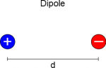
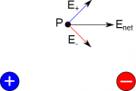
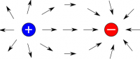
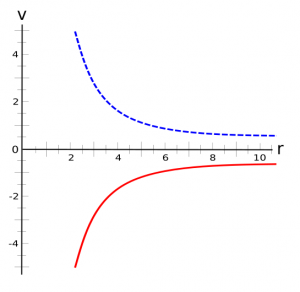
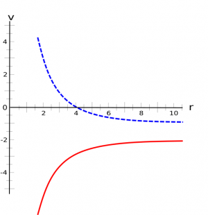
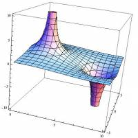
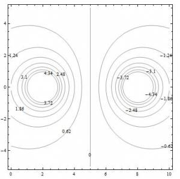

Over the last two weeks, you have read about the [electric field](/notes/week-01-charges-field-potential/pc_efield/) and [electric potential](/notes/week-01-charges-field-potential/pc_potential/) that is created by a single point charge. While a single point charge is definitely the simplest case, most charged objects that you will run into are not single point charges. These notes will talk about the electric field and electric potential due to multiple charges - starting with the next most complicated case: two point charges that are near each other. The idea of adding together the electric field or electric potential for multiple charges is called the **superposition** of the field (for both vector and scalar fields), and it generalizes to any number of charges as you will read soon.



## What happens when you have two charges?

If you place two charges next to each other (with nothing else around them), one of two things will happen: either (1) they will move towards each other (opposite signs of charge) or (2) they will move away from one another (same sign of charge). Sometimes it makes sense to think about this movement of the two charges (i.e., when thinking about forces or changes in energy); other times, it can be difficult to think of two moving objects simultaneously (i.e., when trying to describe their field or potential).

To simplify the situation, we will usually make some sort of assumption. For example, *we often assume that the charge(s) are fixed in place* (something is holding them at a particular location, but we don't care what that something is). Or *we will assume that we are interested in a particular instant in time* and examine what is happening for that situation (like taking a single frame from a movie or freezing time).

## How useful is this assumption?

Dipole representation - one positive and one negative charge, separated by a distance d

It turns out that this assumption is fairly useful. In the case of charges fixed in place, this often true for metals and insulators that are experiencing a fixed external electric field. The electrons redistribute, but do not continue moving because they have either moved as far as they can ([in the case of conductors (metals)](/notes/week-02-charges-superposition/charge_and_matter/#types_of_matter)) or are strongly bound to their nuclei ([in the case of insulators](/notes/week-02-charges-superposition/charge_and_matter/#types_of_matter)). This assumption also works if we rub some excess charge off onto an insulator as the excess charge stays fairly localized to the place where it was rubbed off. If we are interested in the distribution at a given time, that is an even stronger assumption as we are taking a snapshot of the distribution at a specific instant in time, so the electrons are fixed in the snapshot.

To illustrate the idea of superposition of electric field and potential, we will use the example of a fixed electric **dipole**, which is a special term for when you have a positive and negative charge next to each other (shown to the right). An electric dipole is a common example in physics because it is a fairly good model of an atom in an insulator - where the positive charge represents the positive nucleus and the negative charge represents the negative electrons.

## Superposition of Electric Field

Electric field at a single point (Point P) due to a dipole

[As you have learned](/notes/week-01-charges-field-potential/pc_efield/), the electric field from a single *positive charge* at any given point will point *away* from the charge, and the electric field at any given point from a *negative charge* will point *toward* the point charge. So what happens to the electric field when you have a positive charge next to a negative charge? The field at any point in space around the two charges will be given by a **net electric field**, which is the [vector addition](/notes/week-01-charges-field-potential/math_review/#vector_addition) of the electric field from the positive charge and the electric field from the negative charge.

$$
{\overset{\rightarrow}{E}}_{net} = {\overset{\rightarrow}{E}}_{+} + {\overset{\rightarrow}{E}}_{-}
$$

The figure on the right shows how the electric fields from the positive and negative charges combine at a single observation point to give the net electric field at that location. Remember electric field is a vector, so here the vertical components cancel out and the horizontal components add together. (This should make sense intuitively - if you add something that points up and to the right to something that points down and to the right you should be left with something that just points to the right.)

Electric field vectors in space surrounding a dipole

If you repeat this process for many observation points all around the dipole, you will end up with the electric field shown in the next figure to the right. Close to the individual charges, the electric field looks much like it would for a single point charge (the electric field points away from the positive charge and toward the negative charges); however in the middle of the two charges the field bends to point from the positive charge to the negative charge.

If you have more than two charges, the net electric field is simply found by adding up the individual fields from each point charge.

$$
{\overset{\rightarrow}{E}}_{net} = {\overset{\rightarrow}{E}}_{1} + {\overset{\rightarrow}{E}}_{2} + {\overset{\rightarrow}{E}}_{3} + ...
$$

***Just remember that you must add the vectors together and not simply the magnitude*** (in other words, the direction matters!). Superposition might seem like a new idea (adding of vector fields), but it is the same process that you do when you add together all the forces acting on an object to find the net force. In fact, the net force is the superposition of all the forces acting on an object. So the difference here is that the forces are often defined at an object or collection of objects (i.e., where the force is applied to a system) while the electric field for any charged object permeates all of space (i.e., can be found at any observation location around the charge/charges).

## Superposition of Electric Potential

Potential vs Distance graph of a positive (dashed blue) and a negative (solid red) charge with the V=0 reference point at r=$\infty$.

Because electric potential is a scalar, it means adding together the electric potentials can be quite a bit simpler than adding electric fields (you don't have to consider direction); however, you must first check that the reference point for each of the individual potentials is the same. This is the same idea that we used with [relative motion](https://pcubed.msuperl.org/notes/week-01-modeling-motion-no-net-force/relative_motion/) when we had to choose where the origin was to make measurements of displacements - it doesn't make sense to compare measurements with two different origins. The **reference point** for potential is typically defined as the location where the electric potential is equal to zero. You can find the reference point by setting V = 0 and solving for the position, $r$, or by graphing the electric potential versus distance and finding the location where V=0. ***You can only add potentials that have the same reference point***.

Most of the time, *we assume V=0 is at infinity*. We actually already made this assumption when we said the [electric potential for a point charge](/notes/week-01-charges-field-potential/pc_potential/) is $V = \frac{1}{4\pi\epsilon_{0}}\frac{q}{r}$ (the only time when $V = 0$ is when $r = \infty$). The potential vs distance graph for a positive charge (in blue) and a negative charge (in red) is shown in the figure to right.

Potential vs Distance of a positive (dashed blue) and a negative (solid red) charge with the V=0 reference point at a non-infinite reference point.

However, we could have equally said the voltage for a point charge was $V = \frac{1}{4\pi\epsilon_{0}}\frac{q}{r} - 2$, which would give us a reference point at $r_{rp} = \frac{1}{4\pi\epsilon_{0}}\frac{q}{2}$. The electric potential vs distance graphs for this potential/reference point are shown to the right (again, with blue for a positive charge and red for a negative charge). There is nothing wrong with having a different reference point, but we will usually pick a reference point at $r = \infty$ because it makes interpreting voltage numbers easy: a (+) voltage means you are close to a positive charge, a (-) voltage means you are close to a negative charge, and a zero voltage means you are either at $r = \infty$ or somewhere in between a positive and negative charge. *Sometimes it's convenient to set the potential to zero at somewhere other than* $r = \infty$*, which we will do when we discuss circuits.*

If the reference points for the individual electric potentials are the same, you can find the **total electric potential** at a given location by summing all of the individual electric potentials at that point.

$$
V_{tot} = V_{1} + V_{2} + V_{3} + ...
$$

For the case of the electric dipole, we have a positive point charge and a negative point charge, whose potentials are given by:

$$
V_{+} = + \frac{1}{4\pi\epsilon_{0}}\frac{|q_{+}|}{r_{+}}
$$

$$
V_{-} = - \frac{1}{4\pi\epsilon_{0}}\frac{|q_{-}|}{r_{-}}
$$

where $r_{+}$ is the distance from the positive charge and $r_{-}$ is the distance from the negative charge. The only time that $V_{+} = 0$ is when $r_{+} = \infty$ and the only time that $V_{-} = 0$ is when $r_{-} = \infty$, so we know that both of these potentials have the same reference point. This means that we can add these individual potentials to find the total electric potential around the dipole.

$$
V_{tot} = V_{+} + V_{-} = + \frac{1}{4\pi\epsilon_{0}}\frac{|q_{+}|}{r_{+}} - \frac{1}{4\pi\epsilon_{0}}\frac{|q_{-}|}{r_{-}}
$$

Contour map for the potential of a dipole

Sometimes, you may see the electric potential represented as a 3D contour map, where the x and y directions represent the space around the charge(s) and the z direction and/or color represents larger or smaller values of potential. For the dipole, this sort of contour map would look like the one to the right. In this picture, higher on the z-axis (or vertical) would mean a more positive electric potential and closer to the positive charge; whereas, negative on the z-axis would mean a negative potential and indicate that you are closer to the negative charge. Notice that there is somewhere in between that would have a zero electric potential, which comes from the addition of the potential from the positive and negative charges.

While the 3D contour maps are useful visualizations, they are rather cumbersome to draw without a computer. Instead, you may see potential represented as a 2D topographic map (kind of like a top view, looking down on the 3D contour version). In the 2D map, called an **equipotential map or equipotential lines**, the x and y directions again represent the space around the charge(s) and the lines represent the location where the electric potential is the same (this is where the word equipotential comes from). For the dipole, this equipotential map is shown to left. Notice that each of the lines is labeled with a number - this is the electric potential everywhere on that line. To the left of the zero line, the numbers are all positive and increase as you get closer to the center of the circle. This indicates that the positive charge of the dipole is in the center of the left circle. Similarly for the right circle, the potential lines are decreasing in potential indicating that this is where the negative charge of the dipole is.

Topographic map of electric potential

The final example below shows how to create these kinds of graphs in Wolfram Alpha, so you can vary the parameters.

## Examples

- [Superposition with Three Point Charges](/examples/week3_superposition_three_points/)
  - Video Example: Superposition with Three Point Charges
- [Plotting Potential for Multiple Charges](/examples/week3_plotting_potential/)


