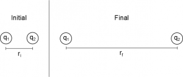

As you read about in the [electric force](/notes/week-03-electric-force-energy/pc_force/), we noted that the electric force is a conservative force. This means we can define a potential energy - **electric potential energy** in this case - using that force. These notes will talk about the general relationship between force and potential energy, walk through an example for point charges, and highlight the relationship between electric potential energy and electric potential.



## General Relationship - Energy and Force

Much like the gravitational force, the electric force is conservative. This means that we can define an electric potential energy using the general relationship:

$$
\Delta U = - \int_{i}^{f}\overset{\rightarrow}{F} \bullet d\overset{\rightarrow}{r}
$$

This relationship is **always true for conservative forces** (works for [springs](/pcubed/notes/week-08-potential-energy-applications/spring_pe/), [gravitational interactions](/pcubed/notes/week-08-potential-energy-applications/newton_grav_pe/), electric interactions, etc.). In our case, we are particularly interested in the electric potential energy ($U_{elec}$):

$$
\Delta U_{elec} = - \int_{i}^{f}{\overset{\rightarrow}{F}}_{elec} \bullet d\overset{\rightarrow}{r}
$$

There are a few important features of this relationship:

- Energy is scalar (including electric energy), so to get from the vector force we must use the [dot product](/notes/week-01-charges-field-potential/math_review/#vector_multiplication) with displacement to get energy. Dot products produce scalar quantities from two vector quantities.
- The electric force is **not constant**, it usually depends on $r$. This means we have to use the integral rather than just multiplying by the distance.
- If we are integrating from some initial location to some final location, we will get a **change** in electric potential energy between the two locations (not the energy at a single place). This change in energy is the important part - it does not matter how you get from the initial to the final location (squiggly or straight path), you will get the same change in energy. This means that electric potential energy is **path independent**.
- [Energy conservation](https://www.msuperl.org/wikis/pcubed/doku.php?id=183_notes:energy_cons) and the [work-energy theorem](/pcubed/notes/week-07-energy-transfer/work/) from mechanics still apply (and are [highly dependent on your choice of system](/pcubed/notes/week-10-internal-energy-heat/system_choice/))
- The units of electric potential energy are joules (J) just like all the other forms of energy.

## Deriving Electric Potential Energy for Two Point Charges

Two charges are initially separated by $r_{i}$. After some time they are separated by $r_{f}$.

Using the relationship between force and potential energy, we can derive the electric potential energy between two point charges from the electric force. Suppose we have two positive point charges $q_{1}$ and $q_{2}$, who are initially separated by a distance r. We will *assume* $q_{1}$ *is fixed* and let $q_{2}$ move to infinity. Starting with the general relationship:

$$
\Delta U_{elec} = U_{f} - U_{i} = - \int_{i}^{f}{\overset{\rightarrow}{F}}_{elec} \bullet d\overset{\rightarrow}{r}
$$

we can plug in the electric force equation for the force from $q_{1}$ on $q_{2}$ (point charges), and we know that our initial location is $r_{i} = r$ and our final location is $r_{f} = \infty$. So we get:

$$
\Delta U_{elec} = U_{\infty} - U_{r} = - \int_{r}^{\infty}\frac{1}{4\pi\epsilon_{0}}\frac{q_{1}q_{2}}{r^{2}}\widehat{r} \bullet d\overset{\rightarrow}{r}
$$

The force from $q_{1}$ on $q_{2}$ points in the $+ \widehat{x}$ direction so this means $\widehat{r} = \widehat{x}$. $q_{2}$ will also move in the $\widehat{x}$ direction so that means $d\overset{\rightarrow}{r} = dr\widehat{x}$.

$$
U_{\infty} - U_{r} = - \int_{r}^{\infty}\frac{1}{4\pi\epsilon_{0}}\frac{q_{1}q_{2}}{r^{2}}\widehat{x} \bullet dr\widehat{x}
$$

Since here we have a scalar times a vector dotted with another scalar times a vector, we can rearrange this equation so that we have the scalars multiplied in the front times the dot product of the two vectors.

$$
U_{\infty} - U_{r} = - \int_{r}^{\infty}\frac{1}{4\pi\epsilon_{0}}\frac{q_{1}q_{2}}{r^{2}}dr\widehat{x} \bullet \widehat{x}
$$

Because $\widehat{x}$ has a magnitude of 1, and we are dotting $\widehat{x}$ with $\widehat{x}$ (these are parallel vectors)

$$
\widehat{x} \bullet \widehat{x} = |\widehat{x}||\widehat{x}|cos(0) = 1 \cdot 1 \cdot 1 = 1
$$

So we get for our energy equation:

$$
U_{\infty} - U_{r} = - \int_{r}^{\infty}\frac{1}{4\pi\epsilon_{0}}\frac{q_{1}q_{2}}{r^{2}}dr
$$

Pulling all of the constants out of the integral, we get

$$
U_{\infty} - U_{r} = - \frac{1}{4\pi\epsilon_{0}}q_{1}q_{2}\int_{r}^{\infty}\frac{1}{r^{2}}dr
$$

$$
U_{\infty} - U_{r} = - \frac{1}{4\pi\epsilon_{0}}q_{1}q_{2}\left. \ \left( - \frac{1}{r} \right) \right|_{r}^{\infty}
$$

$$
U_{\infty} - U_{r} = - \frac{1}{4\pi\epsilon_{0}}q_{1}q_{2}\left( - \frac{1}{\infty} + \frac{1}{r} \right)
$$

Because 1 divided by a very large number is extremely close to zero, we say $\frac{1}{\infty} = 0$. (You can show this formally using limits, but physicists tend to be lazy in this regard. This is one way we tend to drive mathematicians crazy.) This leaves the change in electric potential energy from r to $\infty$ as:

$$
\Delta U_{elec} = U_{\infty} - U_{r} = - \frac{1}{4\pi\epsilon_{0}}\frac{q_{1}q_{2}}{r}
$$

Just as we did with the [superposition of potential](/notes/week-02-charges-superposition/superposition/), *we will often assume that $U=0$ at infinity*. You don't have to choose infinity as the location where $U=0$ but we often will because it is convenient. This assumption allows us to be consistent with [how potential is defined](/notes/week-01-charges-field-potential/pc_potential/), and it allows us to interpret a positive potential energy as repulsion and a negative potential energy as attraction. Using this assumption, then

$$
U_{r} = \frac{1}{4\pi\epsilon_{0}}\frac{q_{1}q_{2}}{r}
$$

This energy then is the electric potential energy between two point charges $q_{1}$ and $q_{2}$ that are separated by a distance $r$. If $U$ is positive, $q_{1}$ and $q_{2}$ have the same sign and if $U$ is negative, $q_{1}$ and $q_{2}$ have opposite signs.

## Getting from Energy to Force

We can also use the inverse of energy-force relationship to get the electric force from electric potential energy. If we know what the electric potential energy is in terms of $r$, you can calculate the electric force by taking the negative derivative of energy with respect to $r$, which will give you the electric force in the $\hat{r}$ direction. *This assumes that your electric potential energy equation does not depend on an angle*. (If your electric potential energy does depend on an angle, then you have to use the [gradient](https://en.wikipedia.org/wiki/Gradient).)

$$
\overset{\rightarrow}{F} = - \frac{dU}{dr}\hat{r}
$$

If you know the electric potential energy in terms of $x$, $y$, and $z$ variables, you can calculate the electric force by taking the negative derivative with respect to each direction (this is the [gradient](https://en.wikipedia.org/wiki/Gradient) in cartesian coordinates).

$$
\overset{\rightarrow}{F} = - \frac{dU}{dx}\hat{x} - \frac{dU}{dy}\hat{y} - \frac{dU}{dz}\hat{z} = - \left\langle \frac{dU}{dx},\frac{dU}{dy},\frac{dU}{dz} \right\rangle
$$

## Relating Energy Back to Potential

Now that we have an idea of what the electric potential energy looks like (both generally and specifically for point charges), we can relate energy back to what we learned last week about [electric potential](/notes/week-01-charges-field-potential/pc_potential/). Let's start by considering two point charges again. Looking at the electric energy equation, we could easily rewrite this equation in term of the electric potential from $q_{1}$:

$$
U = q_{2}\frac{1}{4\pi\epsilon_{0}}\frac{q_{1}}{r} = q_{2}V_{1}
$$

Or the electric potential from $q_{2}$:

$$
U = q_{1}\frac{1}{4\pi\epsilon_{0}}\frac{q_{2}}{r} = q_{1}V_{2}
$$

This shows a larger, more general relationship between electric potential energy and electric potential.

$$
U = qV
$$

Or even more importantly:

$$
\Delta U = q\Delta V
$$

**Note that electric potential energy is NOT the same thing as electric potential**. Electric potential energy requires two charges or a charge interacting with potential, whereas electric potential is from a single charge. **Electric potential energy has units of *joules* and electric potential has units of *volts*.** That being said, electric potential is related to electric potential energy. Electric potential tells you about how much energy there could be, without needing to know charges are interacting.

## Examples

- [Particle Acceleration through an Electric Field](/empcubed/examples/week3_particle_in_field/)
  - Video Example: Particle Acceleration through an Electric Field
- [Preventing an Asteroid Collision](/empcubed/examples/week3_spaceship_asteroid/)
  - Video Example: Preventing an Asteroid Collision




