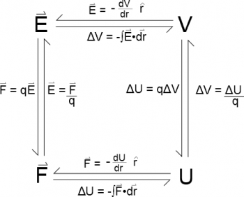
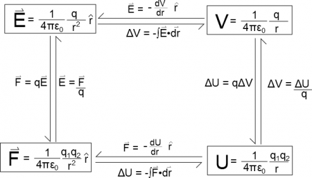

You may have noticed in reading about [electric field](/notes/week-01-charges-field-potential/pc_efield/), [electric potential](/notes/week-01-charges-field-potential/pc_potential/), [electric force](/notes/week-03-electric-force-energy/pc_force/), and [electric potential energy](/notes/week-03-electric-force-energy/pc_energy/) that these quantities are very similar and follow very similar patterns. These notes will summarize the relationships between the four quantities, highlight their similarities and differences, and revisit the relationships between the four quantities for point charges.



## General Relationships

The figure below summarizes the *general* relationships between the four quantities. **These relationships are always true**. It does not matter if you have a point charge, a sphere of charge, a cylinder of charge, or a random blob of charge - these relationships will always be true.

General relationship between Electric Field, Electric Force, Electric Potential, and Electric Potential Energy

A couple of things to notice about these relationships:

- Electric Field and Electric Force are **vectors** - They have a magnitude and direction at every location in space.
- Electric Potential and Electric Potential Energy are **scalars** - They only have a magnitude at every location in space.
- Electric Force and Electric Potential Energy describe an **interaction** - They require two charged objects or two systems of charged objects; you cannot describe the force or energy of just one charge (this is why we have electric potential and electric field).
- Electric Field and Electric Potential describe a **single** charge or system of charges - They require one charged object or a system of charged objects and describe the vector and scalar fields around that object.

## Example for Point Charges

Over the past two weeks, we have been modeling point charges. Using the general relationships above, we found:

**Note: these equations are only true for point charges**. They are not true for other types or shapes of charges. However, we see very similar patterns for the point charges.

- Electric Field and Electric Force are both **vectors** - They both point in the $\widehat{r}$ direction (or $- \widehat{r}$ direction depending on the kinds of the charge).
- Electric Potential and Electric Potential Energy are both **scalars** - There is no direction associated with them.
- Electric Force and Electric Energy describe an **interaction** - There must be (at the minimum) two point charges, which is why there are two $q$'s in the equation
- Electric Field and Electric Potential describe a **single** charge - There is only one $q$ in each equation.

Relationship between Electric Field, Electric Force, Electric Potential, and Electric Potential Energy for a **Point Charge**
