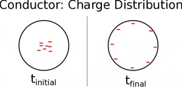
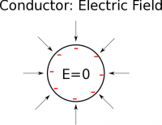
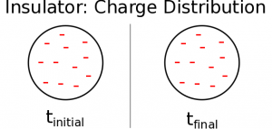
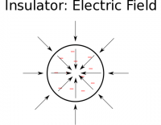
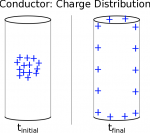
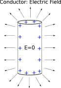
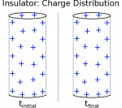
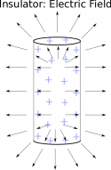

Over the last set of notes, we have talked about [how we use superposition to find the electric field or electric potential from a line of charge](/notes/week-04-modeling-distributions-of-charge/line_fields/), how you set up [the dQ and the $\overset{\rightarrow}{r}$](/notes/week-04-modeling-distributions-of-charge/dq/), and how to use those steps in [a specific example](/notes/week-04-modeling-distributions-of-charge/linecharge/). For this class, we will expect you to be able to set up these kinds of integrals for a line a charge (1D), but we will not go into the mathematics for 2D or 3D distributions of charge. Even though we won't go into the integral set up or analytical derivation of these fields, it is useful to have an idea of what the electric field would look like around some of these shapes. These notes will show what the electric field looks like for two common shapes of charge (spheres and cylinders) and we will discuss what how these fields change when the material is an insulator or a conductor.

## Sphere of Charge

In the [first week of notes](/notes/week-02-charges-superposition/charge_and_matter/), we talked about what it means for an object to be an insulator or conductor. When we make *a point charge assumption*, these properties don't matter because all of the charge is assumed to be at a single location (whether or not the object is a conductor or an insulator). However, when talking about shapes and distributions of charge, whether the object is an insulator or conductor can significantly change what the electric field looks like. We'll start by considering the electric field for a conducting sphere (remember that a [conductor is a material where the excess charges are free to move](/notes/week-02-charges-superposition/charge_and_matter/#types_of_materials)) and then consider an insulating sphere ([where the excess charges are not free to move](/notes/week-02-charges-superposition/charge_and_matter/#types_of_materials)).

## Conducting Sphere of Charge

Initial and final charge distribution on a conductor

For the sake of illustration, let's say that we placed a collection of electrons in the center of a conducting, metal ball so that the ball has an overall net negative charge. What would you expect to happen to the charges in the ball? The electrons would feel a strong repulsive force from one another because they all have a negative charge (“like” charges repel). Because the ball is made of metal, the electrons can easily move through the material, so we would expect the electrons to move as far away from one another as possible.

This means that the electrons will move to the surface of the metal ball and will evenly distribute around the surface, so that they have the maximum space possible between the electrons. Now that we know where the electrons are located, we can say what the electric field would look like around the metal ball.

Now, in practice, it need not be the electrons we placed in the metal the move to the surface of the metal. In fact, it isn't those electrons that move large distances. The entire electron distribution in the metal shifts outward and those that are already near the edge of the material are the ones that produce the effect. The net result is the same whether we model the metal as having the excess electrons move to the edge or we recognize it's a shift of all the electrons in the material including the newly introduced ones.

Electric Field inside and around a conductor

Outside the metal ball, we would hypothesize that the electric field should point in towards the metal ball since the electric field points toward a negative point charge. If you actually do the math (either with an integral over the volume of the sphere or with a computational code), you will see exactly this. The electric field will point radially towards the metal ball and get stronger the closer you are to the ball. In fact, if you are looking for the electric field outside the metal ball, it will look exactly the same as if there were a point charge (with the same net negative charge) at the center of the ball. **Thus, outside a conducting sphere we can still use the equation:**

$$
{\overset{\rightarrow}{E}}_{outside} = \frac{1}{4\pi\epsilon_{0}}\frac{Q}{r^{2}}\widehat{r}
$$

where $Q$ is the total charge on the ball and $\overset{\rightarrow}{r}$ points from the center of the sphere to the observation location.

However, what would happen to the electric field inside the sphere? We know that all of the charges should be located on the surface of the metal ball. When inside the sphere, there will always be a contribution to the electric field from the electrons on one side of the sphere that opposes the electric field contribution from the electrons on the other side of sphere. This means that on the inside, the electric field from the electrons on the surface perfectly cancels out, **leaving a net field of zero.**

$$
{\overset{\rightarrow}{E}}_{inside} = 0
$$

This is actually the primary idea behind shielding sensitive electronics (also referred to as a [Faraday Cage](https://en.wikipedia.org/wiki/Faraday_cage)). If you surround something with a sheet of charged metal, then you can guarantee that there will be no electric field on the inside. This net electric field inside of the cage is a result of the superposition of the applied external field and the field generated by the cage material, the cage is not “blocking the field.”

## Insulating Sphere of Charge

Initial and final charge distribution on an insulator sphere

If instead we have an insulating, plastic sphere (rather than a metal, conducting one), we would see a very different charge distribution. In an insulator, excess charges cannot move freely and are stuck where they were placed. Thus, if we place a collection of electrons inside the ball, they will stay distributed through the volume of the sphere rather moving to the surface. For the purposes of our class, we will *assume that any charge on an insulator will be evenly distributed* - in future courses you may talk about what would happen if there was an uneven distribution of charge. This means that inside the insulating sphere, the excess charges will be spread out through the inside.

Electric field inside and around an insulator

Now that we know where the charges are located, we can think about what the electric field should look like around the plastic charged ball. Similar to the metal ball, at any point outside of the plastic ball we would expect the electric field to point in towards the plastic ball since the electric field points in toward a negative point charge. If you actually do the math (again either with an integral over the volume of the sphere or with a computational code), you will exactly the same electric field outside the plastic ball as you would if the ball (with the same amount of charge) were metal:

$$
{\overset{\rightarrow}{E}}_{outside} = \frac{1}{4\pi\epsilon_{0}}\frac{Q}{r^{2}}\widehat{r}
$$

where $Q$ is the total charge on the ball and $\overset{\rightarrow}{r}$ points from the center of the sphere to the observation location.

However, inside the plastic sphere, the electric field is now non-zero. The contributions to the electric field from the charges in the middle of the sphere do not completely cancel out, leaving an electric field that points toward the center of the sphere for a negative charge (it would point outwards for a positive charge). The electric field inside will be strongest at the edge of the sphere and will be smallest (or exactly zero) in the center. (Toward the end of the semester, we will learn a mathematical trick that can help you find the exact value of the electric field inside an object.)

## Cylinders of Charge

Charge distribution in cylindrical conductor

Another common example that we will frequently talk about is the idea of a charged cylinder. This will become particularly relevant when we start talking about wires in circuits next week. For now, we'll talk about the shape of the electric field for a conducting and an insulating cylinder of charge.

## Conducting Cylinder of Charge

Much like what happened with the metal sphere, if we place an excess charge - let's say it's positive this time - on a metal cylinder (like a wire), those charges will spread out as far as they possibly can from one another (“like” charges repel) because they are free to move through a conductor. This means that all of the charges will spread out over the surface of the cylinder, leaving the inside of cylinder neutral.

Electric field inside and around a cylindrical conductor

If we think about the electric field inside the cylinder, we would see a similar effect as we did with the metal ball. There will always be a contribution to the electric field from the charges on one side of the cylinder that opposes the electric field contribution from the charges on the other side of cylinder. This means that:

$$
E_{inside} = 0
$$

This is actually a larger pattern in all conductors - **the electric field inside a conductor should always equal zero**.

Outside the cylinder, we would expect the electric field to generally point away from the positively charged cylinder since the electric field points in away from a positive charge. If you actually do the math (either with an integral over the volume of the cylinder or with a computational code), you will see something like this. Particularly, in the middle of the cylinder, the electric field will point radially away from the cylinder (pointing directly away from the surface of the cylinder) and is roughly constant; however, near the ends of the cylinder the electric field starts to bend around the edge and is no longer uniform.

## Insulating Cylinder of Charge

Charge distribution for a cylindrical insulator

For an insulating cylinder (like a plastic pipe) if we add excess charges, those will stay in place (as charges are not free to move in an insulator). We will again *make the assumption in these cases of a uniform charge distribution* for our course, meaning any insulator has *excess* charges evenly spread over it.

Just like with the sphere, if we are outside the cylinder, the electric field will look the same as if the cylinder were a conductor (as long as it has the same amount of charge). Namely that it points radially away from the positively charged cylinder, expect near the ends of the cylinder.

Inside the insulating cylinder, the electric field would be non-zero. The contributions to the electric field from the charges in the middle of the cylinder do not completely cancel out, leaving an electric field that points away from the center of the cylinder for a positive charge (it would point towards the center for a negative charge). **The electric field inside will be strongest at the edge of the cylinder and will be smallest (or exactly zero) in the center.**

Electric field inside and around a cylindrical insulator
