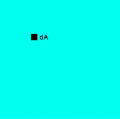
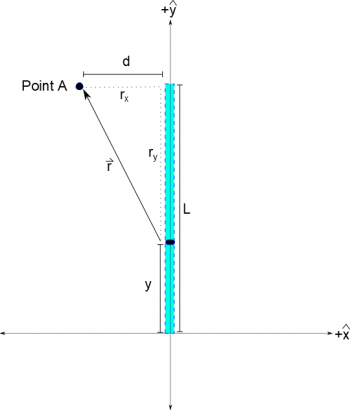

[We've talked about](/notes/week-04-modeling-distributions-of-charge/line_fields/) how we can calculate the electric field or electric potential for any shape of charge by breaking it into little pieces of charge, calculating the field from each piece of charge, then adding all of those little fields together (using [superposition](/notes/week-02-charges-superposition/superposition/)) to get the total field. These notes are going to talk about how we find the dQ for various shapes of charge and how we can write the $\overset{\rightarrow}{r}$ so that it applies for all of the dQ chunks.



## dQ - Chunks of Charge

When we are splitting the total charge into small pieces of charge, it helps to write the little bit of charge in terms of that shape. For example, if you have a line of charge, writing the charge in terms of the length is useful. If you have a flat disk of charge, writing the charge in terms of the area is useful. If you have a sphere of charge, writing the charge in terms of the volume is useful. This idea of how much charge is in a particular shape (line, area, or volume) is called **charge density**.

Horizontal “little bit of length”, $dx$

For the purposes of this class, we will *assume that the charge density is uniform*, which means that every little piece of charge in the shape should have the same of amount of charge.

Vertical “little bit of length”, $dy$

## Charge on a line

For a **1D uniform charge density** (such as lines of charge), we use the variable $\lambda$, which has units of $\frac{C}{m}$ (coulombs per meter). You can calculate $\lambda$ by taking the total charge that is spread over the total length:

$$
\lambda = \frac{Q_{tot}}{L_{tot}}
$$

Once you have the charge density, you can use this to write your little bit of charge in terms of a little bit of length.

$$
dQ = \lambda dl = \lambda dx = \lambda dy
$$

You can write the “little bit of length” in a variety of ways, depending on how you define your coordinate system or what variables you wish to use. (For example, a little bit of vertical length is usually written as “dy” or a little bit of horizontal length is usually “dx”.) If you check the units of this equation you get $C = \frac{C}{m}*m$, so this equation seems to be giving us what we want - a little bit of charge written in terms of a little bit of length.

“Little piece of area”, $dA$

## Charge on a surface

For a **2D uniform charge density** (such as sheets of charge), we use the variable $\sigma$, which has units of $\frac{C}{m^{2}}$ (coulombs per meter squared). You can calculate $\sigma$ by taking the total charge that is spread over the total area:

$$
\sigma = \frac{Q_{tot}}{A_{tot}}
$$

Once you have the charge density, you can use this to write your little bit of charge in terms of a little bit of area.

$$
dQ = \sigma dA
$$

You can write the “little bit of area” in a variety of ways, depending on the shape of charge.

## Charge in a volume

Similarly, for a **3D uniform charge density** (such as a sphere of charge), we use the variable $\rho$, which has units of $\frac{C}{m^{3}}$ (coulombs per meter cubed). You can calculate $\rho$ by taking the total charge that is spread over the total volume:

$$
\rho = \frac{Q_{tot}}{V_{tot}}
$$

Once you have the charge density, you can use this to write your little bit of charge in terms of a little bit of volume.

$$
dQ = \rho dV
$$

Again, you can write the “little bit of volume” in a variety of ways, depending on the shape of charge.

We will talk more about dAs, dVs and bigger shapes towards the end of the course, but for now we will focus on lines of charge (or 1D charge distributions).

## Limits on the integral

Since we are ultimately adding up the “little chunks of charge,” we need to include limits on the integral that say how much of the charge we are adding up. However, we have rewritten the little chunks of charge to be in terms of little bits of length ($dQ = \lambda dl$). This means that the limits on the integral need to be written in terms of length. In general, this is a larger principle in calculus - the limits on your integral need to match the differential variable (dx, dl, dA, or dV). What the limits actually are is highly dependent on the situation/context and how you choose your coordinate system. For example if you are trying to integrate a line with a total length of L, your limits could be from 0 to L if you put the “0” of your coordinate system at the end of the line of charge; or your limits could be from -L/2 to L/2 if you choose the “0” to be in the middle of the line. Neither of these are wrong (they would give you the same answer!) - just make sure you are consistent in how you choose your coordinate system and the limits you pick.

## $\overset{\rightarrow}{r}$ - separation vector

Separation vector for a vertical line of charge, broken into its components

In general, we have defined the $\overset{\rightarrow}{r}$ to be the separation vector that points from the source (q or dQ in this case) to the point of interest. If you pick a general point away from the line of charge, such as Point A in the figure, the separation vector can both a) have very different magnitudes and b) point in very different directions for different dQs along the line of charge. This means that we need to come up with a way to write the separation vector that is true for a variety of points along the line. This generally means writing the separation vector in terms of some variable that changes as you move from one dQ to the next along the line.

Because we talk about lines of charge, we usually pick some length variable like “L”, “x” or “y”. **You always want this variable to match the “little bit of length” variable that you chose for your dQ.** So if you choose a “dL”, you want to use “L” as your variable; if you choose “dx”, you want to use “x”; etc. This will prevent you from referring to the same length with two different variable names.

For the picture shown, we can find the $\overset{\rightarrow}{r}$ by using the same separation vector equation that we were using before:

$$
\overset{\rightarrow}{r} = {\overset{\rightarrow}{r}}_{observation} - {\overset{\rightarrow}{r}}_{source}
$$

First, we need to pick a coordinate system - so lets pick the $(0,0)$ location to be at the bottom of the tape with +x being to the right and +y being up like normal. In this coordinate system, the observation location is at a height of L and a distance of d in the -x direction. So we get:

$$
{\overset{\rightarrow}{r}}_{obs} = \langle - d,L,0\rangle
$$

The source location is a little more tricky because our dQ could be any on the piece of tape. For example, dQ could be at the bottom of the piece of tape, at the top, or somewhere in the middle - so we ideally we want to write the location of dQ (aka the ${\overset{\rightarrow}{r}}_{source}$) so that it is in terms of some variable that we can adjust. Since the tape is oriented vertically, we'll pick a variable $y$ for the height of the dQ. This means we can write ${\overset{\rightarrow}{r}}_{source}$ as:

$$
{\overset{\rightarrow}{r}}_{source} = \langle 0,y,0\rangle
$$

The x-component of ${\overset{\rightarrow}{r}}_{source}$ here is zero because we have the tape located on the y-axis, which would be true no matter where on the tape our dQ is located. When we combine these pieces, we get the total separation vector:

$$
\overset{\rightarrow}{r} = \langle - d,L,0\rangle - \langle 0,y,0\rangle
$$

$$
\overset{\rightarrow}{r} = \langle - d,L - y,0\rangle
$$

This equation for the $\overset{\rightarrow}{r}$ works for any spot along the piece of tape, and functions like any other vector (we can find its magnitude, unit vector, etc.). Because $\overset{\rightarrow}{E}$ and $V$ rely heavily on $\overset{\rightarrow}{r}$ and the $|r|$, we will use this method and reasoning when we are dealing with lines of charge (though this works more generally for planes, spheres, or blobs too).

## Examples

- [A Tilted Segment of Charge](https://www.msuperl.org/wikis/pcubed/doku.php?id=184_notes:examples:week4_tilted_segment)
- [Two Segments of Charge](https://www.msuperl.org/wikis/pcubed/doku.php?id=184_notes:examples:week4_two_segments)
  - Video Example: Two Segments of Charge


