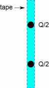
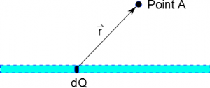

In the previous notes, we talked about how to add fields using [superposition](/notes/week-02-charges-superposition/superposition/), which can be greatly aided by the [use of a computer](/notes/week-02-charges-superposition/comp_super/) (especially if there are many charges). We can also do a similar process for a line of charge analytically (using ideas from calculus) rather than using code. We will also talk about how these ideas ideas extend to large distributions of charge (including 2D sheets of charge and 3D volumes of charge). This page of notes will start by focusing on how we conceptually think of the electric field or electric potential for a line of charge (and we will go into the mathematical details in the next few pages).



## Building Electric Field for Lines of Charge

Piece of tape modeled as two point charges

Say we have a line of charge (e.g. a piece of tape), and we are interested in what the electric field looks like at some distance d away from the piece of the tape (Point A). How could we find the electric field at Point A? We cannot simply use $\overset{\rightarrow}{E} = \frac{1}{4\pi\epsilon_{0}}\frac{Q_{tot}}{r^{2}}\widehat{r}$ because the equation was built on the *assumption that the charge was a point charge*. However, we do know that the electric field follows **superposition** - meaning that electric field at a given point is the total (or sum) of all the electric fields from whatever sources are nearby.

So one way we could model the piece of tape would be to model it as two point charges - each point charge with half the total charge of the tape. In this case the electric field at Point A would be given by: ${\overset{\rightarrow}{E}}_{tot} = {\overset{\rightarrow}{E}}_{1} + {\overset{\rightarrow}{E}}_{2}$. Here we have to calculate the electric field twice (find the different $\overset{\rightarrow}{r}$, find the magnitude of r, and calculate $\overset{\rightarrow}{E}$), but we get a better model. Now this might not be a great model for a line - but it's better than one point. We could make this model even better if we divided it into 4 point charges, spread out over the length of the tape, each with an amount of charge Q/4. Then the field would be given by ${\overset{\rightarrow}{E}}_{tot} = {\overset{\rightarrow}{E}}_{1} + {\overset{\rightarrow}{E}}_{2} + {\overset{\rightarrow}{E}}_{3} + {\overset{\rightarrow}{E}}_{4}$. We have to do more work computationally, but we also get a much better model. But still, we could make this model better if we split the charge into 8 points, or even 16 points, or better yet 32 points. However, the more points you split the charge into, the more work you have to do to compute the electric field (lucky for us, [a computer is very good at doing these repetitive computations](/notes/week-02-charges-superposition/comp_super/)).

$dQ$ and $r$ for point P from a little bit charge along the line of tape

However, to make the best model of this line of charge, we would need to split the line into extremely small pieces of charge or infinitesimally small pieces of charge, which in calculus notation, we would write as dQ. We can then find the electric field at Point A due to only that small piece of charge - this would be “a little bit of electric field” since it comes from “a little bit of charge”, so we would write this as dE. *Now if we have an extremely small piece of a line of charge, this DOES look exactly like a point of charge.* We know how to handle points of charge. [Using the equation for electric field of a point charge](/notes/week-01-charges-field-potential/pc_efield/), we can say that the little bit of electric field that comes from our little bit of charge would be:

$$
\overset{\rightarrow}{dE} = \frac{1}{4\pi\epsilon_{0}}\frac{dQ}{r^{2}}\widehat{r} = \frac{1}{4\pi\epsilon_{0}}\frac{dQ}{r^{3}}\overset{\rightarrow}{r}
$$

This expression is for the electric field from just one of the little points along the line of charge. [Just as we did with point charges](/notes/week-01-charges-field-potential/pc_efield/), the $\overset{\rightarrow}{r}$ points from the source of the field (dQ in this case) to the point of interest (Point A in this case). If we want the total electric field due to all of the little points of charge along the line, then we know from [superposition](/notes/week-02-charges-superposition/superposition/) that we just need to add up all of the little electric fields. In calculus notation, we can add up all of the little things/parts we are interested in using an integral (this is what an integral does). So to get the total electric field, we add up the electric fields from all of the little points of charge along the line:

$$
\overset{\rightarrow}{E} = \int\overset{\rightarrow}{dE} = \int\frac{1}{4\pi\epsilon_{0}}\frac{dQ}{r^{3}}\overset{\rightarrow}{r}
$$

This equation is the most general expression for the electric field from a line of charge - *it works for any line of charge for any point around that line of charge*. (This is a good place to start when trying to find the electric field of a line.) In fact, this expression is true for any shape of charge - be it a line, cylinder, sphere, or blob. We have not used anything specific about the line shape or Point A in determining this expression. All we have said with this equation is that:

1.  We split the total charge into a whole bunch of little point charges (dQ part of the equation).
2.  We find the electric field from each little point charge ($\frac{1}{4\pi\epsilon_{0}}\frac{dQ}{r^{3}}\overset{\rightarrow}{r}$ part of the equation).
3.  We calculate the net electric field by adding up the electric field from each little point (integral part of the equation).

## Building Potential for Lines of Charge

This idea of splitting the total charge into a bunch of points is not limited to the electric field. We can find the electric potential at various points around the shape of charge (be it a line, cylinder or blob) in much the same way. First we split the line of charge into a whole bunch of little point charges, which we still call $dQ$. We then find the little bit of electric potential ($dV$) from the point charge ($dQ$):

$$
dV = \frac{1}{4\pi\epsilon_{0}}\frac{dQ}{r}
$$

Then we find the total electric potential by adding up all of the little bits of electric potentials from all of the little points of charge along the line (with an integral):

$$
V_{tot} = \int dV = \int\frac{1}{4\pi\epsilon_{0}}\frac{dQ}{r}
$$

Again, this is a very general expression for finding the electric potential it works for lines, spheres, cylinders, planes, or blobs of charge, which makes it a great place to start a problem (we haven't made any assumptions about what the shape of charge looks like). We will only focus on lines of charge in this course ([and will talk about more specific examples](/notes/week-04-modeling-distributions-of-charge/linecharge/)), but you may use this method (of breaking into chunks and adding together) in your future courses.

## Relating to Force and Energy

Once we have the electric field and/or electric potential, it is easy to make the jump to the electric force on a point charge or the electric energy. [Remember that the general relationships](/notes/week-03-electric-force-energy/pc_vefu/) between field and force and potential and energy are always true, so we can use the electric field at Point A (using the tape example again) to find the force on a point charge (q) at Point A from the piece of tape:

$$
{\overset{\rightarrow}{F}}_{tape \rightarrow q} = q{\overset{\rightarrow}{E}}_{tape} = q\int\frac{1}{4\pi\epsilon_{0}}\frac{dQ}{r^{3}}\overset{\rightarrow}{r}
$$

Similarly, we could find the electric energy between the tape and the point charge:

$$
U = qV_{tape} = q\int\frac{1}{4\pi\epsilon_{0}}\frac{dQ}{r}
$$
