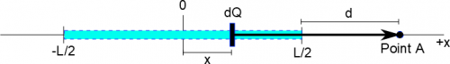

Now that we have the ideas behind how to construct the electric or potential field for distributions or lines of charges, we can put all of these pieces together to find the fields in specific examples. We will outline the steps for two examples in these notes, and you will get to try them out for yourselves in class and in the homework.



## Horizontal Line of Charge

Line of charge problem set up

Say that we have a horizontal line of charge (this could be like a piece of tape, a plastic pen, a glass rod, etc.) that has a total length of $L$ and a total charge of $Q$, and we are interested in finding the electric field at Point $A$ that is a distance $d$ away from the end of tape. First thing that we need to do is choose a frame of reference - lets pick $x = 0$ to be in the middle of the piece of tape, with $+ x$ direction to the right and $- x$ direction to the left. In this frame of reference, the piece of tape stretches then from $- \frac{L}{2}$ to $\frac{L}{2}$. Note that this choice of reference frame is completely arbitrary. You can pick whatever reference frame you would like (but you can be strategic in your choice - some reference frames will be easier to handle mathematically than others).

Before we talked about how to find the electric field using the general equation:

$$
\overset{\rightarrow}{E} = \int\frac{1}{4\pi\epsilon_{0}}\frac{dQ}{r^{2}}\widehat{r} = \int\frac{1}{4\pi\epsilon_{0}}\frac{dQ}{r^{3}}\overset{\rightarrow}{r}
$$

Now we just need to fill in the pieces of this equation.

## Finding dQ

To find dQ, we want to split this line of charge into little chunks of charge. Since this is a linear charge distribution, we can write dQ as

$$
dQ = \lambda dl
$$

But since the little bits of length are horizontal we will replace dl with dx to represent that “little bit of horizontal length”.

$$
dQ = \lambda dx
$$

And then to find the charge density (C/m) *assuming a linear charge distribution* and *assuming no discharging occurs*, we take the total charge over the total length of the line:

$$
\lambda = \frac{Q}{L}
$$

$$
dQ = \frac{Q}{L}dx
$$

Now we have the little bit of charge represented in terms of the little bit of length.

## Finding $\overset{\rightarrow}{r}$

To find the $\overset{\rightarrow}{r}$, we need to write the distance from a general dQ to Point A, which in this case will only be in the $\widehat{x}$ direction. Remember that we can write the separation vector $\overset{\rightarrow}{r}$ as:

$$
\overset{\rightarrow}{r} = {\overset{\rightarrow}{r}}_{obs} - {\overset{\rightarrow}{r}}_{source}
$$

This is still true and is a general definition. In this case, ${\overset{\rightarrow}{r}}_{obs}$ would be the vector that points from the origin to Point A (our observation point). Since Point A is in the +x region, we get the distance to Point A to be ${\overset{\rightarrow}{r}}_{obs} = (\frac{L}{2} + d)\widehat{x}$. The source in our case is the “little bit of charge” - so to find ${\overset{\rightarrow}{r}}_{source}$ we need a way to write where the $dQ$ is relative to the origin. Since the distance from 0 to dQ can change depending on where you put your dQ, we will call this some variable, namely “x” to match what we chose for dQ. So ${\overset{\rightarrow}{r}}_{source} = ( + x)\widehat{x}$. **Note that this distance is a “big” x and not a dx (or “little bit of x”) because the** $\overset{\rightarrow}{r}$ **represents a large distance and not an infinitesimal distance**. So the total separation vector here is given by:

$$
\overset{\rightarrow}{r} = {\overset{\rightarrow}{r}}_{obs} - {\overset{\rightarrow}{r}}_{source} = ( + \frac{L}{2} + d)\widehat{x} - ( + x)\widehat{x}
$$

$$
\overset{\rightarrow}{r} = \langle\frac{L}{2} + d - x,0,0\rangle = (\frac{L}{2} + d - x)\widehat{x}
$$

Because the $\overset{\rightarrow}{r}$ points in a single direction, the magnitude is pretty simple:

$$
|\overset{\rightarrow}{r}| = r = \sqrt{(\frac{L}{2} + d - x)^{2} + 0^{2} + 0^{2}} = \frac{L}{2} + d - x
$$

## Putting it together

Now, we can fit all the pieces together to find the electric field by plugging in what we found for dQ, $\widehat{r}$ and r:

$$
\overset{\rightarrow}{E} = \int\frac{1}{4\pi\epsilon_{0}}\frac{dQ}{r^{2}}\widehat{r}
$$

$$
\overset{\rightarrow}{E} = \int\frac{1}{4\pi\epsilon_{0}}\frac{Q}{L}\frac{dx}{(\frac{L}{2} + d - x)^{2}}\widehat{x}
$$

The final piece that we need to add is limits to the integral. Since the piece of tape stretches from $- \frac{L}{2}$ to $\frac{L}{2}$, this means that the limits on the integral should also go from $- \frac{L}{2}$ to $\frac{L}{2}$ - conceptually this means that we want to add up the little bits of charge *only* along the length of the line. **This gives us a final integral of:**

$$
\overset{\rightarrow}{E} = \int_{- \frac{L}{2}}^{\frac{L}{2}}\frac{1}{4\pi\epsilon_{0}}\frac{Q}{L}\frac{dx}{(\frac{L}{2} + d - x)^{2}}\widehat{x}
$$

At this point, you can either calculate the integral on your own or plug it into [Wolfram Alpha](https://www.wolframalpha.com/). The important physics steps in this process are in setting up this integral. In this course, we will strongly focus on how you pick your dQ, how you find your $\overset{\rightarrow}{r}$, and how you choose the limits for the integral (rather than focusing on the final number/solution to the integral).

## Examples

- [Electric Field from a Ring of Charge](/examples/week4_charge_ring/)
  - Video Example: Electric Field from a Ring of Charge
- [Super Challenge Problem: Electric field from a Cylinder of Charge](/examples/week4_charge_cylinder/)
  - Video Example: Electric Field from a Cylinder of Charge




