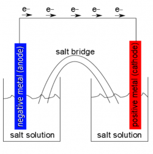
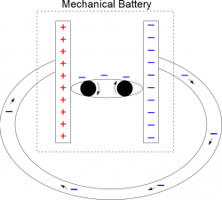
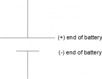
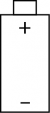

While a pair of charged plates is easy to think about on a general level, it becomes surprisingly complicated to model at a microscopic level. As electrons move from one plate to the other, the amount of excess charge on each plate decreases, which means that over time, the “driving force” that is pushing the electrons through the wire is also decreasing. Thus, the flow of electrons (which we will eventually define as the [electron current](/notes/week-06-resistors-combinations/defining_current/)) is always changing - starting as a large flow of electrons from one plate to the other and decreasing until the plates are neutral and there is no electron flow between them.

Rather than dealing with a constantly changing electron current, we are going to start by thinking about a simpler model - one where we *assume the electron current is constant* from a battery. (We will return to this idea of charged plates and a changing electron current next week).

A battery is a source of electric energy - and electron current - that we use on an everyday basis. Your cell phone, car, calculator, and many other devices all rely on batteries to function. For our purposes, we are particularly interested in batteries because over a short amount of time, a battery can provide a constant source of electrons, that we can use to light a lightbulb, power a calculator, or any number of other electrical devices. These notes will discuss briefly the chemical model of a battery (which is how a AA battery works for example), then introduce the mechanical model of a battery, which helps simplify the function of a battery in a circuit.



## Chemical Model of a Battery

Redox reaction represents a chemical model of a battery

A battery is ultimately a chemical separation of charge. The battery consists of two metal plates placed in a salt solution: one metal produces excess negative charges when reacting with the salt solution (leaving the metal negative) and one metal produces negative charge in the salt solution leaving the metal positive. Chemically this is often referred to as a [redox reaction](https://en.wikipedia.org/wiki/Redox). When connected by a conducting wire, the excess charges in the negative metal are able to flow to the positive metal, while a similar process happens with the salt solution. This is a very similar process to what occurs when you have two charged plates connected by a conducting wire; however, it takes much longer for the metal plates to become neutral. This means there is a (roughly) constant electron current between plates for some time. After a while, the plates are no longer able to react with the salt solution, which reduces the electron current and causes your battery to “die”.

This is of course a very rough explanation of a chemical battery. Many physicists and chemists are [currently studying how to make batteries last longer and be more efficient](https://www.sciencedaily.com/news/matter_energy/batteries/). Applications of which include: spacecraft (where replacing batteries is not an option) and fuel cells (to power vehicles with only water as a by-product).

## Mechanical Model of a Battery

Mechanical model of a battery

Oftentimes in circuits, we are less concerned with how the electrons in circuits are produced and are more concerned with what happens to the charges after they are produced. This means we will generally simplify our model of the battery to what we call a “mechanical model” of the battery. In this model, the battery consists of two charged plates, one that is positive and one that is negative, with a conveyor belt that pulls the electrons from the positive plate to the negative plate. In this model, *the conveyor belt represents the chemical reaction in the battery that maintains the separation of charge*.

When the positive and negative plates of the battery are connected by a conducting wire, the excess electrons on the negative plate will travel through the wire toward the positive plate. When they arrive at the positive plate, the “conveyor belt” will return the negative charges to the negative plate, keeping a constant amount of negative charge and a constant amount of positive charge on the plates. **The primary consequence of this is that there will be a constant electron current in the wire**. Using this model of the battery, we can think about what is happening in circuit when the flow of electrons is constant; we will often call this “the steady state of the circuit” or the *steady state assumption*.

## Symbol for a Battery

Abbreviated representation of a battery

 When describing circuits, we will often draw out a symbolic representation (called a circuit diagram) of the circuit elements that we can use to think about what is happening to the charges in the circuit. When representing a battery, we will either draw out the mechanical model of the battery (including the positive plate, negative plate, and conveyor belt) as shown above, or we will draw out a simplified version of the battery including a short line for the negative plate and a long line for the positive plate (where the steady state is assumed without explicitly drawing the conveyor belt). You may also see a physical drawing of a battery drawn out (particularly in textbooks) with the positive and negative sides of the battery explicitly labeled. Any of these representations of a battery will work.
