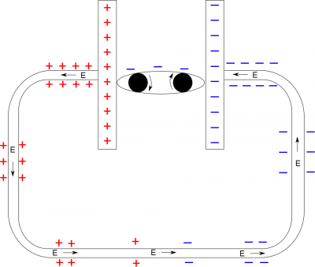

In the previous page of notes, we showed that there **must** be some charges along the surface of a wire and they **must** be arranged in a gradient. We call these charges along the surface of the wire *surface charges*. The surface charges create an electric field in the wire, which then pushes electrons through the wire to create a current. In this page of notes, we will dig a little deeper into what a gradient of surface charges actually is and how we represent that gradient on a drawing.

## What is a gradient?

Color gradient from dark blue to white.

A gradient is simply a change in the amount of something. For example, you may have seen a color gradient (like the one shown at the right), where you start with a single color that slowly fades to white. In this case, the color is what is changing, so we call it a “color gradient.” Similarly, when we talk about a **surface charge gradient on a wire, this means that we are talking about a *change* in the amount of charge along the wire**. The word *change* here is really important. It is not simply that there are a lot of charges on the surface of the wire. For a surface charge gradient to exist, there must be areas on the wire with a lot of positive charge, areas with less positive charge, areas with almost no charge, areas with less negative charge, and areas with a lot of negative charge. The key to figuring out what is happening in the wire is to determine where your positive charge is concentrated, where your negative charge is concentrated, and how the charges change in between.

## How do we represent a surface charge gradient?

It would be impossible to actually count or draw every single electron along the surface of a wire. There are simply too many, and it would make our picture too messy to be useful. Instead, we draw a small representative amount of charges on our picture. For example, if we go back to the picture with the battery and surface charges:

Simple circuit with surface charges and electric field drawn.

There are a few things to notice:

1.  We have drawn a small amount of charges on the surface of the wire. For example, in the top right corner, we have drawn a total of eight negative signs on the outside of the wire. This does not mean that there is exactly eight electrons on the wire. Instead, **this just shows that we expect this area of the wire to have a large concentration of negative charge**. There is no particular reason why we drew eight - we could have picked 12 or 6 or any other number to start with. The important part is that there are more negative signs in this area than any other part of the wire.
2.  As we move along the wire on the right side, the number of negative signs decreases from 8 to 6 to 4 to 2. **This represents the gradient of surface charges.** As we move along the wire, we expect there to be a lot of negative surface charges near the battery, and as you get further away along the wire, there should be fewer and fewer negative surface charges. Remember, the *change* in the amount of charge is what makes it a gradient. Similarly, as we approach the positive side of the battery, we draw 2 to 4 to 6 to 8 positive signs to represent the increase in the amount of positive surface charges. Note that there is an area between the negative and positive signs where we have zero surface charges. Together, this means our gradient is continuous along the whole wire (it goes from negative to zero to positive). Again, there is no particular reason why we jumped by 2's in the gradient - we could have jumped by 3's or 4's or 1's - but it is important that the jump is consistent (at least for the same material/size/shape of wire).
3.  The last thing to notice here is the electric field arrows. We said already that the gradient is what creates the electric field field. **This means that the electric field arrows need to match your surface charge gradient and vice versa**. Remember from [Week 1](/empcubed/notes/week-01-charges-field-potential/pc_efield/), we know the electric field should point away from positive charges and toward negative charges. This is still true here. We also see the electric field follows the charge gradient. On the left side of the wire, we see the electric field arrows point from areas with lots of positive charge toward areas with small amounts of positive charge. On the right side of the wire, we see the electric field arrows point from areas with small amounts of negative charge towards areas with large amounts of negative charge. Thus, **because the gradient is constantly changing, we get a constant electric field in the wire**. These arrows aren't necessarily to scale, the important part is that the electric field arrows point in the direction that matches the gradient (from positive to negative) and that they are all the same size (the electric field is constant). The final note here is your electric field arrows should roughly match your gradient. For example, if your gradient is jumping by 4's, you should draw large electric field arrows since a large gradient creates a large electric field. If your gradient is jumping by 1's, you should draw small electric field arrows since a small gradient creates a small electric field. (This can be especially important if you have wires with different materials or if you have different sizes of wire.)

In the next page of notes, we'll talk more about how the surface charge gradient and electric field create a current in the wire.
