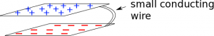

Thus far in class, we've have spent a lot of time modeling [stationary charges and their interactions](/notes/week-01-charges-field-potential/charge/), including [electric force](/notes/week-03-electric-force-energy/pc_force/), [electric field](/notes/week-01-charges-field-potential/pc_efield/), [electric potential energy](/notes/week-03-electric-force-energy/pc_energy/), and [electric potential](/notes/week-01-charges-field-potential/pc_potential/). We've discussed these ideas in the context of point charges, [lines of charge](/notes/week-04-modeling-distributions-of-charge/line_fields/), and [distributions (or volumes) of charge](/notes/week-04-modeling-distributions-of-charge/dist_charges/). Now, we will shift our focus to modeling moving charges - which has incredibly important applications for how electricity and circuits work. Using what we know about charges and electric field, we will start with one simple question: what would happen if we connected two charged, parallel plates with a thin, conducting wire?



## Connecting Two Charged Plates

Suppose we start with two charged, conducting plates - one with a net positive charge (+Q) on the plate and one with an equal amount of excess negative charge (-Q) on the plate. [Because the plates are conducting](/notes/week-02-charges-superposition/charge_and_matter/#types_of_matter), we know that the electrons in the plates can easily move through the material, so it is safe to assume that *each of the plates has a uniform distribution of charge* on the surface.

Two charged plates connected by a small conducting wire

[Based on what we know about how charges interact](/notes/week-01-charges-field-potential/charge/), what would you expect to happen if we connect these plates with a small conducting wire? [Remember that in matter (and specifically in conductors)](/notes/week-02-charges-superposition/charge_and_matter/), the electrons are the charges that are mobile.

Any electron from the negative plate is going to feel a strong repulsion from the other excess electrons on the negative plate and will feel a strong attraction from the positive plate (really from the positive nuclei of the atoms lacking electrons). When the wire is first connected, those excess electrons now have a path to travel from the negative plate to the positive plate. Generally speaking, the electrons will be pushed through the wire both because of the repulsion from the other electrons on the negative plate and the attraction from the positive nuclei on the positive plate. However, the story is much richer and more complicated than that as you will learn: charges not only spread out on both plates *but also along the wire* to move electrons from the negative plate and onto the positively charged plate. **This process happens very quickly - no matter how far apart the plates are!**

The next few pages of notes will go into more detail at the micro level about what is happening as the charges move through wire, how the charges redistribute, and how we are going to simplify this model of charges of moving.
