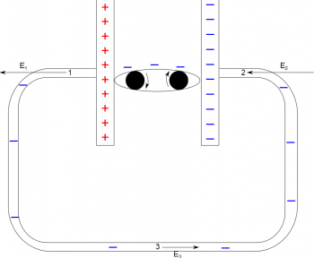
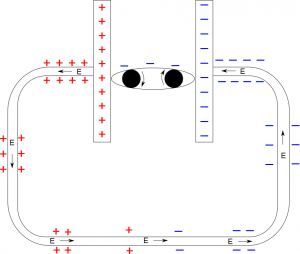

We have already talked about how to model a battery as a separation of charges. However, if we connect the two ends of the battery with a conducting wire, what happens to the charge distribution in the wire? Using [the mechanical model of battery](/notes/week-05-moving-charges-batteries/batteries/) and [what we know about conductors](/notes/week-02-charges-superposition/charge_and_matter/), these notes will discuss how charges interact in the wire and how that impacts the electron current.



## Simple Circuit

We will start with the simplest circuit possible: a battery connected by a conducting wire (shown to the right). If we *assume the battery is a mechanical battery*, then we should have a constant amount of charge on each of the plates (one side of the battery being the positive plate and one side being the negative plate). Much like the example before, we would expect the electrons to flow from the negative plate through the wire to the positive end of the plate (with the only difference being that the chemical “conveyer belt” would now move the electrons from the positive plate back to the negative plate to start the cycle over again).

If the electrons are moving, there has to be some sort of force that is making those charges move. [From what we talked about before](/notes/week-03-electric-force-energy/pc_force/), we know we can write this force on the electron in terms of the electron charge and the electric field it is in:

$$
{\overset{\rightarrow}{F}}_{e^{-}} = q_{e^{-}}\overset{\rightarrow}{E}
$$

Since the electrons move through the wire, we know there must then be an electric field in that wire - but where is that electric field coming from? One reasonable hypothesis could be that there is an electric field in the wire from the battery.

Hypothesis 1 - Simple circuit: shows the electric field at 3 points in the wire from ONLY the mechanical battery

## Hypothesis 1 - Electric field comes from the battery alone

If this were true, the electric field at Point 1 in the wire would point to left given that it is near the positive plate. Likewise, the electric field at Point 2 would also point to the left, given that it is near the negative plate. At Point 3, we would expect the electric field to be point to the right because it is between the positive and negative plates, though it would be smaller because it is further away from the plates.

**However this is problematic for a few of reasons:**

1.  If the electric field is smaller in some parts of the wire than others, this would mean that the electrons move faster in parts of the wire (where the electric field is bigger - close to the battery) and slower in other parts of the wire (where the electric field is smaller - in the middle of the wire). We can measure the electron current at each part of the wire in such a circuit and show that this is not in fact true. *The electron current close to the battery is exactly the same as the electron current in the middle of the wire*.
2.  The electric field from the battery plates would always point either left or right (away the positive plate and towards the negative plate); thus, this electric field could never push the electrons down or up the vertical parts of the wires, let alone explain how the electrons are able to bend around the corner of the wire.
3.  If it is the electric field from the battery that pushes the electrons, the proximity to the battery drastically change what you observe in your circuit. We know this is not true. On a small scale - it doesn't matter if you connect a lightbulb to a battery with a 5 cm wire or a 5 m wire, the lightbulb will still have the same brightness. On a larger scale - to power your house, you do not need a generator in your backyard; the power generator can be miles away and you will still have the same current going to your house that your neighbors would.

This tells us that while the battery certainly contributes to the electric field in the wire, **there must be something else that is adding to the electric field in the wire**.

## Hypothesis 2 - There are stationary charges on the surface of the wires

Hypothesis 2 - Simple circuit: shows the electric field in the wire from the charges on the surface of the wire

Because the wire is made of metal, electrons are free to move and any excess charge will move to the surface of the wire. Thus, when connected to the battery, **there are charges on the surface of the wire**, which contribute to the net electric field in the wire (in addition to the field from the battery).

For example, near the negative end of the mechanical battery, there are negative charges on the surface of the wire. Near the positive end of the mechanical battery, there are positive charges on the surface of the wire. Moving farther from the negative end of the battery will result in less and less negative surface charges, with the same effect as you move farther from the positive end. In the middle, there must be a place where the surface charge is zero (where the surface charge switches from positive to negative). **This creates a *continuous charge gradient* along the wire - from the positive end of the battery to the negative end of the battery.** When we say a gradient in this context, we mean that the amount of surface charge changes as you move along the wire. An example of the surface charge gradient is shown in the figure below, where the surface starts as large and positive near the positive plate, decreases along the wire, and ends as large and negative near the negative plate.

## Electric field in the wire follows the surface charge gradient

The electric field around the circuit then follows the charge gradient, pointing from more positive areas of the wire to less positive areas (or from less negative areas to more negative areas). Ultimately, this means that the **electric field follows the wire pointing from the positive end of the battery to the negative**. Remember that because electrons are negative charges, [they will move in the direction opposite of the electric field](/notes/week-03-electric-force-energy/pc_force/). In a circuit then, the electrons that are driven by the mechanical battery follow the wire opposite to the electric field that is set up by the surface charges.

The contributions of the surface charges generate an electric field that adds with the electric field due to the battery (via [superposition](/notes/week-02-charges-superposition/superposition/)). The result *in steady state* is that **the surface charges in the wire and the battery's electric field set up a *constant electric field* along the wire, which pushes the electron current in the opposite direction of the electric field** (from the negative end to the positive end of the battery). Now, when the wire is physically far away from the battery, the electric field due to the battery is small. So often, we just assume *that the constant electric field in the wire is due (mostly) to the surface charges*. This is a pretty good assumption anywhere far from the battery (which is pretty much everywhere in macroscopic terms). This might violate your intuition a bit as you expect the field to die off away from the source of charges, but rest assured the electric field is constant through the wire.

If we consider the surface charge hypothesis, this is much more consistent with what we observe when we connect a wire to a battery:

1.  If there is a constant electric field in the wire (from the surface charge gradient), the current at all points in the wire is constant (which is something you can confirm by measuring the electron current at different points in the circuit/wire).
2.  The way the surface charges are arranged can drastically change the direction of the electric field in the wire - that is charges are able to bend around the corners in the wire and move vertically in the circuit above. (Specifically how the charges move around the bends is described in [this example](/empcubed/examples/week6_charges_circuit/).)
3.  If the force that pushes the electrons comes from the surface of the wires, then the proximity to the battery doesn't matter - there will still be a constant electric field in the wire to move the electrons.

Thus, surface charges as the model for how charges move through wires is far more consistent with the observations we have in real circuits in everyday life. If you have a very large battery (also called a high voltage power supply) it is actually possible to observe the surface charges on a wire.



In this video, you can see the mechanical effects of surface charge when a piece of foil is held by the positive end, negative end, and neutral center of the wire. On the ends of the wire, the foil is initially attracted, polarized, and then repelled. Since the surface charge at the center of the wire is 0 nothing happens to the foil. A metal pen can also be used to see what kind of charge the foil has picked up based on if it is attracted to or repelled by the pen.

## Examples

- [Charge Distribution on the Bends of a Circuit](/empcubed/examples/week6_charges_circuit/)
  - Video Example: Charge Distribution on the Bends of a Circuit


