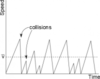

In the last few pages of notes, we established that when connected to a battery there are surface charges in the wire that [create a constant electric field through the wire](/notes/week-05-moving-charges-batteries/q_in_wires/). Because [electric force is directly proportional to the electric field](/notes/week-03-electric-force-energy/pc_force/) ($\overset{\rightarrow}{F} = q\overset{\rightarrow}{E}$), the electric field in the wire pushes the electrons from the negative plate of the battery to the positive plate of the battery causing an [electron current](/notes/week-06-resistors-combinations/defining_current/) through the wire. Rather than focusing on the surface charges, these notes will focus on describing the electron current that occurs in the wire and how we find the average speed of those electrons.



## Current in Different Parts of the Wire

Given what you know about the electric field in the wire, how would you expect the electron current to compare in different parts of the wire? If the electric field is constant along the wire, each electron would feel a constant force along the wire. For every electron that leaves the negative plate of the battery, there is one returning to the positive plate of the battery. Thus, **at every point along the wire, the electron current is the same**.

What if you added a light bulb to the circuit, how would you expect the electron current to compare? Do the electrons get “used up” in the light bulb? It turns out that electrons transfer electric energy into heat and light at the light bulb (we will talk about this more [next week](/notes/week-06-resistors-combinations/r_energy/)), but **the electrons are not destroyed or used up**. We can justify this using the [conservation of charge](/notes/week-01-charges-field-potential/charge/). A light bulb does not emit electrons (only light/heat), so this means that the amount of charge going into the light bulb must equal the amount of charge coming out of the light bulb.

*In steady state* we can rewrite the conservation of charge in terms of the electron current, called the “Current Node Rule”:

$$
Q_{in} = Q_{out}
$$

$$
\frac{Q_{in}}{s} = \frac{Q_{out}}{s}
$$

$$
i_{in} = i_{out}
$$

**This means for any given point in a circuit, the electron current entering that point or node must equal the electron current leaving that node**. You may also hear this rule called “the Kirchhoff node rule”. The current node rule (which represents the conservation of charge in steady state) will be one of the primary tools that we use to analyze circuits.

## Why do we need an electric field?

We have already established that there is an [electric field from the surface charges](/notes/week-05-moving-charges-batteries/q_in_wires/) that drives the electron current. But why do we need an electric field in the first place? The electrons in the electron current are constantly interacting with the positive nuclei in the wire, both through electrical interactions (electrons are attracted to the positive nuclei) and through contact interactions (electrons “bouncing off” the positive nuclei). Because of these interactions, the electrons are constantly losing energy to the many positive nuclei in the wire (which increases the thermal motion of the atoms causing the wire to heat up). Without the electric field from the surface charges, the electrons would quickly lose all of their energy and the current flow would stop. The electric field is needed to keep the electron current flowing through the wire.

## Drift speed in wire

Graph of electron speed in a wire vs time

Modeling all of these interactions for every electron in the electron current is quite complicated (or almost impossible). While there are several ways to model the electrons in the wire, we will use a model called the [Drude Model](https://en.wikipedia.org/wiki/Drude_model), which builds off of the idea that the electrons are interacting or bouncing off the positive nuclei in the wire. In this model, the electron will experience short periods of acceleration from the electric field, followed by periods where the electron drastically slows because of collision with a positive nuclei in the wire. The average speed of the electron in this stop/start motion is called the **drift velocity** which has units of m/s, and we say that the electron “drifts” through the metal. The drift velocity of electrons in a wire is actually quite slow compared to the speed of the individual electrons (the same way that the wind has slow speed compared to the speed of the individual air molecules).

Using the Drude Model, we can find the average drift velocity for the electrons in the wire. Starting with the momentum principle, we know

$$
\frac{\Delta\overset{\rightarrow}{p}}{\Delta t} = {\overset{\rightarrow}{F}}_{net}
$$

which we could rearrange as:

$$
\Delta\overset{\rightarrow}{p} = {\overset{\rightarrow}{F}}_{net}\Delta t
$$

where $\Delta\overset{\rightarrow}{p}$ is the change of momentum that occurs between collisions and $\Delta t$ is the time between collisions. In the wire, we know that the force on the electron comes from the electric field of the surface charges, so ${\overset{\rightarrow}{F}}_{net} = e\overset{\rightarrow}{E}$, where $e$ is the charge of an electron and $E$ is the electric field. Plugging that in gives:

$$
\Delta\overset{\rightarrow}{p} = e*\overset{\rightarrow}{E}*\Delta t
$$

If we *assume that the electron loses all its momentum during each collision*, then:

$$
\Delta\overset{\rightarrow}{p} = \overset{\rightarrow}{p} - 0 = e*\overset{\rightarrow}{E}*\Delta t
$$

Since the speed of the electrons is much smaller than the speed of light, then:

$$
\overset{\rightarrow}{v} = \frac{\overset{\rightarrow}{p}}{m_{e}} = \frac{e*\overset{\rightarrow}{E}*\Delta t}{m_{e}}
$$

However, the time between collisions is not the same for every electron (depending on each individual path) - sometimes that time is longer or shorter. If we take the average time between collisions, then that gives us the average drift velocity of the electrons in the wire:

$$
{\overset{\rightarrow}{v}}_{avg} = \frac{e*\overset{\rightarrow}{E}*\Delta t_{avg}}{m_{e}}
$$

Typically, we will define **electron mobility** as:

$$
u = \frac{e*\Delta t_{avg}}{m_{e}}
$$

which is different for different metals and can be determined experimentally. So using electron mobility, we can write the drift velocity of the electrons as:

$$
{\overset{\rightarrow}{v}}_{avg} = u\overset{\rightarrow}{E}
$$

.

Likewise, we can combine this with the [expression for electron current](/notes/week-06-resistors-combinations/defining_current/) $i = nAv_{avg}$ to get:

$$
i = nAuE
$$

## Examples

- [Drift Speed in Different Types of Wires](/empcubed/examples/week6_drift_speed/)
  - Video Example: Drift Speed in Different Types of Wires
- [Application of Node Rule](/empcubed/examples/week6_node_rule/)
  - Video Example: Application of Node Rule




