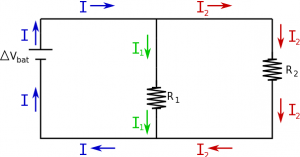
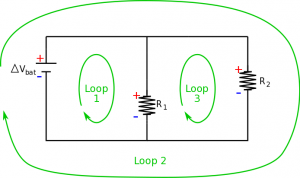
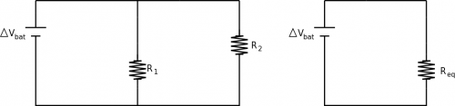

Another way to combine resistors is in parallel. This means that there are at least two “parallel” paths that start from the same potential and end at the same potential, *not* that the paths necessarily look parallel. We will continue to make the same assumptions that we did when working with resistors in series, namely: *we have a steady state current* and *potential differences across wires are negligible*. These notes will then discuss how we apply the node rule and loop rule to parallel circuits and use that to find equivalent resistance.



## Node Rule and Current in Parallel

Current $I$ breaks into two different currents, $I_{1}$ and $I_{2}$ at the top node in this circuit

When two circuit elements are parallel, this means that there are two different paths along the circuit that take you across the same potential difference. For example, consider a circuit with a battery and two resistors (similar to before), but this time there is a split in the wire and the resistors are side-by-side rather than in a row. When we use the node rule, on the this circuit, there are two nodes that are of particular interest (the points where there are three wires coming together in the circuit diagram). The node rule says that the current going into a node should be the same as the current leaving the node to satisfy conservation of charge. For the top node, this means that current from the battery is split when it hits the branches for the $R_{1}$ and $R_{2}$ resistors, but **the sum of the current in each branch should be equal to the total current coming from the battery**. This is a different mathematical statement of conservation of charge than we had for series elements, but still quite powerful.

$$
I_{bat} = I_{1} + I_{2}
$$

The current does not necessarily split evenly between the two paths, but rather will follow the colloquial “path of least resistance”. In other words, the path that has the most resistance will have the least current.

## Loop Rule and Voltage in Parallel

Break down of loops in a circuit with two resistors in parallel

For a parallel circuit, using the loop rule becomes a little more involved, because now there are actually three different loops with the circuit. This means that we need to look at energy conservation around every loop in the circuit. To start, we will again mark which side of the resistors and battery would have a higher potential and which side would have a lower potential. For the first loop going clockwise, we see that there is a gain in potential from the battery and then a drop of potential across the resistor:

$$
+ |\Delta V_{bat}| - |\Delta V_{1}| = 0
$$

$$
|\Delta V_{bat}| = |\Delta V_{1}|
$$

For the second loop, we see the same with the second resistor:

$$
+ |\Delta V_{bat}| - |\Delta V_{2}| = 0
$$

$$
|\Delta V_{bat}| = |\Delta V_{2}|
$$

Finally for the third loop (again clockwise), we see a gain in potential across $R_{1}$ (moving from low to high potential) and a drop in potential across $R_{2}$ (moving from high potential to low).

$$
+ |\Delta V_{1}| - |\Delta V_{2}| = 0
$$

$$
|\Delta V_{1}| = |\Delta V_{2}|
$$

This tells us that **circuit elements in parallel have an equal potential difference**.

$$
|\Delta V_{bat}| = |\Delta V_{1}| = |\Delta V_{2}|
$$

## Equivalent Resistance

Circuit with resistors in parallel, $R_{1}$ and $R_{2}$, and its equivalent circuit with $R_{e}$

To simplify parallel circuits, we will again try to replace the resistors in parallel with a single resistor that has an equivalent resistance. We will still do this by comparing a circuit with two resistors in parallel to a circuit with a single equivalent resistor, keeping the $\Delta V_{bat}$ and $I_{bat}$ the same for both circuits. From the node rule in the two-resistor circuit, we know that:

$$
I_{bat} = I_{1} + I_{2}
$$

If we *assume that our resistors are ohmic*, then we can rewrite the currents here in terms of the potential differences and the resistance ($I = \Delta V/R$).

$$
I_{bat} = \frac{\Delta V_{1}}{R_{1}} + \frac{\Delta V_{2}}{R_{2}}
$$

Where $\Delta V_{1}$ is the potential difference across $R_{1}$ and $\Delta V_{2}$ is the potential difference across $R_{2}$. Using the loop rule around the equivalent circuit, we can write the current from the battery as:

$$
I_{bat} = \frac{\Delta V_{bat}}{R_{eq}}
$$

Since the current from the battery should be the same in each of these circuits, we can set these equations equal to each other.

$$
\frac{\Delta V_{bat}}{R_{eq}} = I_{bat} = \frac{\Delta V_{1}}{R_{1}} + \frac{\Delta V_{2}}{R_{2}}
$$

Now, from the loop rule, we know that $\Delta V_{bat} = \Delta V_{1} = \Delta V_{2}$, so the potentials in this equation will cancel out, leaving:

$$
\frac{1}{R_{eq}} = \frac{1}{R_{1}} + \frac{1}{R_{2}}
$$

Therefore, if we want to replace two parallel resistors with a single resistor, it needs to have a resistance that equal to the inverse sum of the individual resistors. This is an important conclusion because if you actually plug in numbers here you will find that the equivalent resistance is *less than* either of the two individual resistors. This means that **combining resistors in parallel will reduce the overall resistance**. Note that one has to be careful with using equivalent resistances for more complex circuits as the current that is computed is that through the equivalent resistor and *not necessarily* that through all the branches of a complex circuit.

## Examples

- [Example: Resistors in Series and in Parallel](/examples/week8_resistors_parallel/)
  - Video Example: Resistors in Series and in Parallel


