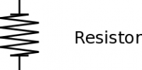
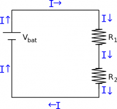
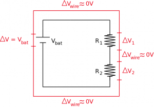
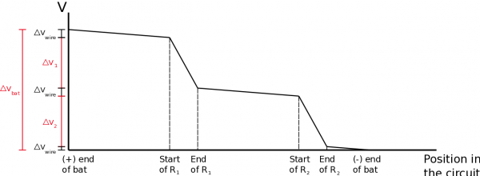
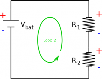
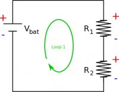
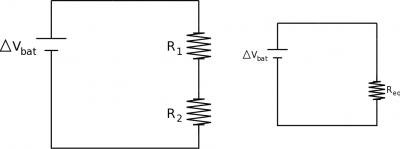

Up until now, we have talked about resistors from a very microscopic point of view and have introduced the idea of resistance, which helps us talk about resistors from a more macroscopic perspective. This week will be continuing to consider circuits from a macro-view and thinking about what happens when we combine multiple circuit elements in one circuit. These notes will focus on a particular way to combine resistors (in series) and what the effects of that would be on the circuit.



## Circuit Diagrams

Resistor representation in a circuit diagram

Circuit diagrams are a simplified way to represent a circuit. In a circuit diagram, each element is represented by some kind of symbol and the wires are represented by lines. These diagrams are not very good for showing what is happening to surface charges or the electric field, but they do help visualize a circuit particularly for combinations of circuit elements and some of the more macroscopic properties.

[We have already briefly talked about the symbol for a battery](/notes/week-05-moving-charges-batteries/batteries/); we will begin to use this much more frequently this week. Any kind of resistor - whether it's a lightbulb, a thin resistor, a thick resistor, made from a different material, etc. - is represented by a squiggly line. As we said before, wires are generally just represented by lines.

## Node Rule and Current in Series

Current remains the same across resistors in series

When two circuit elements are in series this means that **all of the current that goes into the first element also goes into the second element**, *assuming a steady state current situation*. For example, consider two resistors that are in series with a battery. All of the current that comes out of the battery **must** travel through the wire and go through the first resistor. After the first resistor, all the current must then pass through the second resistor - there is no other path for electrons to travel along. Finally, all the current must then return to the battery. Note, we have drawn the conventional current coming from the positive plate of the battery (rather than the electron current which would come from the negative plate).

This means that **in series, circuit elements always have the same current with no alternate paths for current flow**. This conclusion follows naturally from the [node rule](/notes/week-06-resistors-combinations/current/), which is a mathematical statement of the conservation of charge in steady state. In terms of the circuit above, this means that the current that goes through the battery ($I_{bat}$) is equal to the current through the first resistor ($I_{1}$), which is equal to the current through the second resistor ($I_{2}$).

$$
I_{bat} = I_{2} = I_{1}
$$

## Loop Rule and Voltage in Series

Potential differences (or voltage drops) throughout the circuit

For resistors in series, we can also say something about the difference in electric potential across each circuit element. Using the [loop rule](/notes/week-06-resistors-combinations/r_energy/), we know that **the sum of all of the changes in electric potential around a complete loop must equal zero.** Consider the same series circuit above with the battery and two resistors. If we think about the electric potential or energy per charge going around the circuit, we know that the highest electric potential will be on the positive side of the battery. As the current moves through the wire, there would be a small drop in electric potential along the wire (from the electron collisions with the nuclei), but a much larger change in potential would occur over the resistor. Then again, there would be another small drop over the next wire with a larger change over the second resistor, with a final small drop over the wire that connects back to the battery. If we move from the negative plate of the battery back to the positive plate, then there is now a large gain in electric potential (instead of a drop), and we have returned to where we started.

Oftentimes, the changes in potential in the wires are so small compared to those over the resistors, that we *assume the changes in electric potential across the wires are negligible*. You might also hear this assumption stated as “we assume that the wires are perfect”. If we make this assumption, then there are only the three circuit elements that we need to worry about: the battery, the first resistor, and the second resistor. In this case, we could write an equation that states that the gain in electric potential across the battery plus the drops in electric potential across the resistors, should give you zero.

$$
+|\Delta V_{bat}|-|\Delta V_1|-|\Delta V_2| = 0
$$

Another way of saying this would be that the energy per charge coming from the battery must be distributed across the two resistors. You can see this in the graph below.

$$
|\Delta V_{bat}|=|\Delta V_1| + |\Delta V_2|
$$

This means that **in a series circuit, the electric potentials add together**.

Graph of electric potential throughout the circuit. Note that the change in potential along the wires is very small compared to the change in potential across a resistor.

Example: loop 1

Example: loop 2

An easy trick to help with the loop rules is to mark which side of the circuit element (be it a battery, resistor, or capacitor) would have the higher electric potential with a (+) and which side would have the lower electric potential with a (-). When moving around the loop, if you go from a low potential to a high potential the $\Delta V$ will be positive. If you move from a high potential to a low potential the $\Delta V$ will be negative. For example, in our loop, we moved from the negative side of the battery to the positive side of the battery so we had a $+\Delta V_{bat}$ and we moved from the positive side of the resistors to the negative so we had a $-\Delta V_1$ and $-\Delta V_2$. If we changed the direction of our loop to be counterclockwise instead, we would have gotten $+\Delta V_1$ and $+\Delta V_2$ and $-\Delta V_{bat}$. Both of these loops would have given you the same equation however.

## Equivalent Resistance

To simplify series circuits, we will often try to replace the series resistors with a single resistor that has the equivalent resistance as the combination of resistors. This would mean that you get to deal with one resistor instead of two for example. We can do this by comparing the circuit with two resistors to the circuit with the equivalent resistance. In both of these circuits we would want to keep the battery the same (would have the same $\Delta V_{bat}$) and keep the current coming out of the battery as the same (same $I_{bat}$). From the loop rule around the combination circuit, we know that:

$$
|\Delta V_{bat}|=|\Delta V_1| + |\Delta V_2|
$$

Circuit with two resistors, $R_1$ and $R_2$, and its equivalent circuit with $R_e$

If we *assume that our resistors are ohmic*, then we can rewrite the potential changes in terms of the resistance and current:

$$
\Delta V_{bat}=I_1R_1+I_2R_2
$$

Where $I_1$ is the current going through $R_1$ and $I_2$ is the current through $R_2$. Using the loop rule around the equivalent circuit, we can write the potential from the battery as:

$$
\Delta V_{bat}=I_{bat}R_{eq}
$$

Since the potential difference from the battery should be the same in each of these circuits, we can set these equations equal to each other.

$$
I_{bat}R_{eq}=\Delta V_{bat}=I_1R_1+I_2R_2
$$

Now, from the node rule, we know that $I_{bat}=I_1=I_2$, so the currents in this equation will cancel out, leaving:

$$
R_{eq}=R_1+R_2
$$

If we want to replace two series resistors with a single equivalent resistor it needs to have a resistance that is equal to the sum of the individual resistors. Another important conclusion from this is that **if you put two resistors in series, the total resistance of the circuit will increase**. Note that one has to be careful with using equivalent resistances for more complex circuits as the current that is computed is that through the equivalent resistor and *not necessarily* that through all the branches of a complex circuit.

## Examples

- [Example: Resistors in Series](/empcubed/examples/week8_resistors_series/)
  - Video Example: Resistors in Series


