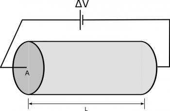
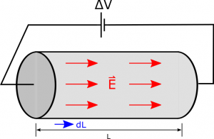

So far we have been approaching circuits from a very microscopic picture, including talking about the surface charges, electron currents, and electric fields in the wires. However, the surface charges, electric fields, and individual electrons are extremely difficult to measure. Instead, it often much more useful to think about circuits in terms of macroscopic properties, which are much easier to measure (i.e., conventional current instead of electron current or potential difference instead of electric field). These notes will start to connect the microscopic features of circuits that we have been talking about to the macroscopic measures.



## Conductivity

Conductivity is a way to relate the properties of the materials (like electron density and electron mobility), the electric field, and the conventional current. Remember from before, that we defined the conventional current ($I$) to be the electron current ($i$ - number of electrons per second passing a point in the circuit) times the magnitude of one of the moving charges ($|q|$).

$$
I = |q|i
$$

Which we could also rewrite in terms of the average speed of the electrons or in terms of the electric field

$$
I = |q|nAv_{avg} = |q|nAuE
$$

Where $n$ is the electron density, $u$ is the electron mobility and $A$ is the cross-sectional area of the wire.

Typically, we will group together the properties that come from the material ($q$, $n$, and $u$) into a single property called **conductivity**. Conductivity is represented by a $\sigma$ where

$$
\sigma = qnu
$$

and has units of $\frac{C^{2}s}{m^{3}kg}$, *Be careful - do not confuse the conductivity with 2D charge density which also uses a* $\sigma$. If we use this definition with the conventional current, we get

$$
I = \sigma AE
$$

This could also be written in terms of the **current density**:

$$
J = \frac{I}{A} = \sigma E
$$

Where $J$ is the current density (units of $\frac{C}{sm^{2}} = \frac{A}{m^{2}}$) and $\sigma$ is the conductivity of the wire. Using current density can be useful because you can tell how the current will change based off the electric field without needing to know anything about the shape or size of the wire.

Because electric field is a vector, we can consider current density to be a vector that points in the direction of the conventional current, which points in the same direction as the electric field in circuit.

$$
\overset{\rightarrow}{J} = \sigma\overset{\rightarrow}{E}
$$

This equation then says that for a given electric field, materials with higher conductivity would have a larger current density (no matter what the shape or size of that material may be). This makes sense as the conductivity is a measure of the propensity of a material to sustain a current, that is, higher conductivity means it is easier to drive a current in the material (lower energy cost).

## Resistance

[Before when we talked about resistors](/notes/week-06-resistors-combinations/resistors/), we said that a resistor was a section or part of the circuit where the passage of electrons requires more energy (conventionally, that it resists the passage of electrons more than other parts of the circuit). We found there to be a larger electric field, a larger drift velocity, and a larger surface charge gradient over the resistor. **Resistance** is a way to quantify how much a resistor resists the passage of electrons based off the properties of the material (electron mobility and electron density) and the shape of the resistor.

A piece of a resistor with a potential difference of $\Delta$ V from one end to the other, a length L, and a cross-sectional area of A.

## Derivation of $R$

For example, suppose we have a resistor that has a cross sectional area of $A$, a length $L$, and a potential difference of $\Delta V$ from one end to the other. If we *assume a steady state current*, then the electric field inside the resistor would be constant in magnitude and direction and would point along the length of the wire. We could use the relationship between electric potential and electric field then to write:

$$
\Delta V = - \int_{i}^{f}\overset{\rightarrow}{E} \cdot \overset{\rightarrow}{dl}
$$

Electric field direction in a resistor (shown by the red arrow) and the dl vector shown by the blue arrow.

Because $\overset{\rightarrow}{E}$ would point along the length of the wire, we would want to integrate along the length of the wire, which would mean that $\overset{\rightarrow}{E}$ and $\overset{\rightarrow}{dl}$ would be parallel. This simplifies the dot product to just a multiplication, leaving:

$$
|\Delta V| = \int_{0}^{L}Edl
$$

$$
|\Delta V| = EL
$$

So the change in voltage is equal to the magnitude of the electric field times the length of the wire. If we solve for the electric field, we can combine this with the definition of current density above to get:

$$
J = \frac{I}{A} = \sigma\frac{|\Delta V|}{L}
$$

If we solve for the conventional current, and do some rearranging of the $(\sigma A)$ using fractions we would get:

$$
I = \frac{\Delta V}{\frac{L}{\sigma A}}
$$

We then define this bottom fraction to be **resistance** that depends on the properties of the material ($\sigma$) and the shape and size of the resistor ($A$ and $L$).

$$
R = \frac{L}{\sigma A}
$$

## Making sense of $R$

Why does the bottom fraction make sense? A longer, thinner wire should be more resistive, so the geometric properties make sense (directly proportionally to $L$ and inversely proportional to $A$). A wire with higher conductivity should be less resistive, which also make sense (inversely proprtional to $\sigma$).

**Resistance has units of volts per amp, which is also called an ohm.** An ohm is represented by a capital omega ($\Omega$). Sometimes you may see resistance rewritten in terms of **resistivity**($\rho$), which is simply the inverse of conductivity $\rho = 1/\sigma$. So using resistivity, $R = \frac{\rho L}{A}$ - either version of resistance is fine.

## Ohm's Model

Perhaps equally as important, we can now relate the change in electric potential over a resistor to the resistance and current passing through the resistor. This model of resistance works well for low voltage and currents. This model is also often called “Ohm's Law”:

$$
\Delta V = IR
$$

Of course, in deriving $\Delta V = IR$, we have assumed that there was a steady state current. We have also *assumed that the material scales linearly* (i.e., if we double the electric field, the current density should double). The materials where the current does scale linearly are often called Ohmic materials. There are many materials that are approximately ohmic, and we will often make this assumption; however, there are also many materials that are not ohmic and would scale non-linearly, particularly as the temperature of these materials increases, in which case $\Delta V = IR$ would not apply.

## Summary

To summarize, we can compare the microscopic and macroscopic views of circuits. In the microscopic view, we write the average drift velocity of the electrons in terms of the electron mobility and the electric field. In the macroscopic view, instead we write the current density in terms of the conductivity and the electric field. In the microscopic view, we tend to talk about the electron current in terms of the electron density, electron mobility, area of the wire, and electric field; whereas, in the macroscopic view, we talk about conventional current in terms of the potential difference and resistance.

| Micro                    | Macro                             |
|--------------------------|-----------------------------------|
| $v_{avg} = uE$​         | $J = \sigma E$​                  |
| $i = nAv_{avg} = nAuE$​ | $I = &#124;q&#124;i = \frac{\Delta V}{R}$​ |
