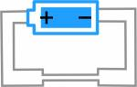
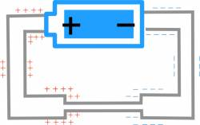
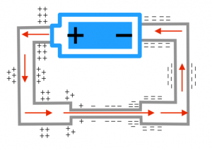

To this point, we have talked about what happens inside a wire when connected to two ends of battery - both in the *steady state current* situation and in the initial transient when the circuit is first connected. We found a few important conclusions about the circuit in *steady state:*

- The electron current going into a location must be the same as the current leaving that location because [charge is conserved](/empcubed/notes/week-01-charges-field-potential/charge/).
- The electron current moves through the wire because there is a constant electric field inside the wire. This electric field comes primarily from the [surface charges along the wire](/empcubed/notes/week-05-moving-charges-batteries/q_in_wires/).
- The distribution of surface charges varies along the wire - from highly positive near the positive end of the battery to zero in the middle of the circuit to highly negative near the negative end of the battery. This [gradient](/empcubed/notes/week-05-moving-charges-batteries/q_in_wires/) in the surface charge density causes the electric field inside the wires.

These notes will apply what we learned about the electric field, current, and surface charges to what we call a resistor and discuss what happens to energy around the circuit.



## A Thin Resistor

We'll start with a similar circuit as last week - a battery connected by a wire; however, in the middle of the wire, we'll make a part that is much thinner than the rest of the wire (but still made of the same material). We'll call this narrow section a **resistor**. *Note that real resistors are not simply thin pieces of metal, but this is the simplest model of a resistor and it helps us to understand the general concepts of resistance.* We'll show that a resistor is a section or part of a circuit that resists the passage of electrons more than in other parts of the circuit. These notes will try to address the question: what happens to the surface charges and electric field around this thin section of wire?

## Conservation of Charge in Circuits

Surface charge distribution around a circuit with a thin section of wire, BEFORE steady state is achieved

## Before steady state

Just after the circuit is connected, *before the steady state current is established*, there would be a constant electric field set up in the wire, which would start to move the electrons in the wire (with some average speed $v_{avg}$) and create the electron current. At this point, the number of electrons per second trying to enter the thin resistor is fairly large, compared to the number of electrons per second that can pass through the resistor. This means that the electrons pile up on one side of the resistor (and there is a similar lack of negative charges on the other side), creating a larger electric field within the resistor than that in the nearby wires. The electrons that pile up generate an electric field that opposes the motion of the electrons attempting to enter the resistor. At this point in time the current going into the resistor ***does not*** equal the current going through the resistor (e.g. the node rule does not apply), but this because we are looking at the situation *before the circuit is in a steady state*. (Charge is still conserved in this situation - it's just that some of the charge are piling up on the surface rather than passing through the thin part of the wire.) The electrons will continue to pile up until a steady state current is reached.

## In steady state

Once a *steady state current is reached*, we know that the current in the resistor (or thin part of the wire) must be the same as the current in the thick part of the wire. In the steady state, charge has already built up on the ends of the resistor to create a larger electric field and no more charge is added to the surface at this point. If the charges aren't moving to the surface, conservation of charge says that all of the charges passing through the large part of the wire must also pass through the thin part of the wire.

Using [the current relationships](/empcubed/notes/week-06-resistors-combinations/current/), we can show that the electric field and therefore drift speed must be larger inside the resistor to maintain the same current.

$$
i_{thin} = i_{thick}
$$

$$
nA_{thin}uE_{thin} = nA_{thick}uE_{thick}
$$

Since the thin and thick wires are made of the same materials, the electron density and electron mobility is the same, which leaves:

$$
E_{thin} = \frac{A_{thick}}{A_{thin}}E_{thick}
$$

Electric field and surface charges around a circuit in steady state with a thin wire

Since $A_{thick} > A_{thin}$, this means that the electric field will be bigger in the thin section of wire compared to the thick wires. Because $v_{avg} = uE$, this also means that the average speed of the electrons in the thin wire must also be bigger than the average speed in the thick wires. Ultimately, this means that in the steady state situation, the largest surface charge gradient occurs over the resistor, with only small gradients in the thick wires.

As noted above, a thin wire resistor is only one kind of resistor. You could also have a resistor in a circuit made out of a different material, but still the same size as the thick wires. Or both a different size and a different material. Resistors come in a wide variety of shapes, sizes, and materials. In these cases, the electron density and electron mobility of the materials matter much more to current analysis in the circuit.
