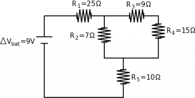
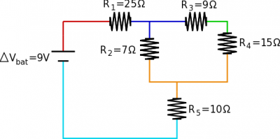

Now that you know about series and parallel combinations (both of resistors and capacitors), you can also make larger combinations in a circuit involving both series and parallel relationships. These relationships are foundational for the types of circuits that power all electronics (from your cell phone to NASA space station). Depending on the set up of your circuit and what you want the circuit to do, these circuits can get quite complicated. These notes will provide an example of a more complicated circuit and discuss strategies that you could use to analyze them.

As a reminder,

| Circuit Element | Placement | Same Across Elements | How they add | Formula |
|----|----|----|----|----|
| Resistor | In series | Current | Reg. addition | $R_{eq} = R_{1} + R_{2} + R_{3} + \ldots$​ |
| Resistor | In parallel | Potential | Inv. addition | $\frac{1}{R_{eq}} = \frac{1}{R_{1}} + \frac{1}{R_{2}} + \frac{1}{R_{3}} + \ldots$​ |
| Capacitor | In series | Charge | Inv. addition | $\frac{1}{C_{eq}} = \frac{1}{C_{1}} + \frac{1}{C_{2}} + \frac{1}{C_{3}} + \ldots$​ |
| Capacitor | In parallel | Potential | Reg. addition | $C_{eq} = C_{1} + C_{2} + C_{3} + \ldots$​ |

## A More Complicated Circuit

Complex circuit with 5 resistors (in a combination of series and parallel)

If we have a complex circuit with 5 resistors (shown above), among other things, we could solve for the total equivalence resistance of the circuit. Ultimately, this will tell you how much current the battery must provide. (You could also solve for the potential difference across each resistor, the current going through each resistor, the power dissipated in all the parts of the circuit, etc.)

If we start with the $R_{3}$ and $R_{4}$ resistors, we can tell that these are in series because all of the current that goes through $R_{3}$ also goes through $R_{4}$. We can find the combined 3,4 equivalent resistance then:

$$
R_{3,4} = R_{3} + R_{4}
$$

$$
R_{3,4} = 24\Omega
$$

At this point $R_{2}$ and $R_{3,4}$ are in parallel because they have the same potential difference across them. Note that $R_{2}$ is *not* in parallel with $R_{3}$ or with $R_{4}$ but only with combination. We can then find the combined resistance of $R_{2 - 4}$ then:

$$
\frac{1}{R_{2 - 4}} = \frac{1}{R_{2}} + \frac{1}{R_{3,4}}
$$

$$
R_{2 - 4} = (\frac{1}{7} + \frac{1}{24})^{- 1}
$$

$$
R_{2 - 4} = 5.42\Omega
$$

Then finally we can find the combination of $R_{1 - 5}$ since $R_{1}$, $R_{2 - 4}$, and $R_{5}$ are all in series (all of the current from the battery must go through each of the resistors).

$$
R_{1 - 5} = R_{1} + R_{2 - 4} + R_{5}
$$

$$
R_{1 - 5} = 25 + 5.42 + 10
$$

$$
R_{1 - 5} = 40.42\Omega
$$

So the total equivalent resistance of the whole circuit is $40.42\Omega$. We can use this to find the total current coming out of the battery using Ohm's law:

$$
\Delta V_{bat} = I_{bat}R_{eq}
$$

$$
9 = I_{bat}40.42
$$

$$
I_{bat} = 0.22A
$$

So the battery must provide 0.22 A of current to the circuit.

## Strategies for Analysis

Depending on what you are given and what you trying to figure out about the circuit, your approach to the analysis may be different. As in the example above, with the resistance of all the resistors given, combining the resistors into an equivalent resistor is often useful; however, you could also be given the power of resistor, the potential difference, or the current. A few strategies that you might find useful may be:

- **Redraw the circuit** - Since we generally make the *assumption that potential difference across wires is negligible*, this means that we are free to shorten, lengthen, bend or unbend wires as needed without changing the circuit. This will sometimes help make it clear whether something is in series or parallel. *Be careful not to change any connections in redrawing the circuit* - this will definitely change the answer.

Color coding of equivalent areas of potential difference on a complex circuit. Each color represents a different electric potential.

- **Color Coding** - Again, since we generally make the *assumption that potential difference across wires is negligible*, this means that everywhere along a single wire has the same electric potential. It can help to color code the pieces of the circuit that have the same electric potential (shown for the circuit above). Any circuit elements that have the same color transition (i.e., dark blue to orange) would be in parallel. In the example circuit, this shows why $R_{2}$ is in parallel with the *combination* of $R_{3}$ and $R_{4}$, but is not in parallel with only $R_{3}$.
- **Look for easy combinations of circuit elements** - usually this means zooming in on the most complicated-looking part of the circuit and looking for elements that are definitely in series or definitely in parallel. If you replace those with an equivalent resistor, then continue looking for combinations, you can simplify the circuit down to something that is manageable. You can make as many combinations as you would like - just make sure you keep track of what you combined.
- **When in doubt, use the loop and node rules** - Because the loop rule is the statement of conservation of energy and the node rule is the statement of conservation of charge, these rules will **ALWAYS** work. It is possible to get circuit elements that are neither in series or parallel and cannot be combined into an equivalent resistance. You could also end up with a circuit with two power sources or batteries. Even in these cases, the loop and node rules will still work. (You may end up with a large system of equations to solve, but Wolfram Alpha and/or your calculator are pretty good at solving those.)

## Other kinds of Circuits

We should also say that there are many more circuit elements beyond just resistors and capacitors. There are [operational amplifiers](https://en.wikipedia.org/wiki/Operational_amplifier) (often called op amps for short), [transistors](https://en.wikipedia.org/wiki/Transistor), [diodes](https://en.wikipedia.org/wiki/Diode), and various [kinds of chips](https://en.wikipedia.org/wiki/Integrated_circuit) that can be used to help build up a circuit. Most circuits (or anything that is plugged into the wall outlets) will also not operate under a steady-state current (also called Direct Current or DC). Instead, the power that comes from the wall is what we call [alternating current](https://en.wikipedia.org/wiki/Alternating_current) or AC. In an AC circuit, both the current vs. time graph and the voltage vs. time graph would look like a sine curve, constantly switching between positive and negative. This is done for a variety of reasons; it's easier to produce and has fewer power losses during transport. Unfortunately, AC circuits and these other circuit elements are beyond the scope of this class.

## Examples

- [The Wheatstone Bridge](/examples/week8_wheatstone/)
  - Video Example: The Wheatstone Bridge
- [Challenge: Charging Capacitors through Resistors](/examples/week8_charge_discharge_caps_resistors/)
  - Video Example: Charging Capacitors through Resistors




