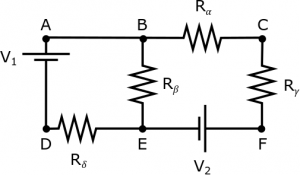
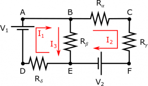
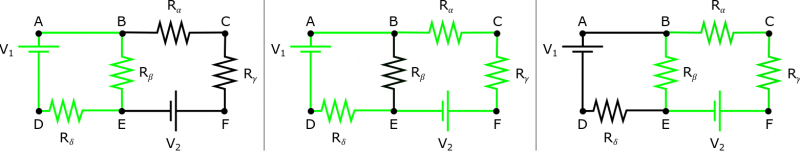
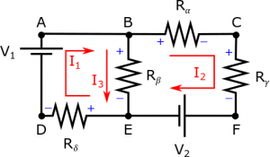

So far this week, we have talked about how to deal with circuit elements that are in [series](/empcubed/notes/week-06-resistors-combinations/r_series/) and in [parallel](/empcubed/notes/week-06-resistors-combinations/r_parallel/). We can use these rules for resistance, along with Ohm's law, to figure out the current and voltage at every point in the circuit. However, how do you solve circuits that are neither in series or parallel? Or when there are multiple voltage sources? For circuits that don't follow the series/parallel rules, we can always go back to the [Loop Rule](/empcubed/notes/week-06-resistors-combinations/r_energy/) and [Node Rule](/empcubed/notes/week-06-resistors-combinations/current/) that we talked about previously because these are the statements of Conservation of Energy and Conservation of Charge, respectively. This page of notes will walk you through the general steps and an example of how to set up the Loop and Node Rules to solve for quantities in a circuit.

## Example and Steps for Node/Loop Rules

We'll start with following circuit as an example for the general steps for the Node and Loop Rules. In this circuit, we have two batteries (labeled $V_{1}$ and $V_{2}$) and four resistors (labeled $R_{\alpha}$, $R_{\beta}$, $R_{\gamma}$, and $R_{\delta}$). Six different points (A-F) are also labeled on the circuit so that we can easily refer to different paths/locations on the circuit. For this example, we will say that the battery voltage and resistance values are all known, but the current in each branch is unknown. We will also make the assumptions that *the circuit is in a steady state* and that *the potential differences across the wires are negligible*.

## Step 1: Pick the direction of current in each branch of the circuit

Current $I_{1}$ is picked to go clockwise around the left branch, current $I_{2}$ is picked to go clockwise around the right branch, and current $I_{3}$ is picked to go down through the middle branch.

The first thing we need to do when solving these problems is to pick a direction for the current in each branch of the circuit. This is very similar to picking a coordinate system, just in the context of circuits. In the circuit below, we have picked the directions for the currents labeled now as $I_{1}$, $I_{2}$, and $I_{3}$. You can pick which ever directions you want in this step. For example, we could have picked $I_{3}$ to point up instead of down (or similarly for the other currents). *It doesn't matter what direction you pick for the current directions in this step as long as you are consistent with the current directions in the following steps.* (This is the same idea as it doesn't matter which direction you call the x-direction as long as you are consistent with your use of “x” after that.)

## Step 2: Identify the Nodes and write out the Node Rule equations

Once you have your current directions chosen, you can start to write out the Loop and Node equations. We will typically start with the Node equations because they are a little simpler to write, but you could equally start with the loops.

For the Node equations, you want to pick the junctions where you have more than one current either entering or leaving that junction. For our example, this would be Point B and Point E. Then we use the Conservation of Charge to say that $I_{in} = I_{out}$ for that junction (i.e. all of the charge that enters that point must also leave that point). For Point B, this equation would then be:

$$
\text{Node B:~}I_{1} = I_{2} + I_{3}
$$

and for Point E, this equation would be:

$$
\text{Node E:~}I_{3} + I_{2} = I_{1}
$$

You'll notice that the Node equations for Points B and E are exactly the same (just flipped as to which currents are going “into” the junction vs “out of” the junction). This is because there are only three branches in this circuit - it is possible to have more complicated circuits where there are more junctions and more non-repeating Node equations.

## Step 3: Identify the Loops and write out the Loop Rule equations

The next step is to identify the loops in the circuit, then use the Loop Rule to write an equation for each of those loops. In the example circuit, there are three distinct loops:

There are three loops in this example circuit - the right loop, the left loop and the outside loop.

1\) one loop that goes around the left part of the circuit ($A \rightarrow B \rightarrow E \rightarrow D \rightarrow A$)

2\) one loop that goes around the outside of the circuit ($A \rightarrow B \rightarrow C \rightarrow F \rightarrow E \rightarrow D \rightarrow A$)

3\) one loop that goes around the right part of the circuit ($B \rightarrow C \rightarrow F \rightarrow E \rightarrow B$)

It doesn't matter where you pick the starting point of the loops or which direction (clockwise or counterclockwise) around the loop that you pick, but the loop must return to the same point as the start point and the equation must be consistent with the loop direction that you pick. As we talked about before, **when you are constructing the loop equations, there is a positive change in potential when you move from a low potential to a high potential across a circuit element (whether it's a battery, capacitor, or resistor) and there is a negative change in potential when you move from a high potential to a low potential across an element**. Again, this is true for all circuit elements - including batteries, resistors, and capacitors.

- For batteries, the positive and negative sides are indicated by the length of the line (the longer line is the positive side, the shorter line is the negative side).
- For resistors, the positive and negative sides are indicated by the **current directions *you* chose.** Since conventional current is the flow of positive charges from higher potential to negative potential, the “positive” side of the resistor is the side closest to the tail of the current arrow and the “negative” side of the resistor is the side closest to the head of the current arrow.
- For capacitors, they will either come pre-labeled which indicate which side is positive/negative or they follow the same rule based on the current direction as resistors.

For our circuit, the positive/negative sides of the resistors have been labeled according to the current directions we picked in Step 1.

Here the positive and negative sides of the resistor are labeled according to the current directions picked in Step 1.

We are now ready to write out the three loop equations:

$$
\text{Loop ABEDA:~} - \Delta V_{\beta} - \Delta V_{\delta} + \Delta V_{1} = 0
$$

$$
\text{Loop BCFEB:~} - \Delta V_{\alpha} - \Delta V_{\gamma} - \Delta V_{2} + \Delta V_{\beta} = 0
$$

$$
\text{Loop ABCFEDA:~} - \Delta V_{\alpha} - \Delta V_{\gamma} - \Delta V_{2} - \Delta V_{\delta} + \Delta V_{1} = 0
$$

Once you have the loop equations written out, you can always substitute $\Delta V = IR$ to make better use of your knowns/unknowns. For example, we could rewrite Loop ABEDA as:

$$
\text{Loop ABEDA:~} - I_{3}R_{\beta} - I_{1}R_{\delta} + \Delta V_{1} = 0
$$

Since this form of the equation better relates the unknown currents with the known resistor values and battery voltages.

## Step 4: Pick the same number of equations as unknowns in your circuit

Now, that we have all of the loop and node equations, you'll notice that we have more equations than we do unknowns. There are 5 total equations (2 nodes and 3 loops), with only three unknown currents ($I_{1}$, $I_{2}$, $I_{3}$). This means we need to pick three of the five equations. In picking the equations, **at least one equation must be a node equation and at least one equation must be a loop equation**. If you pick only nodes or only loops, you will always end up with a $0 = 0$ situation at the end, which is technically true but not useful.

## Step 5: Solve the system of equations

Once you have picked your equations, you can solve the system of equations for the unknowns. In this case, this would mean solving the three equations for the three unknown currents. You can do this by hand or use Wolfram Alpha/calculator to do so. A couple of quick notes about solving the equations:

- If you ever end up with a final equation with two unknowns, a $0 = 0$ equation, or a $0 = 5$ equation, this means that you need to pick a different set of equations. This typically means you did not pick an independent set of equations in Step 3. Try picking a different loop or node equation.
- If you end up with a negative current value, this means that the current direction is opposite to what you picked in Step 1. Conversely if the current value is positive, this means that the current is in the same direction that you picked in Step 1.
