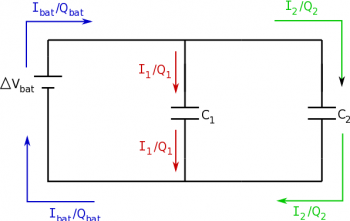
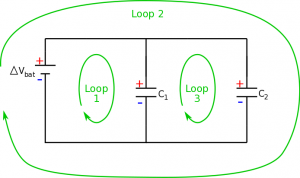
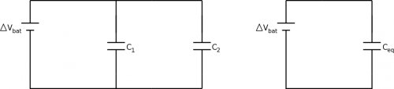

The final combination that we will talk about will be capacitors in parallel. This section should feel familiar to the resistors in parallel. We will continue to use the loop and node rules to analyze these circuits, with our assumption that potential differences across the wires are negligible.



## Node Rule and Charge in Parallel

Node rule representation for a circuit with capacitors in parallel

Just as with resistors, when capacitors are in parallel, this means that there are two separate paths that share the *same potential difference.* Consider a circuit with a battery and two capacitors that are now parallel to the battery (side-by-side with a junction in the wire). Again, with capacitors, we will look at the *charge* rather than current since it is the charges that collect on the plates. When we use the node rule at the location where the wire splits, we should then see that any charge that comes into the junction should equal the total charge leaving the junction (remember this is just a statement of the conservation of charge). For Node A (and also for Node B), we can see that the **total charge coming from the battery should be equal to the charge that travels to the first capacitors plus the charge that travels to the second capacitor**.

$$
Q_{bat} = Q_{C1} + Q_{C2}
$$

## Loop Rule and Voltage in Parallel

Loop rule breakdown for a circuit with two capacitors in parallel

For the parallel circuit with capacitors, we again will now have three loops and thus three equations to check. Again start by marking the high and low potential locations in the circuit. For the first loop going clockwise, we see that there is a gain in potential from the battery and then a drop of potential across the capacitor:

$$
+ |\Delta V_{bat}| - |\Delta V_{C1}| = 0
$$

$$
|\Delta V_{bat}| = |\Delta V_{C1}|
$$

For the second loop, we see the same with the second capacitor:

$$
+ |\Delta V_{bat}| - |\Delta V_{C2}| = 0
$$

$$
|\Delta V_{bat}| = |\Delta V_{C2}|
$$

Finally for the third loop (again clockwise), we see a gain in potential across $C_{1}$ (moving from low to high potential) and a drop in potential across $C_{2}$ (moving from high potential to low).

$$
+ |\Delta V_{C1}| - |\Delta V_{C2}| = 0
$$

$$
|\Delta V_{C1}| = |\Delta V_{C2}|
$$

This tells us that **capacitors in parallel have an equal potential difference**.

$$
|\Delta V_{bat}| = |\Delta V_{C1}| = |\Delta V_{C2}|
$$

## Equivalent Capacitance

Circuit with capacitors in parallel, $C_{1}$ and $C_{2}$, and the equivalent circuit with $C_{e}$

Finally, we can find the equivalent capacitance for capacitors in parallel. Again, we will do this by comparing the circuit with the two capacitors to one with a single equivalent capacitor, keeping $\Delta V_{bat}$ and $Q_{bat}$ the same in each circuit. From the node rule, we found:

$$
Q_{bat} = Q_{C1} + Q_{C2}
$$

Using the capacitance equation, we can rewrite the charge in terms of the potential difference and capacitance $Q = C\Delta V$:

$$
Q_{bat} = C_{1}|\Delta V_{1}| + C_{2}|\Delta V_{2}|
$$

Using the same process for the equivalent capacitor circuit, we get:

$$
Q_{bat} = C_{eq}|\Delta V_{bat}|
$$

Since the $Q_{bat}$ is the same in both equations, we can set them equal to each other:

$$
C_{eq}|\Delta V_{bat}| = C_{1}|\Delta V_{1}| + C_{2}|\Delta V_{2}|
$$

Because the potential differences are all equal in parallel, they cancel out, leaving:

$$
C_{eq} = C_{1} + C_{2}
$$

Thus, **for capacitors in parallel, the capacitances will add together**.

## Examples

[Connecting Already-Charged Capacitors](/empcubed/examples/week8_cap_parallel/)
