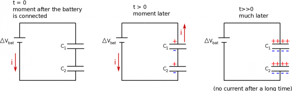
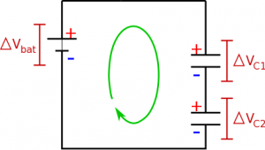
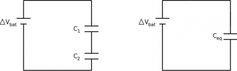

Just like resistors, we are now moving to more of a macroscopic picture of capacitors, rather than thinking microscopically about the charges on the plates. These notes will talk about combinations of capacitors in series and how this differs from resistors in series.



## Node Rule and Charge in Series

Just as with resistors, when capacitors are in series this means that all of the current that goes through one capacitor will go through the other. However, unlike resistors, the current that flows through the circuit will decrease as the capacitors charge or discharge. Since current does not actually pass through capacitors (remember that the charges get stuck on the capacitor plates), we will instead focus on what happens to the charge on the capacitors rather than the current.

Electron movement around a circuit with two capacitors - capacitors in series always have the **same total charge on each plate**

Consider what happens to the charge around a circuit with two capacitors in series. After the circuit is connected, electrons begin to move through the wires and collect on one plate. For every electron that gets stuck on the plate, it pushes another negative off the opposite plate. This electron continues moving down the wire (providing the electron current) until it becomes stuck on the first plate of the second capacitor. This in turn pushes an electron off the second plate of the capacitor, that continues to travel toward the battery. Because of this chain reaction, **the charge on each of the capacitors in series must be the same**. (This is similar to how current was the same for resistors in series.)

$$
Q_{1} = Q_{2}
$$

## Loop Rule and Voltage in Series

Voltage differences in a series circuit with capacitors

We can also say something about the potential difference around the circuit. Following the loop rule, we can again mark out the sides of the circuit elements with higher and lower potentials. For capacitors this should follow which plate would hold the positive charge and which plate would hold the negative charge. If we follow the loop rule clockwise around the circuit with two capacitors, we will get a positive potential difference across the battery (moving from low to high potential), with negative potential differences across each of the capacitors (moving from high to low potential). This means that from our loop rule, we know:

$$
+ |\Delta V_{bat}| - |\Delta V_{C1}| - |\Delta V_{C2}| = 0
$$

$$
|\Delta V_{bat}| = |\Delta V_{C1}| + |\Delta V_{C2}|
$$

So just like for resistors in series, **the electric potentials add together for capacitors in series**. Again, here we have make the *assumption that potential differences across the wires are negligible*.

## Equivalent Capacitance

Circuit with capacitors in series, $C_{1}$ and $C_{2}$, and the equivalent circuit with $C_{e}$

Just like for resistors, we will often try to replace or combine capacitors into a single equivalent capacitor. We will again do this by comparing the circuit with the two capacitors to a circuit with a single equivalent capacitor. In both these circuits, we want to keep the potential difference and current from the battery to be the same. From the loop rule, we know the potential differences will add:

$$
|\Delta V_{bat}| = |\Delta V_{C1}| + |\Delta V_{C2}|
$$

Using the capacitance equation $Q = C\Delta V$, we can write the potential differences of the capacitors in terms of the charge and capacitance.

$$
|\Delta V_{bat}| = \frac{Q_{1}}{C_{1}} + \frac{Q_{2}}{C_{2}}
$$

For the equivalent circuit, we can write a similar expression using the loop rule and the capacitance equation:

$$
|\Delta V_{bat}| = \frac{Q}{C_{eq}}
$$

Setting these equal to each other (since $V_{bat}$ should be the same) gives:

$$
\frac{Q}{C_{eq}} = \frac{Q_{1}}{C_{1}} + \frac{Q_{2}}{C_{2}}
$$

Because the charge is the same, they will cancel out, leaving:

$$
\frac{1}{C_{eq}} = \frac{1}{C_{1}} + \frac{1}{C_{2}}
$$

Thus, to combine capacitors in series, you take the inverse sum of the capacitors. This is important because **the combination of capacitors in series will have a smaller capacitance than either of the individual capacitors**.

## Examples

- [Example: Capacitors in Series](/examples/week8_cap_series/)
  - Video Example: Capacitors in Series


