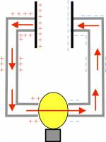
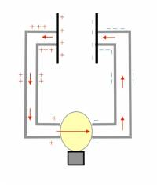
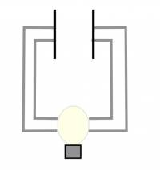
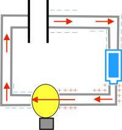
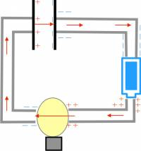
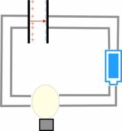
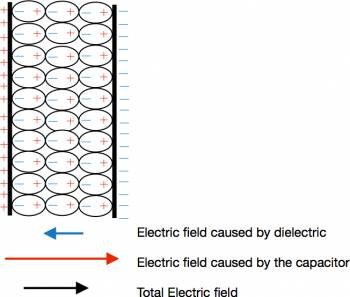

Over the last two weeks we have been building a fairly robust model of what happens to the charges both on the surface of the wires and those moving through the wire (through resistors). Now we are going to introduce a new circuit element called a capacitor and see what changes about the electron current, the electric field and the surface charges. [A week ago](/notes/week-05-moving-charges-batteries/motiv_movingq/), we started talking about a two oppositely charged plates - so we'll start by returning to that example.



## Discharging Capacitors

Discharging capacitor circuit right after wires have been connected

Let's start by considering a set of parallel plates that have a charge of +Q on one plate and charge of -Q on the other plate. In circuits, we call this set up a **capacitor**. Then we connect the plates of the capacitor with a conducting wire. As we said before, the excess electrons from the negative plate are going to feel a strong repulsion from the other electrons and will be pushed through the wire toward the positive plate, which also has a strong attraction. If we put a light bulb in the middle of the circuit, what would we expect to happen to the lightbulb in this case? Because a lot of electrons are moving through the wire (or rather there is large electron current), the lightbulb would light up much in the same way that it would if it were attached to a battery.

When the lightbulb is lit up brightly (only a short time after the wires have been connected), the electric field and surface charges in the wires are also very similar to if there were a battery in the place of the capacitor. The electric field points away from the positive plate and toward the negative plate and is constant along the wire. The electric field in the bulb filament would be larger since it is a resistor and would have surface charge piling up on either side. The surface charges would have a small gradient along the wires from the capacitor plates to the light bulb.

Charge distribution and electric field a short time after the wires have been connected in a discharging capacitor circuit.

Discharging capacitor circuit a long time after the wires have been connected (when the capacitor is fully discharged.)

After a short time has passed, the electron current moves away from the negative plate, meaning the plate has lost some of its negative charge. Since the electron current moves toward the positive plate, that plate becomes less positively charged. This means that not only does the electron current decrease, but that the electric field between the capacitor plates and in the wires also decreases. With a smaller electron current, there is a smaller build up of charges across the lightbulb, making the electric field inside the bulb filament also smaller - so the lightbulb becomes dimmer after some time.

As this process continues, the capacitor plates lose more and more of their charge, so the electric field gets smaller and smaller causing the bulb to get dimmer and dimmer. Eventually, the capacitor plates lose all of their charge (both become neutral plates), so the electron current stops completely because there is no longer an electric field around the wire.

It is important to note here that *this is no longer a steady-state current situation*. The current, potential difference across the capacitor, and the amount of charge on the capacitor are all decreasing as time goes on. Depending on the capacitor and resistor you have in your circuit, this process can take anywhere from fractions of a second up to minutes. The amount of time it takes a capacitor to discharge is slow compared to how long it takes to set up the electric field in the wire (this takes nanoseconds). However, a capacitor is not capable of sustaining a constant current for long periods of time like a battery is. You might hear this referred to as a **quasi-static state**.

## Charging a Capacitor

Charge distribution and electric field of a circuit with a charging capacitor shown immediately after the circuit is connected.

We could also consider the reverse situation: what would happen if you started with neutral plates in your capacitor and connected it to a battery and a lightbulb? In this case, rather than discharging the capacitor, you would be charging the capacitor.

If we think about what happens to the charges immediately after the circuit is connected, the surface charges arrange themselves in the first few nanoseconds and set up an electric field in the wires just like before. Because the capacitor is initially neutral, the capacitor doesn't contribute or impede this electric field, which means an electron current is set up in the wires as if the battery were directly connected to the lightbulb. This means that there is a relatively large electric field set up in the wires, with a strong electron current, so the lightbulb is very bright after you initially connect the circuit.

Charge distribution and electric field shortly after the charging capacitor circuit is connected

As each electron from the electron current hits the capacitor plate, it will become stuck on the plate - it cannot jump the gap between the two capacitor plates. So how does the current continue and not just get stuck on the plate? When an electron stops on one of the plates, it causes an area of excess negative charge. This will then repel one of the electrons in the opposite plate, leaving a net positive charge on the opposite plate, while the repelled electron continues to move in the wire beyond the capacitor.

After some time has passed, the electrons from the electron current pile up on one plate in the capacitor, leaving a net positive charge on the other plate. When this happens, there is now an electric field from the charges on the capacitor that points *opposite* to the field that is established by the surface currents. This means that the net electric field gets smaller and smaller the more charges that build up on the plates. This should also make some intuitive sense - the more charges are on the capacitor plates, the harder it becomes to put more charges on the plates. As the electric field decreases, the electron current will decrease and therefore the lightbulb will become dimmer. Eventually, there will be enough charges on the capacitor plates to create an electric field that completely cancels out the field from the other charges. At this point, there will be no electron current, no electric field in the wires, and no light coming out of the lightbulb.

This process is also a **quasi-static state** - the electron current is decreasing over time, while the charge on the capacitor and potential difference across the capacitor is increasing. The total process from uncharged to fully charged takes between fractions of a second and a few minutes depending on the type of capacitor and resistor involved.

Charge distribution and electric field when the capacitor plates are fully charged.

## Role of the Resistor

When charging or discharging a capacitor, there is usually a resistor placed in the circuit (like a lightbulb or some other kind of resistor) because the resistor helps control both the maximum current possible and the time it takes to charge/discharge. The resistor **does NOT impact how much charge the capacitor holds, just how fast the capacitor charges/discharges.**

## Video Demo

Here is a video demonstration of a lightbulb and capacitor circuit, charging and discharging.



## Dielectrics

Polarization of a dielectric material between two capacitor plates

If you have a fully charged capacitor, one way to add more charge to the plates (making your capacitor more efficient) would be to add a small insulator between the plates of the capacitor. Since it is an insulator, the charges on the plates would polarize the molecules in the insulator but those charges would not be able to move freely. This means that inside the capacitor plates, there would be a strong electric field from the plates pointing in one direction, with a smaller electric field from the dielectric material pointing in the opposite direction. This means that the net electric field between the two plates with the dielectric would be smaller than the field between the two plates by themselves.

Remember that charges will be added to the plates (from the electron current) until the electric field between the plates is equal to the field from the other charges in the circuit. If we decrease the electric field between the plates because we added a dielectric, this means that now more charges will be added to the plate to balance out the electric field.

## Examples

- [Looking at a Capacitor as it's Charging](/empcubed/examples/week7_charging_capacitor/)
  - Example Video: Looking at a Capacitor as it's Charging


