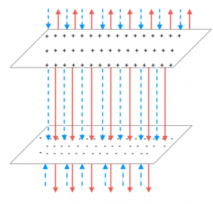

[As you read about](/empcubed/notes/week-08-capacitors-combinations/cap_charging/), capacitors can be charged in a circuit and discharged through a resistor or lightbulb; thus, providing energy or powering a lightbulb for very short amounts of time. It turns out that this is a very useful circuit element and can be used for a variety of purposes in circuits. For example, a capacitor is used to provide power for a camera flash, provides a back up power supply for a computer (so it has enough power to properly shut down if it runs out of battery), and filters out background noise from a video or sound recording. However, when we start to talk about capacitors in larger circuits like this, it becomes difficult to talk about what is happening to every electron around the circuit or the individual electric fields. Instead, we define macroscopic measures like potential difference and capacitance to talk about the role that these capacitors play in circuits.



## Definition of Capacitance

**Capacitance** is defined as the proportionality constant of the potential difference between the plates of the capacitor ($|\Delta V|$) and the amount of charge that is on one plate ($|Q|$) - if the charge increases, the potential difference should increase and vice versa. Note that since one plate will always have a charge of +Q and one will have a charge of -Q (because of conservation of charge), the $|Q|$ will be the same no matter which plate you are looking at. In terms of an equation, this means that:

$$
|Q| = C|\Delta V|
$$

The units of capacitance are then **coulombs/volt (C/V), which is called a farad** (named after [Michael Faraday](https://en.wikipedia.org/wiki/Michael_Faraday)) and abbreviated with “F”. A 1 F capacitor is an extremely large capacitor - large in both in physical size and the amount of time it takes to charge/discharge. A typical capacitor in electronic capacitors is on the order of nanofarads ($10^{- 9}$) to picofarads ($10^{- 12}$).

## Finding Capacitance

We can actually find an expression for capacitance specifically for parallel plates using the [relationship between electric field and electric potential](/empcubed/notes/week-03-electric-force-energy/pc_vefu/) and the definition of capacitance above. *Assume we start with a pair of parallel plates*, which have an area $A$, a charge of $+ / - Q$, and are separated by a distance $d$.

Electric field between two parallel plates. The dashed blue arrows represent the E-field from the negatively charged plate, and the solid red arrows represent the positive plate.

## Deriving the Capacitance for Parallel Plates

We start by considering the electric field between the plates. We know that for two parallel plates, there is an electric field in the middle that points directly from the positive plate to the negative plate (except near the edges where the field bends slightly out). Outside of the plates, the electric field is zero because the contributions from the negative and positive plates will cancel. This means that there is a very strong electric field in the middle of the plates and a very small electric field outside the plates. If we *assume that the area of the plates is very large compared to separation between them*, then the electric field between the plates is approximately constant. It turns out that the magnitude of this electric field is related to only the charge density (charge per area) on the plates *assuming that the charge density is uniform* and the $\epsilon_{0}$ constant. We represent the charge density with a $\sigma$:

$$
|\overset{\rightarrow}{E}| = \frac{Q}{A\epsilon_{0}} = \frac{\sigma}{\epsilon_{0}}
$$

We will actually derive where this relationship comes from later in the course. If we choose a coordinate system, where down is the -y direction, then the electric field vector would be:

$$
\overset{\rightarrow}{E} = - \frac{\sigma}{\epsilon_{0}}\widehat{y}
$$

Now that we have the electric field between the two plates, we can find the potential difference between the plates [using the relationship between electric field and electric potential](/empcubed/notes/week-01-charges-field-potential/pc_potential/#relating_electric_potential_to_electric_field).

$$
\Delta V = - \int_{r_{i}}^{r_{f}}\overset{\rightarrow}{E} \cdot \overset{\rightarrow}{dr}
$$

If we want the change in potential from the bottom to the top plate, then we would want to integrate along the vertical direction, which means we would want to change:

$$
\overset{\rightarrow}{dr} = dy\widehat{y}
$$

and our bounds would be from $0$ to $d$. Plugging in the electric field between the plates $\overset{\rightarrow}{E} = - \frac{\sigma}{\epsilon_{0}}\widehat{y}$, gives:

$$
\Delta V = - \int_{0}^{d} - \frac{\sigma}{\epsilon_{0}}\widehat{y} \cdot dy\widehat{y}
$$

Since $\widehat{y} \cdot \widehat{y} = 1$ (because the two vectors are parallel), the integral becomes:

$$
\Delta V = \int_{0}^{d}\frac{\sigma}{\epsilon_{0}}dy
$$

Because we assumed that the charge density was uniform, $\sigma$ is a constant, just like $\epsilon_{0}$. So the integral becomes quite simple:

$$
\Delta V = \frac{\sigma}{\epsilon_{0}}\int_{0}^{d}dy = \frac{\sigma}{\epsilon_{0}}(d - 0) = \frac{\sigma d}{\epsilon_{0}}
$$

Once we have the potential difference across the plates, we can use the definition of capacitance to find the capacitance of the parallel plates:

$$
C = \frac{Q}{\Delta V}
$$

$$
C = \frac{Q}{\frac{\sigma d}{\epsilon_{0}}} = \frac{Q\epsilon_{0}}{\sigma d}
$$

Since $\sigma$ is the charge density of the plate, we can rewrite it in terms of the charge and area of the plate: $\sigma = Q/A$. So we get a capacitance of:

$$
C = \frac{Q\epsilon_{0}}{\frac{Q}{A}d}
$$

$$
C = \frac{\epsilon_{0}A}{d}
$$

*This expression is only true for parallel plate capacitors*, but shows an important result. **The capacitance of the plates only depends on the size/shape of plates (area) and how far apart the plates are**, not on the amount of charge on the plates or the potential difference.

## Dielectrics

What would change about our capacitance expression if we added a dielectric insulator in between the plates? [As we talked about before](/empcubed/notes/week-08-capacitors-combinations/cap_charging/), adding a dielectric allows more charge to pushed onto the plates of the capacitor for a certain voltage. If we think about that in terms of the capacitance equation $Q = C\Delta V$, this means that the proportionality constant (really the capacitance) should increase if a dielectric is added.

This is generally achieved by adding a constant to the capacitance called the dielectric constant. This constant is really a “constant” as it is highly dependent on temperature and material, but [large resource tables](https://www.kabusa.com/Dilectric-Constants.pdf) exist for finding the dielectric constant of various materials at various temperatures. The dielectric constant is usually represented by a “k” and is unitless. The typical range of a dielectric constant is somewhere between 1-100. So the capacitance equation for a parallel plate capacitor with a dielectric would be given by:

$$
C = \frac{k\epsilon_{0}A}{d}
$$

## Energy in Capacitor

We can also use capacitance to think about how much energy a capacitor is able to store based on the amount of charge on the plates. Remember that the general relationship between electric energy and electric potential is $U = qV$. We can start to find the energy in the capacitor by saying we want to know the small amount of energy it would take to move a small amount of charge from one plate to another. Mathematically this would be:

$$
dU = Vdq
$$

However, the amount of energy this would require depends on the electric potential which comes from how much charge is already on the plates. We already found an expression for the electric potential in terms of the charge density: $V = \frac{\sigma d}{\epsilon_{0}}$, which we could rewrite in terms of the charge on the plates: $V = \frac{qd}{A\epsilon_{0}}$. This makes our energy expression:

$$
dU = \frac{qd}{A\epsilon_{0}}dq
$$

If we integrate this expression over all the charge on one plate (i.e., how much energy would it take to move all of the excess charge from one plate to the other), we get an expression for the total electric energy stored in the capacitor.

$$
U = \int_{0}^{Q}\frac{qd}{A\epsilon_{0}}dq
$$

$$
U = \frac{d}{A\epsilon_{0}}\frac{Q^{2}}{2}
$$

Using the capacitance of the parallel plate $C = \frac{\epsilon_{0}A}{d}$, then we get:

$$
U = \frac{1}{2}\frac{Q^{2}}{C}
$$

## Examples

- [Energy Stored in a Parallel Plate Capacitor](/empcubed/examples/week7_energy_plate_capacitor/)
  - Video Example: Energy Stored in a Parallel Plate Capacitor
- [Finding the Capacitance of a Cylindrical Capacitor](/empcubed/examples/week7_cylindrical_capacitor/)
  - Video Example: Finding the Capacitance of a Cylindrical Capacitor




