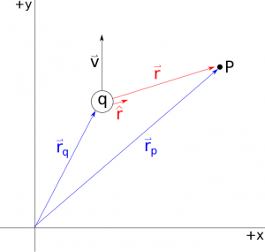
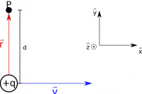

Just like we did with electric fields, we will start with magnetic fields by looking at the simplest source: a single moving point charge. When we are talking about this moving charge and the corresponding magnetic field, there are intuitive qualities that we want to make sure our mathematical model includes: (1) the farther away the observation point is from the moving charge, the smaller that we expect the magnetic field to be; (2) the larger the amount of charge, the larger we expect the magnetic field to be; and (3) the faster the charge is moving, the larger we expect the magnetic field to be. The final piece that is perhaps not so intuitive is that the direction of the magnetic field is actually perpendicular to observation point and to the velocity vector. However, each of these demands is consistent with experimental observations of moving charges. These notes will detail the mathematical equation that we use for the magnetic field (only for a single moving point charge) and explain a new tool called the [Right Hand Rule](/notes/week-09-magnetic-field-moving-point-charge/rhr/) that we can use to find the direction.



## Mathematical Model for Magnetic Field

We have already stated that the magnetic field is a vector field, meaning it has both *magnitude* and *direction*. As you will read soon, the magnetic field can also be related to the magnetic force. Again, we will start by making the *point particle assumption - meaning that we will take our charged object and crush it down to single small point that has some mass and charge*. Only this time, *we will be considering the case where the point charge is moving with a **constant** velocity*, rather than being fixed in one place.

## Magnetic Field Equation for a Moving Point Charge

The general equation for the magnetic field ($\overset{\rightarrow}{B}$), with units of Tesla ($T$), at some Point $P$ due to a moving charge is given by:

$$
\overset{\rightarrow}{B} = \frac{\mu_{0}}{4\pi}\frac{q\overset{\rightarrow}{v} \times \widehat{r}}{r^{2}}
$$

which you may hear referred to as the [Biot-Savart Law](https://en.wikipedia.org/wiki/Biot%E2%80%93Savart_law) in other resources or textbooks. This equation has several pieces to it:

- **Constant** - the first part of this equation $\frac{\mu_{0}}{4\pi}$ is a constant value, where $\mu_{0} = 4\pi*10^{- 7}$ $\frac{T \cdot m \cdot s}{C}$. The $\mu_{0}$ constant (also called the [permeability of free space](https://en.wikipedia.org/wiki/Vacuum_permeability)) plays a similar role as the $\epsilon_0$ did for electric fields.
- **Charge** - the charge q is by now a familiar quantity. It still is a scalar value that can be either positive or negative depending on the type of charge your particle has. Remember that charge has units of Coulombs (C), which is a fairly large unit (1 C is a lot of charge).
- **Separation Distance** - the $r$ in this equation should feel very familiar from all the work we did with electric fields and potentials. In this equation, this is still the same magnitude of the separation vector that points from the source (the moving charge in this case) to the observation point (P in this case). Mathematically, we can still find the magnitude of this vector using:

$$
r=|\vec{r}|=|\vec{r_p}-\vec{r_q}|
$$

Separation Vector

- **Separation Unit Vector** - Similarly the $\hat{r}$ in this equation is the unit vector (has a magnitude of one) that points in the same direction as $\vec{r}$. From before, you know that you can calculate the unit vector using the separation vector and it's magnitude:

$$
\hat{r}=\frac{\vec{r}}{r}
$$

We could also use this unit vector definition to rewrite the magnetic field equation so it is in terms of the $\vec{r}$ rather than $\hat{r}$.

$$
\vec{B}=\frac{\mu_0}{4 \pi}\frac{q\vec{v}\times \hat{r}}{r^2}=\frac{\mu_0}{4 \pi}\frac{q\vec{v}\times \vec{r}}{r^3}
$$

- **Velocity** - unlike what we did before, the magnetic field equation depends on the velocity of the moving charge. Remember that *velocity is vector*, so it has both a magnitude and direction. The units of velocity here are m/s like normal. Here we have *assumed that velocity is constant* or *assumed that we are looking at a particular instant in time*, so there is a single, constant vector to use for $\vec{v}$ (units of $\frac{m}{s}$).
- **Direction - Cross Product** - the final piece to this equation is the cross product between $\vec{v}$ and $\hat{r}$ or between $\vec{v}$ and $\vec{r}$ depending on how you wrote the equation. The cross product is a way to [multiply vectors](/notes/week-01-charges-field-potential/math_review/#vector_multiplication) that gives a perpendicular vector as the product. You have seen the cross product before when we were talking about area vectors or you may remember the cross product from calculus or learning [torque](https://pcubed.msuperl.org/notes/week-12-14-collisions-rotational-motion/torque/) in mechanics. Because of how the cross product works, this means that the **magnetic field is perpendicular to both the velocity of the moving charge and the separation vector**. So for a charge moving in a straight line, the magnetic field creates a curling field (in ring) around the charge. You can always use the determinant method to calculate the cross product and thus the direction of the magnetic field, but we will also make use of the Right Hand Rule as tool to figure out the direction of the magnetic field.

Together, these pieces tell you how the magnetic field from a point charge changes in space. The main take away here is: **the magnetic field is created by *moving* charges, points in a perpendicular direction, and can be calculated for every point in space around the charge**. The examples below show a few instances of how to calculate the magnetic field and how to use the Right Hand Rule to figure out the direction.

## Magnetic Field Vectors

Just like we did before with stationary charges, we will often draw the magnetic field vectors (or just B-field vectors) around the moving charge to help us understand what is happening to the magnetic field. **The magnitude of these vectors represents the magnitude of the magnetic field, and the direction of these vectors points in the direction of the magnetic field.**

Notation for vectors going into the page and out of the page

However, because we are dealing with the cross product, we need to be able to denote when a vector would be pointing into or out of the page/screen. We will do this by using either a circle with a dot inside to represent a vector pointing out of the page/screen or a circle with an x inside to represent a vector pointing into the page/screen. An easy way to remember this is to think of an arrow coming toward you (you would see the point so only a dot) or an arrow going away from you (you would see the cross of the tail feathers). A belly button analogy can also work nicely.

Example set up

For example, consider a charge q moving in the $+\hat{x}$ direction. We want to know the magnetic field at point P, which is a distance d away from the charge in the $\hat{y}$ direction at the instant the moving change is at the origin (see the set up below). Here, notice that we must be specific about *when* we want to find the magnetic field. Because the charge is moving, it will be at a different location at different times – *our solution is only accurate for a particular time/location of the charge*. We can find the magnetic field by using the equation above:

$$
\vec{B}=\frac{\mu_0}{4 \pi}\frac{q\vec{v}\times \vec{r}}{r^3}
$$

where our separation vector is $\vec{r}=d \hat{y}$ since it points from the charge to our point of interest. In this case then:

$$
\vec{B}=\frac{\mu_0}{4 \pi}\frac{q \cdot v \hat{x} \times d \hat{y}}{d^3}
$$

We can pull the constants out, and focus on the cross product then:

$$
\vec{B}=\frac{\mu_0}{4 \pi}\frac{q \cdot v \cdot d}{d^3}\hat{x} \times \hat{y}
$$

We can rewrite $\hat{x}=\langle 1,0,0 \rangle$ and $\hat{y}=\langle 0,1,0 \rangle$, and plug that into the general equation for a cross product:

$$
\vec{B} \times \vec{C} = \langle B_yC_z - C_yB_z, C_xB_z-B_x C_z, B_xC_y - C_xB_y\rangle
$$

$$
\hat{x} \times \hat{y} = \langle (0\cdot0)-(1\cdot0), (0\cdot0)-(1\cdot0), (1\cdot1)-(0\cdot0) \rangle
$$

$$
\hat{x} \times \hat{y} = \langle 0,0,1 \rangle = \hat{z}
$$

So we get that the magnetic field at P should point out of the page.

We could also get this result using the [Right Hand Rule](/notes/week-09-magnetic-field-moving-point-charge/rhr/), which says that if you point your fingers in the direction of the first vector (the velocity vector in this case) and curl the towards the direction of the second vector (the separation vector in this case), your thumb will point in the direction of the cross product (or the B-field direction here). If you do this - point your right hand fingers in the direction of +x and curl them toward +y direction, your thumb will point in the +z direction or out of the page. **NOTE: the right hand rule is true for POSITIVE charges**. If you have a negative charge, you can *either* use your left hand or just flip the direction of your final vector (i.e. if you get +z for your right hand rule, you would have a direction of -z for a negative charge).

## Examples

- [Magnetic Field near a Moving Charge](/examples/week9_detecting_b/)
  - Video Example: Magnetic Field near a Moving Charge


