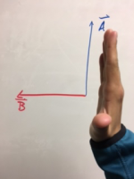
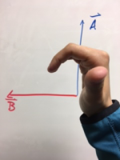
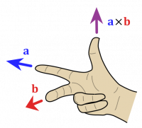

The Right Hand Rule is a handy tool to figure out the directions of vectors in a cross product. There are multiple ways to do the Right Hand Rule, we will present two methods below (though there are more). Feel free to use whatever method makes the most sense to you. For the following methods, we will be using a generic cross product:

$$
\overset{\rightarrow}{A} \times \overset{\rightarrow}{B} = \overset{\rightarrow}{C}
$$

Because this is a cross product, all three vectors are perpendicular to each other.

Remember, this rule is true for your ***RIGHT*** hand, not your left hand! (If you are right handed, remember to put your pencil down!)

## Method 1 - Curling fingers

In this method, you start with your hand completely open and in an “L” shape. Point your fingers in the direction of $\overset{\rightarrow}{A}$, then curl your fingers toward the direction of $\overset{\rightarrow}{B}$. Whichever way your thumb points is the direction of $\overset{\rightarrow}{C}$.

Fingers point in direction of A

Fingers curl towards B

In the case of these pictures, $\overset{\rightarrow}{C}$ would point out of the whiteboard.

## Method 2 - Three Fingers

Three fingers

In this method, you start with your thumb and first finger in an “L” shape. Then extend your middle finger so it is perpendicular to the “L”. Hold your fingers in this shape, and rotate your hand so that your first finger points in the direction of $\overset{\rightarrow}{A}$ and your middle finger points in the direction of $\overset{\rightarrow}{B}$. **Note: you are rotating your whole hand here, not moving your fingers at all.** (At no point should you be flipping anyone off with this Right Hand Rule.)

Then, again, your thumb will point in the direction of $\overset{\rightarrow}{C}$, which in this case is out of the whiteboard.

## Method 3 - Shortcut for Magnetism

In this method, you start by pointing your thumb in the direction of the velocity of a point charge, then you curl your fingers. $\overset{\rightarrow}{B}$ will point in directions tangent to the circle your fingers make as they curl. This works for a positive charge, if the charge is negative, flip your hand and point your thumb in the direction of $- \overset{\rightarrow}{v}$ instead.

Shortcut

## Video Overview of the 3 Methods


