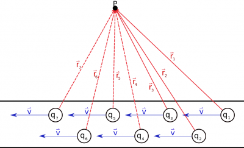
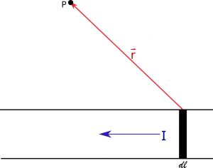
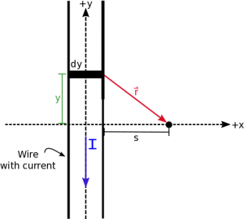

Now that we have talked about a single moving charge and permanent magnets, the next source of magnetic fields that we are going to consider is currents (either comprised of electrons or some other charged particle). This builds on what we learned about [moving charges and how they created magnetic fields](/empcubed/notes/week-09-magnetic-field-moving-point-charge/moving_q/) - since a current is simply many moving charges through a wire. When there are many charged particles that are moving, we could calculate the net magnetic field at a point from each individual charge using superposition. However, this gets tedious very quickly. Instead, we will use an integral to add up over all the charges and the definition of [current](/empcubed/notes/week-05-moving-charges-batteries/q_in_wires/#conventional_current_vs_electron_current) to re-write the Biot-Savart Law in terms of current and length, rather than charge and velocity. This integral description of the magnetic field is useful when the appropriate anti-derivative is known, but for some situations, we might have to resort to numerical integration (i.e., adding up the contributions of each segment of wire).



## Magnetic field from Many Charges

Magnetic field on point P from many moving charges in a wire

If we consider a straight wire with a steady current, there would be many moving charges everywhere in wire that would all contribute to the magnetic field outside of the wire. If we take a “snapshot” of what the wire would look like at any given time, there would be [charges moving somewhat haphazardly](/empcubed/notes/week-06-resistors-combinations/current/) through the wire. We continue to use the [Drude model](https://en.wikipedia.org/wiki/Drude_model) for these charges and *assume that we can model the wire with each charge moving with some average constant velocity in the wire*. The magnetic field at a point would then be the sum of the magnetic fields from each moving charge, each of which would be a different distance away from Point P:

$$
{\overset{\rightarrow}{B}}_{tot} = \frac{\mu_{0}}{4\pi}\frac{q_{1}\overset{\rightarrow}{v} \times \widehat{r_{1}}}{r_{1}^{2}} + \frac{\mu_{0}}{4\pi}\frac{q_{2}\overset{\rightarrow}{v} \times \widehat{r_{2}}}{r_{2}^{2}} + \frac{\mu_{0}}{4\pi}\frac{q_{3}\overset{\rightarrow}{v} \times \widehat{r_{3}}}{r_{3}^{2}} + ... = \Sigma_{i}\frac{\mu_{0}}{4\pi}\frac{q_{i}\overset{\rightarrow}{v} \times \widehat{r_{i}}}{r_{i}^{2}}
$$

Since we have many small charges that we are adding the field contributions from, we can turn the summation into an integral and the individual charges $q_{i}$ into $dq$:

$$
{\overset{\rightarrow}{B}}_{tot} = \int\frac{\mu_{0}}{4\pi}\frac{dq \cdot \overset{\rightarrow}{v} \times \widehat{r}}{r^{2}}
$$

Again this equation just says that we are going to add together the magnetic field contributions at a point from every charge ($dq$) that is moving in the wire.

Now we can rewrite the velocity in terms of the differential length and time: $\overset{\rightarrow}{v} = \frac{d\overset{\rightarrow}{l}}{dt}$. In other words, velocity is simply the change in displacement (or length) over a change in time.

$$
{\overset{\rightarrow}{B}}_{tot} = \int\frac{\mu_{0}}{4\pi}\frac{dq \cdot \frac{d\overset{\rightarrow}{l}}{dt} \times \widehat{r}}{r^{2}}
$$

Since $dt$ represents a small amount of time, $dl$ represents a small amount of length, and $dq$ represents a small amount of charge, we will treat these as independent and rewrite (much to the chagrin of our mathematician friends):

$$
dq \cdot \frac{d\overset{\rightarrow}{l}}{dt} = \frac{dq \cdot d\overset{\rightarrow}{l}}{dt} = \frac{dq}{dt} \cdot d\overset{\rightarrow}{l}
$$

So our magnetic field equation then becomes:

$$
{\overset{\rightarrow}{B}}_{tot} = \int\frac{\mu_{0}}{4\pi}\frac{\frac{dq}{dt} \cdot d\overset{\rightarrow}{l} \times \widehat{r}}{r^{2}}
$$

We can now use the definition of [current](/empcubed/notes/week-05-moving-charges-batteries/q_in_wires/#conventional_current_vs_electron_current) as the amount of charge passing a point per second ($I = \frac{dq}{dt}$) to give the Biot-Savart Law in terms of current instead of charge:

$$
{\overset{\rightarrow}{B}}_{tot} = \int\frac{\mu_{0}}{4\pi}\frac{I \cdot d\overset{\rightarrow}{l} \times \widehat{r}}{r^{2}}
$$

**Note that** $I$ **here is the conventional current, not the electron current**. Otherwise many of the pieces of this equation would be what you expected:

B field contribution of a little bit of length ($dl$) on point P

- The constant is the same as before (we haven't touched that)
- The current $I$ tells you about the amount of charge per second flowing through the wire. This is a scalar number with units of Amps where $A = \frac{C}{s}$.
- The length $d\overset{\rightarrow}{l}$ is now what we are integrating over - so we want to add up all the little bits of the wire that have current flowing through them. Since $d\overset{\rightarrow}{l}$ originally came from the velocity vector, $d\overset{\rightarrow}{l}$ should point in the same direction that the charges are moving in.
- The $\overset{\rightarrow}{r}$ (and relatedly $r$ and $\widehat{r}$) is then the separation vector that point between the $d\overset{\rightarrow}{l}$ (the source) and the observation location.
- The cross product between $d\overset{\rightarrow}{l}$ and $\widehat{r}$ will still give us a direction for the magnetic field that is perpendicular to the separation vector and the direction that the charges move.

We will go into detail about how to put the pieces of this equation together in an example; however, it is important to realize that this equation doesn't really tell us anything new - we are still saying that **moving charges will create magnetic fields that point in a perpendicular direction and can be calculated for every point in space around the charge**. We also did not make very many assumptions in this derivation - only that *we have many charges that are moving along the wire*. Thus, this is a general equation that can be used for any current.

## Magnetic Field from a Very Long Wire

Problem set up to find the magnetic field at a point from a very long wire

Let's look at a particular example of finding the magnetic field a distance $s$ away from a very long wire with some *constant, steady state current* I flowing from top to bottom. Since the wire is very long, we will *assume for our purposes that it stretches from* $+ \infty$ *to* $- \infty$ *in the y direction*. If we start with the general magnetic field equation for a current, then we can start to fill in the pieces.

$$
{\overset{\rightarrow}{B}}_{tot} = \int\frac{\mu_{0}}{4\pi}\frac{I \cdot d\overset{\rightarrow}{l} \times \widehat{r}}{r^{2}}
$$

We will plug in the $\widehat{r} = \frac{\overset{\rightarrow}{r}}{r}$ definition and pull the constants (including $I$) out of the integral:

$$
{\overset{\rightarrow}{B}}_{tot} = \frac{\mu_{0} \cdot I}{4\pi}\int\frac{d\overset{\rightarrow}{l} \times \overset{\rightarrow}{r}}{r^{3}}
$$

The $d\overset{\rightarrow}{l}$ is a little bit of length in the y-direction (just like what we did with electric field) but now it has a direction. Since the current goes from top to bottom, we would say the direction of the $d\overset{\rightarrow}{l}$ is down. So we can rewrite the $d\overset{\rightarrow}{l}$ as:

$$
d\overset{\rightarrow}{l} = \langle 0, - dy,0\rangle
$$

Then we can write the $\overset{\rightarrow}{r}$ as the separation vector that points from the source (the little bit of $d\overset{\rightarrow}{l}$) to the observation point. This works exactly the same way as [before with electric field](/empcubed/notes/week-04-modeling-distributions-of-charge/dq/#limits_on_the_integral). Using $\overset{\rightarrow}{r} = {\overset{\rightarrow}{r}}_{obs} - {\overset{\rightarrow}{r}}_{source}$, we can write ${\overset{\rightarrow}{r}}_{obs}$ and ${\overset{\rightarrow}{r}}_{source}$ as

$$
{\overset{\rightarrow}{r}}_{obs} = \langle s,0,0\rangle
$$

$$
{\overset{\rightarrow}{r}}_{source} = \langle 0,y,0\rangle
$$

$$
\overset{\rightarrow}{r} = \langle s,0,0\rangle - \langle 0,y,0\rangle = \langle s, - y,0\rangle
$$

We denote the ${\overset{\rightarrow}{r}}_{source}$ with a variable $y$ since the position of $d\overset{\rightarrow}{l}$ can change depending on where in the wire you are.

Using the Pythagorean theorem then the magnitude of $\overset{\rightarrow}{r}$ is simply:

$$
r = \sqrt{y^{2} + s^{2}}
$$

Finally, we want to integrate from $- \infty$ to $+ \infty$ since that is the full length of the wire. When we plug these into our magnetic field equation, we get:

$$
{\overset{\rightarrow}{B}}_{tot} = \frac{\mu_{0} \cdot I}{4\pi}\int_{- \infty}^{+ \infty}\frac{\langle 0, - dy,0\rangle \times \langle s, - y,0\rangle}{(y^{2} + s^{2})^{3/2}}
$$

The last step here is to take the cross product. Using the [general equation for a cross product](https://www.msuperl.org/wikis/pcubed/doku.php?id=183_notes:cross_product), we get:

$$
\langle 0, - dy,0\rangle \times \langle s, - y,0\rangle = \langle(0 \cdot ( - dy) - y \cdot 0),( - 0 \cdot 0 + s \cdot 0),(0 \cdot ( - y) - ( - dy) \cdot s)\rangle = \langle 0,0,s \cdot dy\rangle
$$

So the final set up for our magnetic field is:

$$
{\overset{\rightarrow}{B}}_{tot} = \frac{\mu_{0} \cdot I}{4\pi}\int_{- \infty}^{+ \infty}\frac{s \cdot dy}{(y^{2} + s^{2})^{3/2}}\widehat{z}
$$

If we plug this into Wolfram Alpha to do the integral, we get:

$$
{\overset{\rightarrow}{B}}_{tot} = \frac{\mu_{0} \cdot I}{4\pi}\frac{2s}{s^{2}}\widehat{z}
$$

$$
{\overset{\rightarrow}{B}}_{longwire} = \frac{\mu_{0} \cdot I}{2\pi s}\widehat{z}
$$

Now we can check the direction of our solution using the [right hand rule](/empcubed/notes/week-09-magnetic-field-moving-point-charge/rhr/). If you point your fingers on your right hand in the direction of $d\overset{\rightarrow}{l}$ (aka down) and curl them in the direction of the $\overset{\rightarrow}{r}$, your thumb will be pointing out of the page, which is positive $\widehat{z}$. If P was on the left of the wire instead of the right, we would get the magnetic field pointing *into* the page (or a $- \widehat{z}$) rather than out of the page. Try to confirm this using the right hand rule.

Note *this equation is only true for an infinitely long, straight wire with a constant current* because of the assumptions we made when setting up the problem. Although, it can work reasonably well as a model for a wire that is long compared to the distance from the wire at which you want to know the magnetic field. The direction of the magnetic field is inherently *assuming a positively charge current because I is the conventional current*.

### Examples

- [Magnetic Field from a Current Segment](/empcubed/examples/week10_current_segment/)
  - Video Example: Magnetic Field from a Current Segment
- [Challenge Example: Magnetic Field from a Ring of Current](/empcubed/examples/week10_current_ring/)
  - Video Example: Magnetic Field from a Ring of Current




