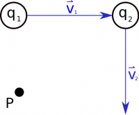

Two moving charges near point P

Superposition is central to understanding of all E&M fields and governs how all of these fields add up. That is, magnetic field vectors superpose just as you might expect. This means that if you have two moving charges, the magnetic field at any given point is given by the vector addition of the magnetic field due to one of the moving charges *plus* the magnetic field due to the other moving charge.

$$
{\overset{\rightarrow}{B}}_{total} = {\overset{\rightarrow}{B}}_{1} + {\overset{\rightarrow}{B}}_{2}
$$

This idea scales for as many moving charges as you have:

$$
{\overset{\rightarrow}{B}}_{total} = {\overset{\rightarrow}{B}}_{1} + {\overset{\rightarrow}{B}}_{2} + {\overset{\rightarrow}{B}}_{3} + {\overset{\rightarrow}{B}}_{4} + ...
$$

However, **if you have both electric and magnetic fields you *cannot* just add together the magnetic and electric fields.** These are different quantities with different units; therefore, they do not add together (this would be like trying to add time to mass - it's just not a thing you can do).


