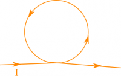
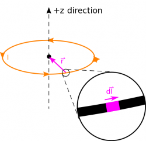
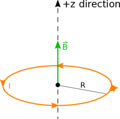
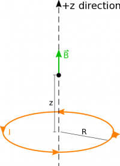

Thus far, we have primarily been talking about the magnetic field from a current in a long, straight wire. However, there are many shapes of wire in the real world that do not correspond to straight wires. Particularly relevant to this class will be a coil of wire and something we will call a solenoid. These notes go more into detail about what coils and solenoids are, and what the magnetic field looks like from both coils and solenoids.

## Coils

Current in a coil of wire

A coil is when a length of wire with current running through it has been wrapped around on itself creating some sort of shape as shown in the figure to the right. (You may also hear a coil referred to as a “current-carrying coil”, “a loop”, or “a ring”.) Typically, we will use circular coils because the mathematical calculations are easier for a circular coil, but you could also have a rectangular coil or some other shape. In these notes, we will focus on how to deal with the circular part of the wire, as we have already talked about how to [calculate the magnetic field from current in a straight wire](/notes/week-10-magnetic-field-of-a-wire/b_current/).

$dl$ in a coil

In a circular coil, the current through the wire would run either **clockwise or counter-clockwise around the loop**. If we wanted to calculate the magnetic field from that current, we could use the Biot-Savart Law

$$
{\overset{\rightarrow}{B}}_{tot} = \int\frac{\mu_{0}}{4\pi}\frac{I \cdot d\overset{\rightarrow}{l} \times \widehat{r}}{r^{2}}
$$

where the $d\overset{\rightarrow}{l}$ now would need to represent a small piece of the circular loop, rather than a small piece of the straight wire. This is shown in the figure above, where the circular coil now is drawn in the xy-plane and the z-direction points straight through the center of the coil.

Magnetic field in the center of a coil of wire

[The example below](https://www.msuperl.org/wikis/pcubed/doku.php?id=184_notes:examples:week10_current_ring) shows the calculation for the magnetic field at the center of a circular coil for a counterclockwise current. Because the circular coil is highly symmetric, we get a fairly simple answer for the magnetic field at the center of the coil (in the plane of the coil):

$$
\overset{\rightarrow}{B} = \frac{\mu_{0}I}{2R}\widehat{z}
$$

Which depends only on the current going through the coil $I$ and the radius of the coil $R$. The direction of the magnetic field comes from the cross product of the $\overset{\rightarrow}{r}$ with each $d\overset{\rightarrow}{l}$ in the coil, which we can check with the right hand rule. If you point your fingers in the direction of the current at any point on the coil and curl them toward the center of the circular coil, your thumb will always be pointing up in the $+ \widehat{z}$ direction. *Note this equation is only true for the magnetic field at the center of a circular coil* - if you have a different observation point or a different shape of coil, this equation will no longer give you an accurate magnetic field.

Magnetic field at a point above the coil

We could also calculate the magnetic field for an observation point at the center of the coil, but out of the plane of the ring (shown in the figure to the left). In this case, we would follow the same process as in [the example](https://www.msuperl.org/wikis/pcubed/doku.php?id=184_notes:examples:week10_current_ring); however, now the r-vector would have a z-component:

$$
\overset{\rightarrow}{B} = \frac{\mu_{0}I}{2}\frac{R^{2}}{(z^{2} + R^{2})^{3/2}}\widehat{z}
$$

Where $R$ is still the radius of the coil, $I$ is the current going around the loop, and $z$ is the distance away from the center of the loop. If you set $z = 0$ (in other words you put the observation point back at the center of the coil), you get the same equation as above. *Note this magnetic field is only true for an observation point at the center of the circular coil, but out of the plane of the ring* - if you have a different observation point or a different shape of coil, this equation will no longer give you an accurate magnetic field.

If you look at many observation points around a circular coil, there is a pattern to the magnetic field produced by that current - the field points through the center of the coil and then wraps around on the outside of the coil. This is shown in the figure below. For such a coil, the magnetic field is strongest in the center of the coil and has a smaller magnitude as you mov
