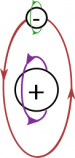
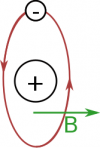
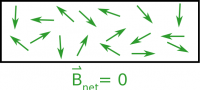
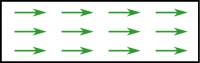
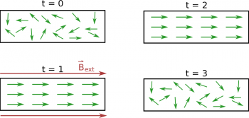
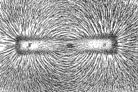
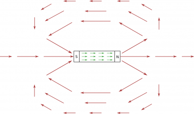
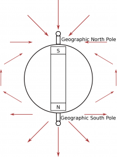
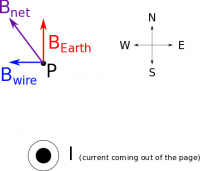

In addition to [moving charges](/notes/week-09-magnetic-field-moving-point-charge/moving_q/), another source of magnetic fields that we are going to talk about are permanent magnets. These are the magnets that probably you have seen, have experience with, and already know about (i.e. refrigerator magnets, the Earth, the traditional U-shaped magnets, etc.). While these are much more frequently used in everyday life, permanent magnets are actually quite complicated and are an area of current research. These notes will show how we simplify and model permanent magnets, their magnetic field vectors and how we can actually measure magnetic fields.



## Modeling Magnetic Materials

Motion of nucleus and electrons in an atom

In the last two pages of notes, we developed a fairly thorough understanding of how moving charges create magnetic fields. We will leverage this along with what we know about atoms to create a model of how materials can be turned into magnets.

In an atom, we know that there is a large, positive nucleus surrounded by the smaller, negative electrons, which are constantly moving around the nucleus. Since each electron has a charge, it produces a magnetic field as it moves around the nucleus (if we model the electron path as a counter-clockwise circle then using the [right hand rule](/notes/week-09-magnetic-field-moving-point-charge/rhr/), the magnetic field would point up). In addition to the electrons moving around the nucleus, the electron itself is spinning on its axis (much like how the Earth is spinning on its axis while traveling around the sun), which *also* creates a magnetic field. Finally, the protons within the nucleus can also spin on their axes, which also would create a magnetic field.

This means that within an atom there are at least 3 (more if there are more electrons/protons) sources of magnetic field simply from the way that the charged particles are moving. For each atom then, we can say that there is a net magnetic field that would point in a certain direction (typically represented by a small B-field arrow).

Net magnetic field on an atom

## Non-Magnetic Materials

Randomized magnetic fields sum to a net magnetic field of zero

If every atom has a magnetic field from its moving charges, why is *everything* not a magnet? For a non-magnetic material (like plastic, wood, glass, etc.) the direction of the magnetic field for every atom is randomized (shown in the figure to the right). When you take the add up the magnetic field vectors from all the atoms in the material, you get a net magnetic field of zero.

## Permanent Magnets

Magnetic fields from atoms point in the same direction in permanent magnets

In contrast to non-magnetic materials, permanent magnets (also called [ferromagnets](https://en.wikipedia.org/wiki/Ferromagnetism)) are materials where the magnetic fields from all the atoms point in (roughly) the same direction (seen in the figure above). This is usually accomplished by putting the material in a very strong magnetic field (typically from a large current rather than another ferromagnet). It is possible for the field from each of the atoms to start to randomize (or un-align themselves) but this generally takes a very long time for a permanent magnet. (There are also other kinds of magnetic materials besides ferromagnets, such as [diamagnets](https://en.wikipedia.org/wiki/Diamagnetism), [paramagnets](https://en.wikipedia.org/wiki/Paramagnetism), and [antiferromagnets](https://en.wikipedia.org/wiki/Antiferromagnetism) - but we won't talk about those in this class.)

## Induced Magnets

Magnetic field vectors in induced magnets with time

There are also some materials that will become “temporary magnets” if exposed to a magnetic field. In this case the material starts out with randomized magnetic fields from its atoms. When this material is placed near a strong external magnetic field the fields from all the atoms start to align with that external field. When the external magnetic field is taken away, the magnetic fields from the atoms remain aligned for some time before returning to their randomized directions. You may have seen this when you place a nail near a strong magnet. The nail will become a magnet for a time and be able to pick up other nails; however it does not remain a magnet indefinitely.

For a demonstration of how you can create a temporary magnet, [you can check out this youtube video](https://www.youtube.com/watch?v=1vQDlB-0mC8).

## Magnetic Field from a Bar Magnet

Magnetic field modeled by iron filings around a bar magnet

One kind of magnet that we will refer to often is a bar magnet, which usually refers to a straight rectangular ferromagnet with a constant, strong magnetic field (whereas a permanent magnet can generally have more varied shapes - like a disk, u-shape, coil, etc.). Since a bar magnetic is generally a ferromagnet, this means that all the little magnetic fields from the atoms are aligned and point in the same direction, resulting in a larger, net magnetic field outside the material. If you happen to drop some iron filings around a bar magnet, the filings will align themselves with the net magnetic field of the bar magnet (shown to the side) so you can actually physically see the shape of the magnetic field.

Magnetic vector field about a permanent bar magnet

Since the magnetic field is a vector field, *it has both a magnitude and a direction at every location in space*, which we can represent with an arrow at various points around the magnet. Closer to the poles of the magnet, the field is much stronger, which we represent with longer arrows. By convention, we say that the direction of the magnetic field points away from the north pole and in towards the south pole outside of the magnet (note that the magnetic fields from the atoms inside the magnet point from the south pole to the north pole). So in lieu of carrying iron filings around with us, we represent the magnetic field of bar magnet as shown in the figure. (You may notice that these magnetic field lines look very similar to those of an [electric dipole](/notes/week-03-electric-force-energy/pc_force/).)

## Measuring Earth's Magnetic Field and other Magnetic Fields

One of the most important magnetic fields (that we actually model as a giant bar magnet) is [Earth's magnetic field](https://en.wikipedia.org/wiki/Earth%27s_magnetic_field). Geophysicists believe that the source of the Earth's magnetic field are currents generated in conductive material in the Earth's core. This is particularly important when we are trying to measure a magnetic field, since all measurements are taken on Earth and will (in some way) have to include Earth's field. We have already mentioned that Earth's magnetic field is relatively small at ~$10^{- 5}T$. If the magnetic field that you are measuring is large, then Earth's magnetic field may be negligible; however, if it is small, you may need to consider Earth's field more carefully in your assumptions.

Direction of earth's magnetic field

In terms of the Earth's magnetic field, the magnetic south pole is actually located at the geographic north pole (and the magnetic north pole is at the geographic south pole). This should make some sense if you think about the direction that a compass points. A compass is simply a very small bar magnet that will try to align itself with the net magnetic field that it is in. If you hold a compass away from any permanent magnets or large pieces of metal, the needle on the compass will point north (as in the cardinal direction north). Since the north end of the compass will point towards the geographic north, that must mean that the magnetic south pole of the Earth is in the northern hemisphere - the magnetic north pole of the compass will be attracted to the magnetic south pole of the Earth. The Earth's magnetic field then will point away from the magnetic north pole and toward the magnetic south pole, just like the bar magnets above.

Earth's magnetic field plays a role in general magnetic field calculations

Since Earth's field is relatively constant, we can actually use Earth's magnetic field to measure the magnetic field from other sources. So say we have a current that runs perpendicularly to Earth's B-field (shown as out of the page/screen in the figure). If we consider a point above the wire (Point P), the Earth's magnetic field will (always) point toward the geographic north. However, the current will produce a B-field at Point P that points to the west (or $- \widehat{x}$) using the right hand rule (point your fingers out of the page then curl them toward Point P - your thumb should be pointing to the left). So if we put the compass at Point P, we would expect it to point in the direction of the ***net*** magnetic field (or to the north west in this case). The example below will go into more detail about how we can use that to calculate the size of the magnetic field from the wire.

### Examples

- [Using the Earth's Magnetic Field for Measurements](/empcubed/examples/week9_earth_field/)
  - Video Example: Using Earth's Magnetic Field for Measurements


