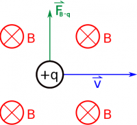
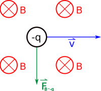

We'll start thinking about the magnetic force in terms of the simplest case: a single moving charge through an external magnetic field. The source of the external magnetic field could be another moving charge, a current, a bar magnet or any combination of those. Most of the time though, we will concern ourselves with how the charge interacts with the field (whatever it may be) and we will not care as much about what produces that magnetic field. These notes will describe how we can calculate the force from the magnetic field, including the magnitude and direction of that force.



## Magnetic Force Equation

Mathematically, the magnetic force on a moving charge from an *external* magnetic field is given by:

$$
{\overset{\rightarrow}{F}}_{B \rightarrow q} = q\overset{\rightarrow}{v} \times \overset{\rightarrow}{B}
$$

where:

- ${\overset{\rightarrow}{F}}_{B \rightarrow q}$ is the force *on* the charge *by* the external magnetic field (units: $N$).
- q is the charge of the moving object (units: $C$).
- $\overset{\rightarrow}{v}$ is the velocity that the charge is moving with (units: $\frac{m}{s}$). Note that this is the velocity, not the speed, so this includes the direction.
- $\overset{\rightarrow}{B}$ is the external magnetic field, both the magnitude and direction (units: $T$).

The last piece that is missing here is the cross product, which tells us about the direction of the magnetic force. [Just like before when we talked about the cross product](/empcubed/notes/week-01-charges-field-potential/math_review/#vector_multiplication), the cross product is a way to multiply vectors that gives you a perpendicular vector as the product. In this case, this means that the **magnetic force is perpendicular to the magnetic field AND to the velocity**. This may seem a little counter-intuitive, but it is an important property of the magnetic field.

In terms of calculating the magnetic force, there are a couple of ways that we can go about the math. If you know the vector components of the velocity and magnetic field, one method you can use is the general [cross product](https://www.msuperl.org/wikis/pcubed/doku.php?id=183_notes:cross_product) equation to calculate the force. This method will always work and will give you each of the components of the force, but it can be cumbersome to actually write out each component sometimes. In the other method, we can simplify the cross product to give us a magnitude of the force and we can use the [Right Hand Rule](/empcubed/notes/week-09-magnetic-field-moving-point-charge/rhr/) to figure out the direction.

## Magnitude of the Magnetic Force

We can find the magnitude of any general cross product using $|\overset{\rightarrow}{a} \times \overset{\rightarrow}{b}| = |\overset{\rightarrow}{a}||\overset{\rightarrow}{b}|sin(\theta)$ where $\theta$ is the angle between $\overset{\rightarrow}{a}$ and $\overset{\rightarrow}{b}$. In terms of the magnetic force then, we can find the magnitude by using:

$$
F = qvBsin(\theta)
$$

where F is the magnitude of the force, $q$ is the charge, $v$ is magnitude of the velocity (speed), and $B$ is the magnitude of the magnitude field. $\theta$ then is angle between the velocity of the charge and the magnetic field. This equation is often much easier to use and think about, but *it does not tell us anything about the direction of the force* - **only the magnitude**.

## Direction of the Magnetic Force

Just like we did with the [Biot-Savart Law](/empcubed/notes/week-09-magnetic-field-moving-point-charge/moving_q/) in this weeks notes, we can use the [right hand rule](/empcubed/notes/week-09-magnetic-field-moving-point-charge/rhr/) to think about the direction of the magnetic force. To use the right hand rule, remember that you point the fingers on your right hand in the direction of the first vector in the cross product and curl them toward the direction of the second vector. Then if you stick out your thumb that will be the direction of the cross product. For the magnetic force then, you point your fingers in the direction of the velocity, then curl them toward the direction of the magnetic field, and your thumb will point in the direction of the force.

RHR used to find resulting magnetic force on a moving positive charge

Magnetic force produced on a negative charge is opposite to that produced on a positive charge. Be careful with the RHR!

For example, if the charge is moving to the right ($+ \widehat{x}$ direction) through a magnetic field that points into the page ($- \widehat{z}$ direction), you should find that the force on the charge points up ($+ \widehat{y}$ direction). Note that **the right hand rule works for positive charges** - if the charge is negative, you have to either remember to flip the direction of the force at the end (i.e. the force would point in the $- \widehat{y}$ direction if the charge was negative) or use your *left hand* (but the same process - fingers still point in the direction of the velocity and curl toward the B-field).

### Examples

[Magnetic Force on a Moving Charge](/empcubed/examples/week10_force_on_charge/)
