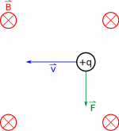
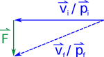
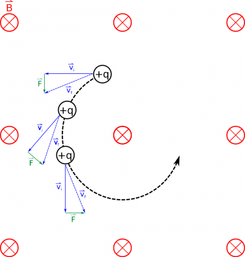

We just talked about the force that a moving charge feels when it travels through a magnetic field. So now the question remains: what happens to the charge when it feels this force? Since the magnetic force is perpendicular to the velocity of the charge, **we will show that the charge actually begins to move in a circular pattern.**



## Path of the Moving Charge

Force felt by a charge moving through a B field in the -x direction

Let's start by considering a charge moving to the left ($- \widehat{x}$ direction) in a magnetic field that points into the page ($- \widehat{z}$ direction). Using the right hand rule, we can figure out that the force on this charge is down ($- \widehat{y}$ direction). So what does this mean for the path of our charge? We can use the [momentum principle](/pcubed/notes/week-02-modeling-motion-net-force/momentum_principle/) to help us figure it out. The momentum principle says that:

$$
\Delta\overset{\rightarrow}{p} = {\overset{\rightarrow}{p}}_{f} - {\overset{\rightarrow}{p}}_{i} = {\overset{\rightarrow}{F}}_{net,avg}\Delta t
$$

where momentum is simply $\overset{\rightarrow}{p} = m\overset{\rightarrow}{v}$ (meaning momentum points in the same direction as velocity). We can rewrite the momentum principle into it's “update form” by saying:

$$
{\overset{\rightarrow}{p}}_{f} = {\overset{\rightarrow}{F}}_{net,avg}\Delta t + {\overset{\rightarrow}{p}}_{i}
$$

Force changes the direction of the velocity

This means that if our magnetic force is pushing the charge down for a short time, the velocity of the charge will then point slightly down. If we do the same process at the next location and the next location (it turns out a computer is pretty good at doing these calculations), we find that **the charge will move in a circle**, with the magnetic force always pointing toward the center of the circular path. It turns out that this is a perfect example of [uniform circular motion](/pcubed/notes/week-03-newtonian-gravitation/ucm/).

## Work Done

Trajectory of a particle moving through a constant magnetic field at a constant speed

You may be wondering if there is a magnetic potential energy associated with the magnetic field (after all [we did use the electric force to get to electric potential energy](/notes/week-03-electric-force-energy/pc_energy/)). We can figure this out by first looking at the work done by the magnetic field on the charge. Remember that [the general equation for work](/pcubed/notes/week-07-energy-transfer/work_by_nc_forces/) is given by:

$$
W_{total} = \int_{i}^{f}\overset{\rightarrow}{F} \cdot d\overset{\rightarrow}{r}
$$

In this case, the force is the magnetic force, which we have already said points perpendicular to the path ($d\overset{\rightarrow}{r}$) at every point in the circle.

$$
W_{B} = \int_{i}^{f}{\overset{\rightarrow}{F}}_{B} \cdot d\overset{\rightarrow}{r}
$$

Since the dot product is between the magnetic force and the path direction, and because those vectors are perpendicular, this tells us that **the work done by the magnetic field is actually zero**.

$$
W_{B} = 0
$$

This is an important result because this tells us that **there is no change in the energy of the particle.** In other words, the magnetic force **only changes the direction of the moving charge - it does not slow down or speed up as it travels through the magnetic field** (unless there is a non-magnetic force also acting on it). The magnetic field can only turn a charge not accelerate it.

This also means that we do not have a way to define a magnetic potential or a magnetic potential energy in the same way that we did with electric fields. It turns out that we can define a [vector potential](https://en.wikipedia.org/wiki/Vector_potential), which you may talk about in your future courses.

## Examples

- [Radius of Circular Motion in a Magnetic Field](/examples/week10_radius_motion_b_field/)
- 

<!-- -->

- 
