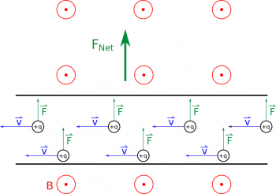
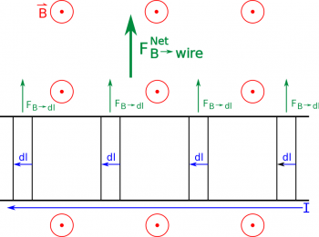
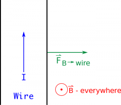

Since we deal with currents on a daily basis in all of electronics, it is particularly important and relevant to consider the force on a current-carrying wire. These notes will step through how get from the magnetic force on a single moving charge to the force on a current.



## Force on a little chunk

If we think about a long straight wire with a *steady state current*, we can model this simply as many moving charges in a wire. When that wire is placed in an external magnetic field (from some other source - either another wire or permanent magnet), each of the moving charges would feel a force. Collectively, this results in a net force on the wire by the magnetic field.

Current carrying wire in an external magnetic field

To calculate this magnetic force on the wire, we follow a very similar set of steps. We can start by dividing the wire into little chunks and only thinking about the amount of moving charge in that little chunk. Since we are interested in the small bit of force on the little bit of moving charge in that piece of the wire, we could write this as:

$$
d\overset{\rightarrow}{F} = dq\overset{\rightarrow}{v} \times \overset{\rightarrow}{B}
$$

where $dq$ is the small amount of charge in the little piece of the wire, $\overset{\rightarrow}{v}$ is the speed with which that small bit of charge is moving (units of $\frac{m}{s}$, and $\overset{\rightarrow}{B}$ is the external magnetic field (units of $T$).

However, especially for wires, it is often more useful to think about the current in that piece rather than the individual moving charges. So to rewrite this in terms of current, we start by rewriting the velocity in terms of the length and time ([just like we did before](/notes/week-10-magnetic-field-of-a-wire/b_current/)) $\overset{\rightarrow}{v} = \frac{d\overset{\rightarrow}{l}}{dt}$. So we get the force from the small piece of the wire to be:

$$
d\overset{\rightarrow}{F} = dq\frac{d\overset{\rightarrow}{l}}{dt} \times \overset{\rightarrow}{B}
$$

Then, since $dt$ represents a small amount of time, $dl$ represents a small amount of length, and $dq$ represents a small amount of charge, we will treat these as independent and rewrite:

$$
dq \cdot \frac{d\overset{\rightarrow}{l}}{dt} = \frac{dq \cdot d\overset{\rightarrow}{l}}{dt} = \frac{dq}{dt} \cdot d\overset{\rightarrow}{l}
$$

This means the magnetic force on the small piece of wire can be written as:

$$
d\overset{\rightarrow}{F} = \frac{dq}{dt}d\overset{\rightarrow}{l} \times \overset{\rightarrow}{B} = Id\overset{\rightarrow}{l} \times \overset{\rightarrow}{B}
$$

using the fact that $\frac{dq}{dt}$ is the definition of conventional current (the amount of charge passing a point per second).

Magnetic Force, F, produced on a current carrying wire in an external magnetic field, B

This means that the small amount of force on the wire is given by:

$$
d\overset{\rightarrow}{F} = Id\overset{\rightarrow}{l} \times \overset{\rightarrow}{B}
$$

where I is current in the little piece of the wire, $d\overset{\rightarrow}{l}$ is the little bit of length that you are interested in (and it is a vector so it points in the direction of the current), and $\overset{\rightarrow}{B}$ is the external magnetic field that the wire is in.

Note: that the force is still given by the cross product between the $d\overset{\rightarrow}{l}$ and the $\overset{\rightarrow}{B}$, so the force on the piece of wire is *still* perpendicular to both the direction of the moving charges ($d\overset{\rightarrow}{l}$) and perpendicular to the magnetic field ($\overset{\rightarrow}{B}$). This means we can still use the [right hand rule](/notes/week-09-magnetic-field-moving-point-charge/rhr/) to figure out the direction of the $d\overset{\rightarrow}{F}$.

## Force on the whole wire

Now that we have the magnetic force on a small piece of the wire, we can find the total force on the wire from the external magnetic field by adding up the contributions from each little piece of the wire. Since we have the small bit of force from the small bit of wire, we will add these using an integral:

$$
{\overset{\rightarrow}{F}}_{wire} = \int_{wire}^{}d\overset{\rightarrow}{F} = \int_{l_{i}}^{l_{f}}Id\overset{\rightarrow}{l} \times \overset{\rightarrow}{B}
$$

Here we want to pick the limits of the integral to be from the starting point of the wire ($l_{i}$) to the end of the wire ($l_{f}$) so we are adding up over the whole length of the wire. This form of the force will *always* work to find the magnetic force on the whole wire - we have not made very many assumptions so far in coming up with this equation.

However, if we do make a few assumptions we can simplify this equation significantly. We will start by *assuming that the current in the wire is constant and in a steady state*. This allows us to pull the current out of the integral as a constant, leaving:

$$
{\overset{\rightarrow}{F}}_{wire} = I\int_{l_{i}}^{l_{f}}d\overset{\rightarrow}{l} \times \overset{\rightarrow}{B}
$$

Next we want to [simplify the cross product](/notes/week-01-charges-field-potential/math_review/) in terms of the magnitude of the two vectors and the angle between them ($\theta$); however, this will give us only the magnitude of the magnetic force, rather than the magnitude and direciton.

$$
|{\overset{\rightarrow}{F}}_{wire}| = I\int_{l_{i}}^{l_{f}}B \cdot dlsin(\theta)
$$

If we *assume that the wire is straight (no bends or curves)*, then the angle $\theta$ between the length of wire and the magnetic field will be constant, so we can pull the $sin(\theta)$ out of the integral. If we also *assume the magnetic field is constant along the length of the wire*, then we can also pull the $B$ out of the integral.

$$
|{\overset{\rightarrow}{F}}_{wire}| = IBsin(\theta)\int_{l_{i}}^{l_{f}}dl
$$

This leaves only the integral of $dl$. When we take the integral of $dl$ over the whole length of the wire, we are left with the total length of wire that we are considering. So we get:

$$
|{\overset{\rightarrow}{F}}_{wire}| = IBLsin(\theta)
$$

Use the right hand rule to determine the direction of the magnetic force F

where |$\overset{\rightarrow}{F}_{wire}$| is the magnitude of the force on the whole wire, $I$ is the current through the wire, $B$ is the *external* magnetic field, $L$ is the length of the wire, and $\theta$ is the angle between the magnetic field and the length of the wire. *Remember though that this equation is only good for straight wires with constant current that are in a constant magnetic field - because of all the assumptions that we made to get to this point.*

To find the direction of the magnetic force, we will need to use the [right hand rule](/notes/week-09-magnetic-field-moving-point-charge/rhr/). Just like we did with the moving charge, you point your fingers in the direction of the moving charges (or rather in the direction of the current/$d\overset{\rightarrow}{l}$), then curl your fingers in the direction of the external magnetic field. Your thumb then points in the direction of the force.

For example, if you have a wire with current going in the $+\hat{y}$ direction that is placed in a magnetic field that points out of the page, then the force on the wire would point down (in the $+\hat{x}$ direction).

## Examples

- [Magnetic Force between Two Current-Carrying Wires](/empcubed/examples/week12_force_between_wires/)
  - Video Example: Magnetic Force between Two Current-Carrying Wires
- [Force on a Loop of Current in a Magnetic Field](/empcubed/examples/week12_force_loop_magnetic_field/)
  - Video Example: Force on a Loop of Current in a Magnetic Field




