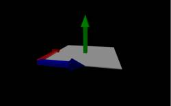
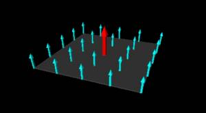
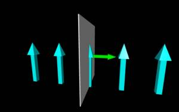

In these notes, we will start thinking the right hand side of Faraday's Law (the $\frac{d\Phi_{B}}{dt}$ part) and what it means to have a changing magnetic flux. Let's start by defining what flux is.

In general, any sort of **flux is how much of something goes through an area**. For example, we could think of a child's bubble wand in terms of the air flux (from you blowing) through the circle (with the bubble solution in it). If you wanted to make bigger bubbles or make many more bubbles, you could do two things: increase the air flow or get a bubble wand with a bigger circle. Both of these actions (increasing the area and increasing the amount of air) will result in a larger “air flux” through the bubble wand. It's probably worth mentioning that we have assumed that you are holding the bubble wand so the circle is perpendicular to the air flow. If instead you rotate the wand 90 degrees, you will not get any bubbles since there is no air that is actually going through the circle part of the bubble wand. So the air flux not only depends on the amount of air and the area of circle, but also on how those two are oriented relative to each other. The idea of flux can be useful in many different contexts (i.e. fluids, electricity, air, etc.), but for any kind of flux, these are still the three conditions that matter: (1) the strength/amount, (2) the area, and (3) the orientation.

Therefore **magnetic flux is the strength of the magnetic field on a surface area or rather the amount of the magnetic field that goes through an area.** For magnetic flux, we need to consider: the strength of the magnetic field, the area that the field goes through, and the orientation of the magnetic field relative to the area. These notes will introduce the mathematics behind magnetic flux, which we will use in Faraday's Law.



## Magnetic Flux

Area Vector is perpendicular to the surface.

[Just like we did before with electric flux](https://www.msuperl.org/wikis/pcubed/doku.php?id=184_notes:e_flux), we will say that magnetic flux is the strength of the *magnetic field* over an area or rather the amount of *magnetic field* that goes through an area. How the magnetic field is oriented relative to the area does matter so we will [again want to treat the area as vector](https://www.msuperl.org/wikis/pcubed/doku.php?id=184_notes:e_flux#area_as_a_vector). This is very similar to how we defined the [electric flux](https://www.msuperl.org/wikis/pcubed/doku.php?id=184_notes:e_flux) before. Mathematically, we represent the magnetic flux as:

$$
\Phi_{B} = \overset{\rightarrow}{B} \bullet \overset{\rightarrow}{A}
$$

Flux through a horizontal plane (where dA is parallel to the magnetic field)

where $\Phi_{B}$ is the magnetic flux (with units of $T \cdot m^{2}$), $\overset{\rightarrow}{B}$ is the magnetic field and $\overset{\rightarrow}{A}$ is the area vector. **The area vector in this case is the vector that has the same magnitude as the area (i.e. length times width for a rectangular area or** $\pi r^{2}$ **for a circular area) and has a direction that is perpendicular to the area**, which is represented by the green arrow in the figure to the right. (This is exactly the same as with electric flux). You may notice that there are actually two different vectors that are perpendicular to the gray surface. We've drawn the green arrow in the $+ y$ direction, but we could have also picked the vector that points in the $- y$ direction. For an open surface, it doesn't matter which of the perpendicular vectors you pick, as long as you are consistent after you pick one.

The dot product between the $\overset{\rightarrow}{B}$ and the $\overset{\rightarrow}{A}$ then tells you about the direction the magnetic field points relative to the area. Mathematically, we can simplify the dot product by saying:

$$
\Phi_{B} = |\overset{\rightarrow}{B}||\overset{\rightarrow}{A}|cos(\theta)
$$

where $\theta$ is the angle between the magnetic field and the area vector. This should also make some physical sense. As shown in the top figure to the left, if the magnetic field (shown in blue arrows) and area vector (red arrow) point in the same direction, then the dot product turns into a simple multiplication and $cos(\theta) = 1$. If we look at the figure, there are lots of magnetic field arrows poking through the surface, so we'd expect a large magnetic flux. As shown in the bottom figure to the left, if the magnetic field (blue arrows) points perpendicular to the area vector (green arrow), then the dot product gives a zero since $cos(90) = 0$. If we look at the figure, we see this result as well because none of the magnetic field arrows actually go through the surface.

Flux through a vertical plane (where dA is perpendicular to the magnetic field)

(As a side note, this technically gives you the magnitude of the flux. Flux can be positive or negative and that depends on how the area vector points relative to the magnetic field vectors. This is discussed further in the [page of notes on directions](/notes/week-13-em-so-far-flux-shortcuts/induced_current/).)

In writing the magnetic flux above, we have made an *assumption that the area vector points in the same direction everywhere on the surface* (or rather that the area we are considering is flat rather than curved). If instead the surface is curved we would need to write the magnetic flux in terms of a very small area and then add the flux through each of those small areas together. Mathematically, we would do this with an integral:

$$
\Phi_{B} = \int\overset{\rightarrow}{B} \bullet d\overset{\rightarrow}{A}
$$

## Changing Magnetic Flux

As you saw in the demo video, just having a magnetic flux is not enough though - **to drive a current, the magnetic flux must be changing**. Mathematically, we write this change as a change in the magnetic flux over a change in time. Namely:

$$
\frac{d\Phi_{B}}{dt}
$$

*If we assume that the change is happening at a constant rate*, we can write this in terms of large changes (using deltas) - $\frac{\Delta\Phi_{B}}{\Delta t}$. In this case, we only care about the initial and final flux relative to the initial and final time:

$$
\frac{\Delta\Phi_{B}}{\Delta t} = \frac{\Phi_{Bf} - \Phi_{Bi}}{t_{f} - t_{i}}
$$

If the change in flux is not happening at a constant rate, we then have to consider the instantaneous change in flux using the differential form: $\frac{d\Phi_{B}}{dt}$.

There are many ways that the magnetic flux could be changing - the size of the magnetic field could be increasing/decreasing, the size of the area could be getting bigger/smaller, the angle between the magnetic field and the area could be changing, or even some combination of these factors. The examples below go through a couple of these cases to show how you could calculate the change in the magnetic flux.

### Examples

[Review of Flux through a Loop](/examples/week12_flux_examples/)

[Flux Through a Changing, Rotating Shape](/examples/week12_changing_shape/)
