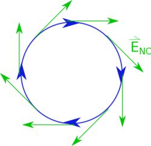

Now that we have talked about the changing magnetic flux part of Faraday's law, we should go back to the right hand side and talk about the curly electric field (the $\int{\overset{\rightarrow}{E}}_{nc} \bullet d\overset{\rightarrow}{l}$ part). It is tempting to say that because we are integrating an electric field along a distance, this part of the equation would give you the electric potential. This would be true if we were integrating $\overset{\rightarrow}{E}$ and not ${\overset{\rightarrow}{E}}_{nc}$, but the fact that this electric field is curly means we are dealing with something else that we will call induced voltage ($V_{ind}$). These notes will discuss what we mean by $V_{ind}$, how that relates to the electric field and the corresponding current, and where the negative sign comes from.



## Induced Voltage and the Electric Field

We know from Faraday's Law that a changing magnetic flux will create a curly electric field. If we put a loop of wire nearby, we can add up the little bits of length along that loop with the curly electric field, which tells us how curly that electric field is. (This is very similar to what we did with [Ampere's Law](https://www.msuperl.org/wikis/pcubed/doku.php?id=184_notes:loop).) The units of this integral ($\int{\overset{\rightarrow}{E}}_{nc} \bullet d\overset{\rightarrow}{l}$) will give us the same units of electric potential (volts) - $\frac{V}{m} \cdot m = V$. However, because we have curly electric field from the changing magnetic flux, this is not technically an electric potential. (When we defined the electric potential *we made an assumption that all the charges were stationary or not moving,* ***which is no longer the case.)***

The curly electric field around a loop

So instead we will define this quantity as the **induced voltage**.

$$
V_{ind} = \int{\overset{\rightarrow}{E}}_{nc} \bullet d\overset{\rightarrow}{l}
$$

where the induced voltage is adding up the curly electric field around a loop.

Perhaps more intuitively, we can also define the $\int{\overset{\rightarrow}{E}}_{c} \bullet d\overset{\rightarrow}{l}$ in terms of the current induced in the wire since the curly electric field in the loop will push the charges and create a current. **We will refer to the current produced by the non-Coulombic electric field as the “induced current”**. This is not to be confused with the conventional current or just normal current that we talked about before, which has surface charges producing the field that pushes th
