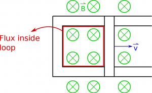
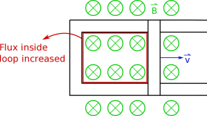
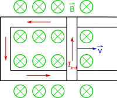
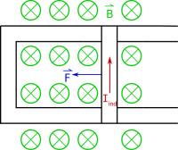

Now that we have talked about the changing magnetic flux part of Faraday's law, we should go back to the right hand side and talk about the curly electric field (the $\int{\overset{\rightarrow}{E}}_{nc} \bullet d\overset{\rightarrow}{l}$ part). It is tempting to say that because we are integrating an electric field along a distance, this part of the equation would give you the electric potential. This would be true if we were integrating $\overset{\rightarrow}{E}$ and not ${\overset{\rightarrow}{E}}_{nc}$, but the fact that this electric field is curly means we are dealing with something else that we will call induced voltage ($V_{ind}$). These notes will discuss what we mean by $V_{ind}$, how that relates to the electric field and the corresponding current, and where the negative sign comes from.



## Induced Voltage and the Electric Field

We know from Faraday's Law that a changing magnetic flux will create a curly electric field. If we put a loop of wire nearby, we can add up the little bits of length along that loop with the curly electric field, which tells us how curly that electric field is. (This is very similar to what we did with Ampere's Law.) The units of this integral ($\int{\overset{\rightarrow}{E}}_{nc} \bullet d\overset{\rightarrow}{l}$) will give us the same units of electric potential (volts) - $\frac{V}{m} \cdot m = V$. However, because we have curly electric field from the changing magnetic flux, this is not technically an electric potential. (When we defined the electric potential *we made an assumption that all the charges were stationary or not moving,* ***which is no longer the case.)***

The curly electric field around a loop

So instead we will define this quantity as the **induced voltage**.

$$
V_{ind} = \int{\overset{\rightarrow}{E}}_{nc} \bullet d\overset{\rightarrow}{l}
$$

where the induced voltage is adding up the curly electric field around a loop.

Perhaps more intuitively, we can also define the $\int{\overset{\rightarrow}{E}}_{c} \bullet d\overset{\rightarrow}{l}$ in terms of the current induced in the wire since the curly electric field in the loop will push the charges and create a current. **We will refer to the current produced by the non-Coulombic electric field as the “induced current”**. This is not to be confused with the conventional current or just normal current that we talked about before, which has surface charges producing the field that pushes the current.

Using the familiar Ohm's law, we can say that

$$
V_{ind} = I_{ind}R = \int \vec{E}_{nc} \bullet d\vec{l}
$$

Where $I_{ind}$ is the current that is created in the loop of wire and R is the resistance of that wire. When we put this together with the rest of Faraday's law, this means that we can write this equation in three different ways:

$$
\begin{aligned}
\int \vec{E}_{nc} \bullet d\vec{l} &= -\frac{d\Phi_B}{dt} \\
V_{ind} &= -\frac{d\Phi_B}{dt} \\
I_{ind}R &= -\frac{d\Phi_B}{dt}
\end{aligned}
$$

Depending on what you want to focus on or calculate you may pick one of these equations, but they are saying the exact same thing.

## Why do we need the negative sign?



Initial flux through loop

When we're talking about Faraday's Law, the negative sign plays an important role. It must be there to satisfy momentum and energy conservation, which we'll talk about in the next few paragraphs. If we think about the third equation above, the negative sign says that **the induced current generates a magnetic field that will be in the direction that opposes the change in magnetic flux**. The curly electric field that the changing magnetic flux generates points in the same direction as this current. This should make some intuitive sense because the conventional current always points in the same direction as the electric field that is driving it. However, we generally talk about the direction of the induced current (rather than the electric field or induced voltage) since it make more intuitive sense and is easier to measure.

Increasing Flux

As an example of how to figure out which direction the induced current flows, let's say we have a bar that is sliding down a pair of connected conductive rails (so current is free to flow through the loop created by the bar and rails), which is sitting in a magnetic field that points into the page (shown in the top figure to the right). Initially there would be some magnetic flux through the loop. At a later time (shown in the second picture to the right), after the bar has moved down the rails, there would be a larger magnetic flux through the loop because the area of the loop will have increased. Since the magnetic flux increased, we know that there should be an induced current in the loop - but what direction should it flow around the loop?

Direction of induced current, magnetic field, and the velocity vector

Let's suppose that the induced current flows counter-clockwise in the loop (shown in the figure above). If we use our original right hand rule for magnetic force ($\vec{F} = \int I d\vec{l} \times \vec{B}$), we should get a force on the bar that points in the negative x-direction. This means that the magnetic force on the induce current would act to *slow down* the moving bar. With the bar slowing down, this is actually good for energy conservation. It means that we have to put energy into the system to keep the bar moving, and in turn that mechanical energy is turned into electrical energy by inducing a current. If you stopped moving the moving the bar, it would eventually slow down and come to rest. This tells us by energy conservation - the induced current should flow counter-clockwise around the loop. If we had instead hypothesized that the induced current flowed in a clockwise direction, we would instead get a force in the +x direction. This would mean that the bar would continually speed up, which induces more current, which then causes the bar to speed up even more! This would completely break energy conservation and mean that you are essentially creating energy out of nothing. This simply cannot happen. So we know that the induced current must be counter-clockwise in our loop.

Determining the direction of the induced current just based on the magnetic flux can be tricky because there are a lot of different parts to the equation. In the next page of notes, we will walk through a **new right hand rule** for the induced current step-by-step.

Resulting magnetic force, F

## Examples

[Decreasing Flux](/examples/week12_decreasing_flux/)
