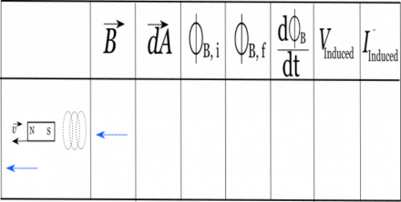
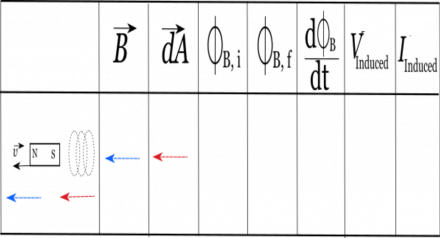
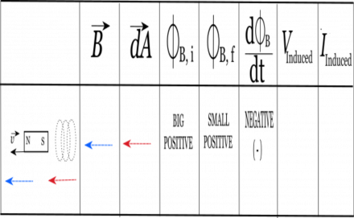
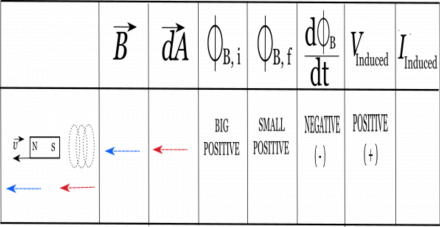
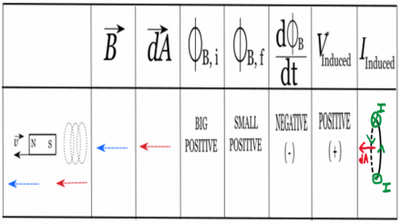

So far, we've been talking about the different pieces of Faraday's Law - namely how a changing magnetic flux will create an induced current. In this page of notes, we will outline the steps that we need to take to determine the direction of the induced current, which are based off of Faraday's Law itself:

$$
V_{ind} = - \frac{d\Phi_{B}}{dt}
$$

We will use the example of a bar magnet moving away from a wire coil to highlight these steps and to show how you can use a table to keep track of your work. While the specifics of the table will change depending on the context, the structure and steps will work no matter what problem you are solving. So to get started you should make a table like the one shown to the right with 8 columns. The first column will be for a picture/diagram of your situation, the second will be for the B-field direction, the third will be for the dA direction, the fourth will be for your initial magnetic flux, the fifth will be for the final magnetic flux, the sixth will be the change in magnetic flux, the seventh will be for your induced voltage, and the eighth will be for your induced current.

This is the table used for predicting the directional of the induced current.

This video will walk you through an example of how to use this table or you can read about it in the notes below.



**NOTE: In this chart there is a mistake in the chart being used: The variables “V” and “I” are not vectors. Please make a note of this when watching the video to ensure there is no confusion.**

## Right Hand Rule Steps

## Step 1.) Draw a picture of your situation

Before anything, you should start with a picture of your situation. We'll draw this in the first column of the table. For our example, we'll have a bar magnet that is moving away from a set of coils. In the picture, we have marked the coils, the orientation of the magnet (which side is north/south), and which way the magnet is moving (marked with the velocity $\overset{\rightarrow}{v}$ arrow).

Step 1: First make a diagram of the particular situation include the coil, magnet, and relevant directions.

## Step 2.) Draw the direction of the B-field through the relevant area

Next we need to determine the direction of the magnetic field through the relevant area. For this situation, the relevant area is going to be our coils, so we are particularly interested in the direction of the B-field through the coils. Remember for a bar magnet, the magnetic field should point out from the north side of the magnet, wrap around, and point into the south side of the magnet. Since our coil is next to the south side of the magnet, this means the magnetic field inside the coil will mostly be pointing to the left (in towards the south side of the magnet). So in the second column we will put an arrow to the left.

Step 2: isolates the direction of the magnetic field and now places that corresponding vector into the chart.

## Step 3.) Choose the $d\overset{\rightarrow}{A}$

Remember that the $d\overset{\rightarrow}{A}$ is perpendicular to the cross section area of the coils. Meaning, that you can think of the $d\overset{\rightarrow}{A}$ as pointing “out of” the coil. For our set up, this means that $d\overset{\rightarrow}{A}$ could point either to the left or right (-x or +x direction). It doesn't matter which way you pick, as long as the $d\overset{\rightarrow}{A}$ is perpendicular to the area. For this example, we'll pick the $d\overset{\rightarrow}{A}$ to point to the left, so we draw an arrow in the third column that points to the left.

Step 3: Pick a direction for dA that points perpendicular to the coil. In this example, we pick dA to be to the left.

## Step 4.) $\Phi_{B,i}$, $\Phi_{B,f}$ and $\frac{d\Phi_{B}}{dt}$

Now, we're ready to figure out what is happening to the initial flux, final flux, and therefore what is happening to the change in flux for the scenario. For this step, we don't need to do exact calculations. Instead, what we really care about is the relative magnitude of the flux (is it a big or small flux) and the sign of the flux (is it positive or negative?).

The magnitude of the flux will depend on the size of the B-field and area at that particular time. For example if your bar magnet is close to your loop, you'd expect a big flux since the magnetic field is stronger closer to the magnet. The sign of the flux will be determined by the dot product of $\overset{\rightarrow}{B}$ and $d\overset{\rightarrow}{A}$. Remember we can simplify the flux equation by saying:

$$
\Phi_{B} = \int\overset{\rightarrow}{B} \bullet d\overset{\rightarrow}{A} = \int B*dA*cos(\theta)
$$

So if $\theta$ is between $0^{\circ} - 90^{\circ}$, then we know the flux will be positive. If $\theta$ is between $90^{\circ} - 180^{\circ}$, then the flux will be negative. So let's go through this for our example.

### Initial flux

The initial flux is determined for the “beginning of the scenario.” For our situation, we start with the bar magnet initially close to the coil (and it will be moving away). This means that the initial magnetic flux should be *relatively big* through the coil since the magnetic field will be stronger closer to the magnet. The sign of the initial flux will be *positive* since both the B-field and the area vector point to the left ($\theta = 0^{\circ}$). So in the fourth column, we write that the initial flux will be “big and positive”.

### Final Flux

The final flux is determined after some time has passed. Think about this as looking at the “End of the Scenario”. For our situation, this means the the bar magnet will have moved further away from the coil to the left. This means that magnetic field through the coil will still be pointing to the left (toward the south end of the magnet) but it will be smaller in magnitude since the magnet is further away. (Nothing has changed about our coil so the dA vector remains the same). This means that our final magnetic flux will be relatively small (compared to our initial flux), but the flux should still be positive since B and dA still point in the same direction. Thus in the fifth column, we write that the final flux is “small and positive.”

### Change in Flux

Now we can determine the sign of the change in flux. Since we already have the initial and final flux values, this step is simple. We just use:

$$
\Delta\Phi_{B} = \Phi_{B,f} - \Phi_{B,i}
$$

In our case, this means we'd be taking a small positive number minus a big positive number. This will result in a *negative* change in flux. (If it helps, you can assign numbers to help you think through this. For example, we could take $2 - 10 = - 8$.) So we write down in the sixth column that the change in flux is negative.

Step 4: Determine the sign of the change in flux based on the initial and final flux for the situation.

## Step 5: Determining $V_{ind}$

Now that the direction of the $\frac{d\Phi_{B}}{dt}$ has been identified, we can simply flip the sign for the V-induced. We have to do this step because there is a negative sign in Faraday's Law:

$$
V_{ind} = - \frac{d\Phi_{B}}{dt}
$$

For our example, the change in flux was negative. So we write down “positive” for the $V_{ind}$ column.

Step 5: The sign of the V-induced is the **opposite** of the change in flux.

## Step 6: Determining the direction of $I_{ind}$

Our final step then is to determine the direction of the induced current! This is where the right hand rule part comes in. But what does it mean for $V_{ind}$ to be positive or negative? Ultimately this goes back to our choice of $d\overset{\rightarrow}{A}$ at the beginning. So there will be two scenarios:

- If $V_{ind}$ is positive, you should put the thumb of your right hand in the **same direction as your** $d\overset{\rightarrow}{A}$. Then the way that you curl your fingers will show the direction of the induced current.
- If $V_{ind}$ is negative, you should put the thumb of your right hand in the **opposite direction as your** $d\overset{\rightarrow}{A}$. Then the way that you curl your fingers will show the direction of the induced current.

For our example, we found that $V_{ind}$ was positive. So this means that we would stick our thumb in the -x direction (pointing to the left) and then curl our fingers around in a circle. You should find the the current would go into the page at the top of the coil and would come back out of the page at the bottom of the coil. Just because it's often hard to draw the current direction in 3D, we often will just notate where on the coil the current is into/out of the page.

Step 6: Find the direction of the induced current based on the right hand rule.

The right hand rule for determining the induced current direction is definitely more complicated than our previous right hand rules; however, this table helps break the process down into manageable chunks. We definitely recommend writing out each step in this way - otherwise it is easy to miss a step or a negative sign, which will throw off your final result.
