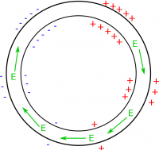
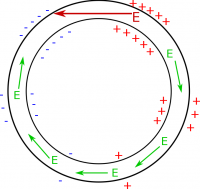
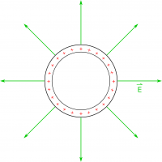
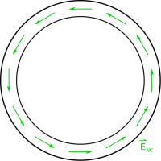

Thus far in this course, we have considered the [electric](/notes/week-01-charges-field-potential/pc_efield/) and [magnetic](/notes/week-09-magnetic-field-moving-point-charge/moving_q/) fields completely separately, either only looking at the effects of an electric field by itself or a magnetic field by itself. However, there are many real-world contexts where a charge may be moving in a magnetic field and also near other charges. This means the charge would feel both an [electric force](/notes/week-03-electric-force-energy/pc_force/) and a [magnetic force](/notes/week-11-sources-of-magnetic-fields/q_b_force/). Through Newton's second law (${\overset{\rightarrow}{F}}_{net} = {\overset{\rightarrow}{F}}_{1} + {\overset{\rightarrow}{F}}_{2} + ...$), we can think about how the combination of these forces affects individual charges. Using the magnetic and electric force is one way that we can think about combining electric and magnetic fields. Note that this is not a direct relationship between electric field and magnetic field, but rather relies on using force.

The notes this week are going to focus on a more fundamental (and direct) relationship between electric and magnetic fields, which hinges on a *changing* magnetic field rather than a *constant* magnetic field. So our starting question is: what happens when you have a changing magnetic field? The following video demonstrates what happens when you move a permanent magnet towards a coil of wire. The coil is connected to a [galvanometer](https://en.wikipedia.org/wiki/Galvanometer), which is a device that measures small currents (on the order of $\mu A$), but it is not connected to a battery.



In the video, you should have seen the needle deflect on the galvanometer when the magnet was brought near the coil and when it was brought far away from the coil. This is a super exciting result! This gives us a means to create an electric current without relying on battery or chemical means to create a potential difference. But this observation begs the question: where does this electric current come from?

## Where does this current come from?

Fig. 1: Proposed charge gradient around a wire loop

Earlier, we found that current (the charges in the wires that are moving) was the result of a constant electric field in the wire. This electric field produced an electric force on the charges that pushed the electrons along. This electric field was created by the gradient of the surface charges along the wire from one end of the battery to the other. We could hypothesize that perhaps the magnet would push the surface charges to make a gradient just like before. The surface charges could then make an electric field that would drive the current in the wire loop. In that case, to get a constant current, there would have to be a constant charge gradient around the loop (shown in Fig. 1 to the left).

Fig. 2: Conflicting Electric field vector at the top of the wire loop

This is all well and good until we return to the top of the loop. At the top of the loop, there would be a large change in the surface charges (shown in Fig. 2 to the left), which would create an electric field that points in the opposite direction! (Remember [electric fields point away from positive charges and towards negative charges](/notes/week-01-charges-field-potential/pc_efield/#electric_field_vectors).) This is very problematic and would not result in a constant current. On top of that, the drastic change from negatives to positives would imply that there's a large change in voltage at that spot. We were ok with this before because there was a battery at that location to justify that change in voltage, but now there's only a wire. It doesn't make sense for there to be a drastic change in voltage in only one spot in the wire. **This tells us that it is NOT surface charges that are creating the electric field in this case.** Something else must be creating an electric field that is driving the current in the loop.

Fig. 3: Electric field vectors if the loop was positively charged

So far, the only other source of electric fields that we know about is charges, but we didn't charge the loop ahead of time to create this electric field (e.g., we did not rub it with a piece of felt or connect it to a battery). We only moved a magnet towards a loop of wire. Even if we had charged the loop (say we charge it positively for example), the electric field from those excess charges would point away from the loop - not around the loop (shown in the Fig. 3 to the left). So all of our previous ideas do not make sense for the this context. It cannot be surface charges making the electric field because the E-field isn't constant. It cannot be excess charges making the E-field because the field would point outwards and not around the loop.

This tells us that we are actually dealing with a new source of electric fields! Namely that **a changing magnetic field will create a curly electric field**, where when we say “curly electric field” we mean that the electric field points in a circular direction (rather than away from positive charges or towards negative charges). It is this curly electric field in the loop of wire that creates the current that we observe in the loop (shown in Fig. 4 to the left).

Fig. 4: Curly electric field (or non-Coulombic Electric Field)

Because this is a curly electric field, which is very different than the other kinds of electric fields that we have talked about, we will write a curly electric field from a changing magnetic field as ${\overset{\rightarrow}{E}}_{nc}$. The “nc” is because this is referred to as the “non-coulombic” electric field, whereas we will keep $\overset{\rightarrow}{E}$ to be for an electric field from static charges.

Mathematically, we represent this relationship using [a vector operation called curl](https://en.wikipedia.org/wiki/Curl_(mathematics)); however, for this class, we will generally simplify the curl operation (using [Stokes' Theorem](https://en.wikipedia.org/wiki/Stokes%27_theorem)) to be:

$$
\int{\overset{\rightarrow}{E}}_{nc} \bullet d\overset{\rightarrow}{l} = - \frac{d\Phi_{B}}{dt}
$$

Where this equation (called [Faraday's Law](https://en.wikipedia.org/wiki/Faraday%27s_law_of_induction)) says that the curly electric field (${\overset{\rightarrow}{E}}_{nc}$) around a loop ($d\overset{\rightarrow}{l}$) is equal to the *opposite* change in the magnetic flux ($\frac{d\Phi_{B}}{dt}$) through that loop. The next few pages of notes will go through each part of this equation in detail (including where the negative sign came from) and how to use it, but it's important to remember that the relationship behind this equation is that a changing magnetic field will create a curly electric field.

### Examples

Video example showing a constant flux, rotating loop, and the magnetic being pushed towards and away from the loop:


