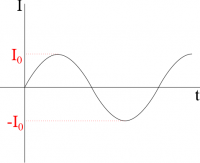
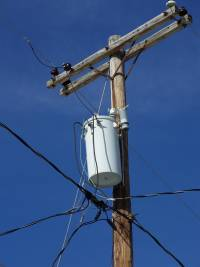
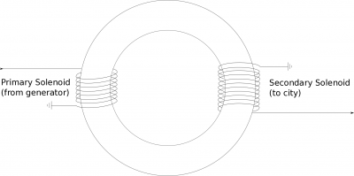
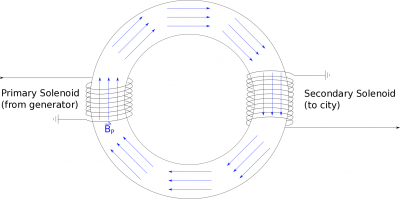
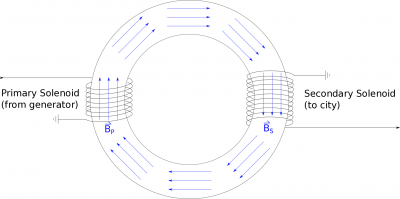

As we said before, one of the most important sources of a changing magnetic field is an alternating current. This is what actually comes out of the wall outlets; as opposed to the current from a battery which is a constant current (or a direct current). We are only briefly going to talk about alternating current as it refers to induction and changing magnetic flux, but there are many more applications of alternating current, especially with regard to circuits, resistors, and capacitors. For the purposes of these notes, we will talk about how we represent an alternating current, how that alternating current can produce an induced current/potential, and how that applies to voltage transformers.

## Alternating Current

Current over time in an alternating current cycle

When a current is constantly switching between positive and negative values, we call this an **alternating current**. Typically, this means that we have a current that is represented by a sine graph (shown in the figure to the right), though there can be other types of alternating current that look like step functions (also called [square waves](https://en.wikipedia.org/wiki/Square_wave)) or triangular shapes (or [triangle waves](https://en.wikipedia.org/wiki/Triangle_wave)). We will stick with a sine graph because it is mathematically easier to manipulate and is the most common kind of alternating current. This means that we represent the current as:

$$
I = I_{0}\sin(2\pi \cdot f \cdot t)
$$

where $I$ is the current at any particular time $t$, $I_{0}$ is the *maximum* current (this is a constant value), and $f$ is the frequency, which in general tells you how fast the current is changing between positive and negative with units of $\frac{1}{s}$ or $Hz$ (Hertz). More specifically, frequency tells you how much of a full cycle happens in 1 second. For example, if your frequency is $1Hz$, this means that your current goes from the maximum current to the minimum current and back to the maximum current in 1 second. If your frequency is $0.5Hz$, your current would go from the maximum current to the minimum current (or half of a cycle) in one second. In short, **frequency tells you what fraction of a complete cycle or how many complete cycles occur in 1 second**.

Alternatively, we could talk about the **period of the oscillation, which tells you how many seconds it takes to complete one full cycle** and is inversely related to frequency:

$$
\tau = \frac{1}{f}
$$

This means that a larger period would be related to a smaller frequency, and a smaller period would be related to a higher frequency. Since the period is often easier to think about conceptually, it may be easier to start with period (from a graph for example) and then relate it back to the frequency.

## Voltage Transformer

If you have an oscillating current, this would also mean that you would have an oscillating magnetic field everywhere around the wire (since currents create magnetic fields). If there is an oscillating magnetic field, this means that there will also be an induced potential/current in any nearby loop of wire since the magnetic field would be constantly changing. One common application of this idea is called a step-up transformer (or alternatively a step-down transformer), which is crucial to getting electricity from the power generator to your house.

Power transformer

As you figured out in the project last week, a rotating loop in a magnetic field will create a oscillating current and oscillating voltage. This idea is exactly what happens in a power generator, just on a much larger scale. In a power generator there are thousands of loops, rotating very quickly in a large magnetic field to produce a very large current with a frequency of 60 Hz (in the U.S. at least). However, because power (or the energy transferred to heat) is related to $P = I^{2}R$, sending a very large current over large distances (like from the generator to your house) would result in a large loss of power over that wire. This is a problem because any power lost on the wires can't be used in your house and if that power is large enough it could heat up the wires to point where they are damaged.

To get around this problem, a step up transformer is used to change a low voltage, high current circuit (like what comes out the generator) into a high voltage, low current circuit for transport from the generator to the neighborhoods or wherever it is needed. A step down transformer is then used close to the neighborhoods to return the high voltage, low current back to a low voltage, high current circuit that is then used in your house. You may have seen these around your neighborhood - they look like small boxes attached to the power lines overhead, generally on the lines going from a larger street into a residential area (shown in the figure to the left).

Primary and Secondary solenoids in a step-up transformer

In these notes, we will go through how a step up transformer works and how it uses induction to change the voltage from a low voltage to a high voltage. We will use a basic transformer, which is essentially two solenoids wrapped around a iron ring (shaped like doughnut), as shown in the figure to the right. The first solenoid, which will refer to as the primary solenoid, is connected to the power generator and has the low voltage (and high current). The second solenoid, which we will refer to as the secondary solenoid, should then have a high voltage (and low current) and eventually be connected to the city through a step down transformer.

Induced magnetic field

Because there is an oscillating potential/current in the first solenoid (from the generator), this will create a constantly changing magnetic field in the primary solenoid. Since the primary solenoid is wrapped around the iron bar, the magnetic field from the solenoid will cause all of the atoms within the iron to align with the magnetic field from the primary solenoid. Because iron atoms are very responsive to magnetic fields, even the atoms that are outside the primary solenoid will align with this magnetic field (largely because they are feeling the effects of their neighboring iron atoms). Since iron is easily magnetized, we will *assume that the magnetic field in the iron from the primary solenoid will be the same magnetic field in the secondary solenoid* (still in the iron ring). Because the magnetic field in the primary solenoid is oscillating, this means that the magnetic field in all of the iron ring is also constantly changing.

Cross sectional area of the iron ring would be dA in our calculation

If we put the secondary solenoid on the end of the iron ring, this changing magnetic field will be the same as that from the primary solenoid: $B_{P} = B_{S}$. This changing magnetic field (from the primary solenoid) will induce a voltage ($V_{S}$) in the secondary solenoid. We can use Faraday's Law to write this as:

$$
- V_{S} = \frac{d\Phi_{B_{S}}}{dt}
$$

We can then rewrite the flux $\Phi_{B2}$ using the flux definition:

$$
\Phi_{B_{S}} = \int{\overset{\rightarrow}{B}}_{S} \bullet {\overset{\rightarrow}{dA}}_{S}
$$

where the area here would be the cross-sectional area of the iron ring (since this is where the magnetic field is). The direction of the magnetic field would always be perpendicular to the area of the cylinder - so the flux would simplfy to:

$$
\Phi_{B_{S}} = B_{S}A_{S}
$$

But this is the magnetic flux through one loop in the secondary solenoid - if we want the total flux through all the loops then we have to multiply by the number of loops:

$$
\Phi_{B_{S}} = B_{S}A_{S}N_{S}
$$

We can then plug this into the voltage equation we wrote above:

$$
- V_{S} = \frac{d}{dt}(B_{S}A_{S}N_{S})
$$

Since $N_{S}$ and $A_{S}$ are constant with respect to time (not add/taking away loops or increasing/decreasing the area), these terms can come out of the derivative:

$$
- V_{S} = N_{S}A_{S}\frac{d}{dt}(B_{S})
$$

*If we assume that the ring has a constant cross-sectional area*, then $A_{P} = A_{S}$ and we already said that $B_{P} = B_{S}$. This means we can rewrite the flux through the secondary solenoid in terms of the magnetic field and area of the primary solenoid.

$$
- V_{S} = N_{S}A_{P}\frac{d}{dt}(B_{P})
$$

If we look at the $A_{P}\frac{d}{dt}(B_{P})$ term, this looks very much like the changing magnetic flux (or induced voltage) through a single loop of the *primary* solenoid:

$$
\frac{d\Phi_{B_{P}}}{dt} = \frac{d}{dt}(B_{P}A_{P})
$$

If we use Faraday's Law, we can rewrite the flux through a single loop of the primary solenoid in terms of the number of coils and the induced voltage in the whole solenoid:

$$
- V_{P} = N_{P}\frac{d}{dt}(B_{P}A_{P})
$$

$$
\frac{d}{dt}(B_{P}A_{P}) = \frac{- V_{P}}{N_{P}}
$$

Finally, We can plug this result into the $V_{S}$ equation above to get the potential in the secondary solenoid as it relates to the potential in the primary solenoid:

$$
- V_{S} = N_{S}\frac{- V_{P}}{N_{P}}
$$

$$
V_{S} = V_{P}\frac{N_{S}}{N_{P}}
$$

This equation then tells us that that if we want the voltage in the secondary solenoid to be 100 times greater than the voltage in the primary solenoid, the secondary solenoid must have 100 times as many loops as the primary solenoid! Remember that even though there are not explicit sines or cosines in our equation, this whole process hinges on the fact that the current, and thus magnetic field and voltage, are oscillating. You would not be able to make a voltage transformer in the same way using a direct current because there would no longer be a changing magnetic flux. (This was one of the [biggest arguments made back in the 1880s](https://energy.gov/articles/war-currents-ac-vs-dc-power) for using alternating current in the power grid rather than direct current.)

### Examples

- [Analyzing an Alternating Current Graph](/empcubed/examples/week14_ac_graph/)
- [Designing a Step-down Transformer](/empcubed/examples/week14_step_down_transformer/)
  - Video Example: Designing a Step-Down Transformer


