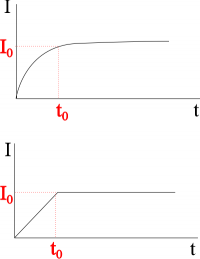
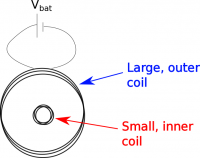
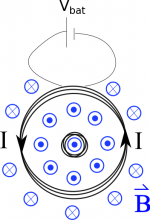
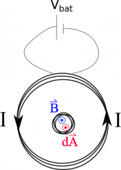
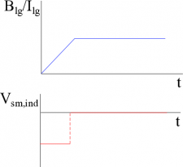

So far, we talked about how you can create a curly electric field (and thus an induced voltage/induced current) from a changing magnetic flux. We have gone through examples of what happens when the area changes and in your last project you worked through what happens when the coil is rotating. You also had a demo video that showed what happened when a strong magnet was brought towards or away from the coil, which is one way that the strength of the magnetic field can change. If instead, you have a magnetic field that is produced by a current, another way that the magnetic field can change is if the current (that is producing the magnetic field) changes. This is actually a fairly common situation for two reasons: 1) we are often turning on and off electrical devices and 2) the current/voltage coming from the wall outlets is an alternating current (meaning it is constantly changing from positive to negative). These notes are going to focus on the first of these, that is, how an induced current develops from a magnetic field that is changing with time that is not the result of the physical motion of a magnet. (The [next page of notes](/empcubed/notes/week-14-induction/ac/) will discuss the second case.)



## Increasing Current to Steady State

Approximating current vs time graph for initially connecting a circuit

When you initially connect a resistor to a battery, the current in the circuit is initially zero and then increases to its steady state value. If we made a graph of the magnitude of the current in the wires around the circuit, it would look something like one shown to right. In this case we would mathematically model the current as $I = I_{0}(1 - e^{- t/\tau})$, where $I_{0}$ is the steady state current and $\tau$ is a constant that tells you how fast the current reaches the steady state. If you only have a resistor in the circuit, it takes nano-seconds to micro-seconds to reach the steady state current.

While this is a realistic representation of the current in the circuit, mathematically, it can be a little complicated. Instead, we will simplify the model and approximate the increase of current in the circuit as shown in the graph to right. We will say that there is a period of time where the current is increasing linearly, and after that time we have a constant steady state current.

When the current is at its steady state value, there would not be an induced current in a nearby coil because the magnetic field would not be changing (constant current would mean the magnetic field would also be constant over time). However, when the current is increasing, you would have an increasing magnetic field around the wires. If you were to put a loop of wire near this increasing magnetic field, you would see an induced current in the loop, even though the wire is not physically moving!

When you have a typical circuit (like a battery connected to a light bulb), the change in the magnetic field is small enough that the induced current in any nearby loop is probably negligible. However, as circuit components become smaller and smaller and are placed closer and closer together (with roughly the same amount of current), the induced currents (because of changing magnetic fields) can become an important consideration in the design of electronics.

## Flux through a Loop

Concentric coils, with the larger coil connected to a battery

As an example, let's consider a set of concentric coils, where the larger outside coil is initially connected to a battery so that it's current increases from 0 A to 1 A in 1 ns. What would be the induced potential in the smaller inner coil?

We know from Faraday's law that the *induced voltage in the small loop should be equal to the change in magnetic flux through the small coil*. Since the small coil is at the center of the large coil, the magnetic flux through the small coil would be due to the magnetic field from the large coil.

Magnetic field from the current in the outer loop

This means we want to start by writing out what would be the magnetic field at the center of the larger loop (and therefore the magnetic field going through the small coil). We found in an earlier example that the magnetic field through a coil (with a counter-clockwise current) would be:

$$
{\overset{\rightarrow}{B}}_{lg} = \frac{\mu_{0}N_{lg}I}{2R_{lg}}\widehat{z}
$$

where $N_{lg}$ is the number of turns of wire around the large coil, $I$ is the current through the large coil and $R_{lg}$ is the radius of the large coil. If we *assume that the current increases linearly from 0 A to 1 A in 1 ns*, this means that we can write the current as:

$$
I = \frac{\Delta I}{\Delta t}t
$$

$$
I = \frac{1}{1 \cdot 10^{- 9}}t = 1 \cdot 10^{9}t
$$

We can plug in this current then to find the magnetic field at the center of the coil as a function of time:

$$
{\overset{\rightarrow}{B}}_{lg} = \frac{\mu_{0}N_{lg}1 \cdot 10^{9}t}{2R_{lg}}\widehat{z}
$$

If we *assume that the small coil is much smaller than big coil*, then the magnetic field that we just found is approximately constant through the small coil. We can then use this to figure out the magnetic flux through the coil. Like we said before, the magnetic flux through the small coil would be due to the magnetic field from the larger coil, so we would write the magnetic flux as:

$$
\Phi_{B_{sm}} = \int{\overset{\rightarrow}{B}}_{lg} \bullet d{\overset{\rightarrow}{A}}_{sm}
$$

We will *assume our* $d{\overset{\rightarrow}{A}}_{sm}$ *points out of page* (as opposed to into the page) because this will mean that our magnetic flux is positive. (We could have used a $d\overset{\rightarrow}{A}$ into the page - it would give the same result, but then the flux would have been negative and we would have to keep track of that extra negative sign.)

Direction of B and dA inside the small loop

If $d{\overset{\rightarrow}{A}}_{sm}$ points out of the page and $\overset{\rightarrow}{B}$ points out of the page, then the dot product in our flux equation simplifies to the multiplication of the vector magnitudes.

$$
\Phi_{B_{sm}} = \int B_{lg}dA_{sm}
$$

Then because the magnetic field is constant in the small loop (based on our assumption above), we can pull it out of the integral. Then integrating $dA_{sm}$ gives the area of the small loop:

$$
\Phi_{B_{sm}} = B_{lg}\int dA_{sm}
$$

$$
\Phi_{B_{sm}} = B_{lg}A_{sm}
$$

If the small coil also has multiple loops, then we would need to multiply the area by the number of loops since the magnetic field would essentially be going through many “areas”. Plugging in the magnetic field from the large coil, then we get that the flux through the small coil as a function of time is given by:

$$
\Phi_{B_{sm}} = \frac{\mu_{0}N_{lg}1 \cdot 10^{9}t}{2R_{lg}}A_{sm}N_{sm}
$$

The final step to find the potential then is to see how the magnetic flux is changing with time:

$$
- V_{ind} = \frac{d\Phi_{B}}{dt}
$$

$$
- V_{ind} = \frac{d}{dt}(\frac{\mu_{0}N_{lg}1 \cdot 10^{9}t}{2R_{lg}}A_{sm}N_{sm})
$$

We can then pull out the constants with respect to time, which leaves the derivative of t with respect to t (which is equal to 1).

$$
- V_{ind} = \frac{\mu_{0}N_{lg}1 \cdot 10^{9}}{2R_{lg}}A_{sm}N_{sm}\frac{d}{dt}(t)
$$

$$
- V_{ind} = \frac{\mu_{0}N_{lg}1 \cdot 10^{9}}{2R_{lg}}A_{sm}N_{sm}
$$

Graphs of B/I vs time for the large loop and induced V vs time for the small loop

This equation tells us that as the magnetic field increases linearly in the large coil, a constant potential (and thus a constant current) is induced in the smaller coil. Remember that the negative sign on the induced potential says that the **induced current will generate a magnetic field that will be in the direction that opposes the change in magnetic flux**. In this case, we have an increasing positive magnetic flux, where we defined a positive flux to be out of the page following the magnetic field. Since the change in flux is increasing, the induced current will oppose this change and thus create a magnetic field that points into the page. So using the right hand rule for induction, we point our thumb into the page, and curl your fingers, which gives the direction of the induced current in the small coil - which would be clockwise.

Depending on the area of the loops and the number of coils, this potential may be small and negligible or it may be large enough to cause problems in the circuit. However, the induced potential (and thus induced current) would only exist in the small coil for a very short period of time - only during the time period where the current is increasing in the large coil. When the current reaches a steady state in the larger coil, there is no longer a changing magnetic flux through the small coil so there is no induced current or potential. The [next page of notes](/empcubed/notes/week-14-induction/ac/) will talk about what happens if the current is constantly changing in the large coil.

### Examples

- [Changing Current Induces Voltage in Rectangular Loop](/empcubed/examples/week14_changing_current_rectangle/)
  - Video Example: Changing Current Induces Voltage in Rectangular Loop


