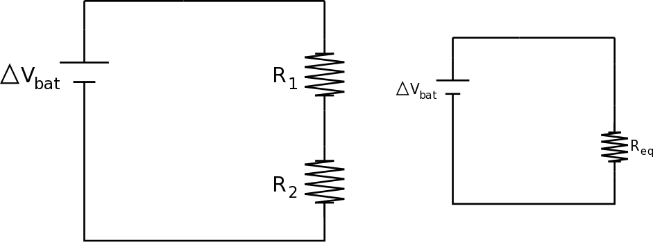
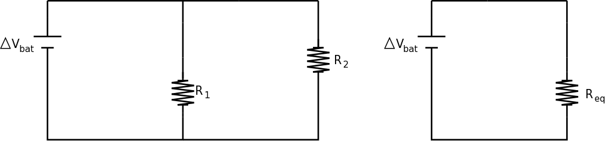
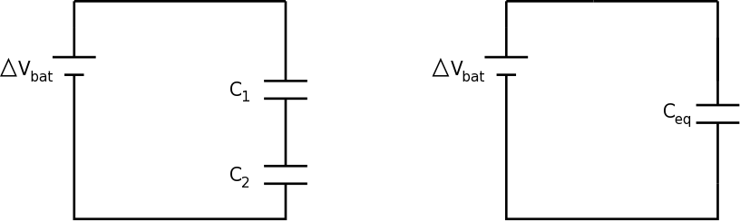
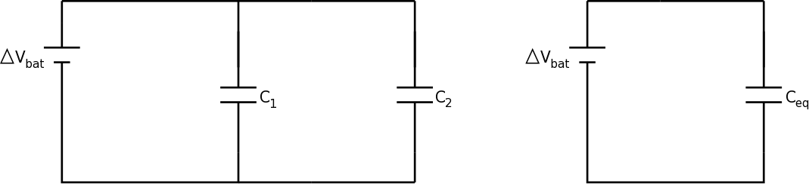

Chapters 18 and 19 (and Chapters 2, 3, 6, 11, and 13) in Matter and Interactions (4th edition)

Conservation theorems are central to many aspects of physics: they often form the central reasoning principles for new observations, they provide checks on new predictions, and they appear to be obeyed regardless of system and scale. You might not have heard them called conservation theorems before, but you have used them. In mechanics, these theorems manifest themselves as the three fundamental principles (for [momentum](https://pcubed.msuperl.org/notes/week-02-modeling-motion-net-force/momentum_principle/), [energy](https://pcubed.msuperl.org/notes/week-07-energy-transfer/energy_cons/), and [angular momentum](https://pcubed.msuperl.org/notes/week-12-14-collisions-rotational-motion/l_principle/)):

$$
\Delta{\overrightarrow{p}}_{sys} = {\overrightarrow{F}}_{ext}\Delta t
$$

$$
\Delta E_{sys} = W_{ext} + Q
$$

$$
\Delta{\overrightarrow{L}}_{sys} = {\overrightarrow{\tau}}_{ext}\Delta t.
$$

Electromagnetism is consistent with these fundamental principles (as you will see), but now that matter has charge, we bring a fourth fundamental principle to the party: [conservation of charge](/notes/week-01-charges-field-potential/charge/),

$$
\Delta Q_{sys} = I_{ext}\Delta t.
$$

These principles are referred to as “conservation theorems” because the describe how properties of a system will change and under what conditions those properties will not change (i.e., how they are conserved),

$$
\Delta{\overrightarrow{p}}_{sys} = 0\, when\,{\overrightarrow{F}}_{ext} = 0
$$

$$
\Delta E_{sys} = 0\, when\, W_{ext} + Q = 0
$$

$$
\Delta{\overrightarrow{L}}_{sys} = 0\, when\,{\overrightarrow{\tau}}_{ext} = 0
$$

$$
\Delta Q_{sys} = 0\, when\, I_{ext} = 0
$$



## Linear and Angular Momentum Conservation in E&M

We have not talked much about linear and angular momentum conservation in an electromagnetic system because they extend beyond the scope of this course. This is because to truly understand the relationship between these and the electromagnetic field, we must develop an understanding that the electromagnetic field can have linear and angular momentum. That’s right, the field itself has momentum that can push physical objects or twist them. This might seem very strange, but it is definitely the case that the electromagnetic field itself can have both.

A common example of this comes from astrophysics. When a star is going through fusion, it has a lot of gas pushing outward from the core. In addition, light is carried outward. This is complicated process, but the gas and light run into material in front of them as they move towards the stellar surface. These pushes by the gas and light cause a pressure on the material in front of them; pushing them outward. However, the gas in front of the outward moving gas and light is gravitationally attracted to any matter behind it. This careful balance of the gravitational pressure, gas pressure, and radiation pressure (the momentum imparted by collisions of electromagnetic radiation with material) determines the size, temperature, and brightness of the star. Stellar formation and evolution is vast research topic, but the point is that without that radiation pressure from the momentum carried by the electromagnetic radiation, the star could collapse under it’s own gravity – in fact, this is what happens in core collapse supernovae!

## Energy and Charge Conservation in E&M

Energy and charge conservation in electromagnetism is much easier to illustrate as both govern the movement of current in electronic circuits. In a typical circuit there are energy providers, [batteries](/notes/week-05-moving-charges-batteries/batteries/) and power supplies, and energy users or storers, [resistors](/notes/week-06-resistors-combinations/r_energy/) and [capacitors](/notes/week-08-capacitors-combinations/cap_charging/). If we consider the full circuit a closed system, there’s is no energy transported out of it, so all the energy provided by things like batteries are used to drive currents in things like resistors. Conservation of charge occurs after steady state is reached, namely when the current is the same throughout the circuit. The charge built up to guide the current in the wires occurs quite quickly and once that is complete, there’s no more charge buildup in the circuit unless the current begins to change with time (e.g., a new switch is closed, more batteries are added, a resistor is adjusted).

### Energy Conservation in a Circuit

A simple circuit consists of a single battery and a single resistor. There’s a little bit of energy used in the wires, but we can often neglect that amount compared to a resistor. The amount of energy provided to a single charge by the battery is just enough to make it around the circuit with most of that energy used in the resistor. We often model this using the amount of energy per unit charge ($\Delta V$, electric potential) provided by the battery as being used entirely by the resistor. This lets us avoid considering specific charges or combinations of charges.

$$
\Delta E_{sys} = W_{ext} + Q
$$

$$
\Delta E_{battery} + \Delta E_{resistor} = q\Delta V_{battery} + q\Delta V_{resistor} = 0
$$

$$
\Delta V_{battery} = - \Delta V_{resistor}
$$

where the minus sign indicates that the electric potential across the battery is negative as it is a user of energy. This calculation where we go around the loop adding up the energy per unit charge provided and used was [called the loop rule](/notes/week-06-resistors-combinations/r_energy/#Energy_around_the_Circuit), which gave us a way to determine the current through a resistor (or other elements in a circuit).

### Charge Conservation in a Circuit

Charge conservation in a circuit is a bit more subtle but explains how the current at any point in a simple circuit is the same. Consider a thick wire that narrows (our simple model for a resistor) and then expands again. In this situation, we found that the electrons in the thin part of the wire speed up to maintain a constant current. This occurs through the buildup of charge near the narrowing resistor causing a large gradient of surface charge near the resistor.

We can apply charge conservation by choosing the resistor as our system. In this case, the amount of charge that builds up is zero as the system is in steady state,

$$
\Delta Q_{sys} = I_{ext}\Delta t
$$

$$
\Delta Q_{sys} = 0 = I_{ext}\Delta t
$$

But now, let’s care about the external currents, which are running into and out of the resistor. On the left side, the current goes in, but on the right side it goes out, so we will say that current is negative as it would act to reduce the charge in the system,

$$
0 = I_{ext}\Delta t = |I_{in}|\Delta t - |I_{out}|\Delta t
$$

$$
|I_{in}| = |I_{out}|
$$

Thus, the current going into the resistor, but be equal to the current coming out of it. We could choose any other part of the circuit like this and make the same argument, which means that charge conservation leads to an important result – namely that the current into any branch is the same as that coming out. [This was called the node or junction rule](/notes/week-06-resistors-combinations/current/).

## Effects and Applications

Armed with these conservation theorems, namely energy and charge conservation, we can find some practical results for typical, passive circuit elements: resistors and capacitors.

### Resistors in a circuit

<figure>

<figcaption aria-hidden="true">
Resistors in series
</figcaption>
</figure>

[Two resistors in series](/notes/week-06-resistors-combinations/r_series/) (end-to-end) must have the same current running through them, but they can use different amounts of electric potential to drive that current depending on their individual resistances. This leads to their combined, effective result on the current in a circuit increasing the resistance of the circuit,

$$
R_{eq} = R_{1} + R_{2}
$$

<figure>

<figcaption aria-hidden="true">
Resistors in parallel
</figcaption>
</figure>

[Two resistors in parallel](/notes/week-06-resistors-combinations/r_parallel/) (connected off the same branch) must use the same electric potential (by the loop rule), but they can drive different currents as long as the sum of those currents is equal to the total before the branch splits. This leads to their combine effective result as reducing the overall resistance of the circuit,

$$
\frac{1}{R_{eq}} = \frac{1}{R_{1}} + \frac{1}{R_{2}}
$$

### Capacitors in a circuit

<figure>

<figcaption aria-hidden="true">
capacitors in series
</figcaption>
</figure>

[Two capacitors in series](/notes/week-08-capacitors-combinations/c_series/) (end-to-end) must have the same amount of stored charge, otherwise a current would be driven until such time that they did. This means that each of them can store a different amount of energy per unit charge, which depends on their individual capacitance. The result is reducing the overall capacitance of the circuit,

$$
\frac{1}{C_{eq}} = \frac{1}{C_{1}} + \frac{1}{C_{2}}
$$

<figure>

<figcaption aria-hidden="true">
Capacitors in parallel
</figcaption>
</figure>

[Two capacitors in parallel](/notes/week-08-capacitors-combinations/c_parallel/) (connected off the same branch) must use the same energy per unit charge (because of the loop rule), but they can store different amounts of charge depending on their individual capacitances. The result is increasing the overall capacitance of the circuit,

$$
C_{eq} = C_{1} + C_{2}
$$
