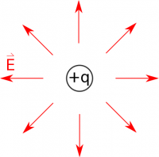
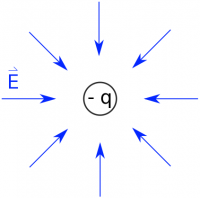
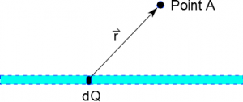
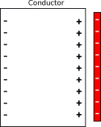
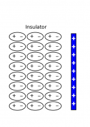
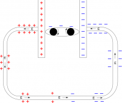

What has driven the development of all the physics and mathematics we have done is one simple observation: **Matter is charged**. That is, matter has a property called charge, which stems from the fact that it is made up of charged particles: electrons and protons. This simple observation leads to a fundamental idea in electromagnetism: **Charges generate electric field**. This field permeates all of space, although, it gets weaker as you are further from the source. This field has a magnitude and direction at every point in space.



## Model of a Point Charge

E field points away from a positive charge

E field points towards a negative charge

Our introduction to charge started with the [electric field that a single point charge produces](/notes/week-01-charges-field-potential/pc_efield/). We observe this field to be,

$$
\overset{\rightarrow}{E} = \frac{1}{4\pi\varepsilon_{0}}\frac{q}{r^{2}}\widehat{r}.
$$

Where the vector $\overset{\rightarrow}{r}$ describes the separation vector between the observation and source locations. We cannot derive this equation. It is the model of the point charge electric field that fits the data well. It is our starting point out of which the whole of electrostatics springs. All the interesting and complicated phenomena that we observe due to electric interactions start fundamentally with this field.

If another charge is brought into the scene, it will interact with the first charge through the electric field that the first charge generates. This push or pull that the new charge experiences is directly related to the electric field that the source charge produces. This [electric force](/notes/week-03-electric-force-energy/pc_force/) then is simply,

$$
{\overset{\rightarrow}{F}}_{E} = q_{test}\overset{\rightarrow}{E}.
$$

For like charges, this interaction is repulsive (a push) and for unlike charges it’s attractive (a pull). We also relate the electric field and force to the [electric potential](/notes/week-01-charges-field-potential/pc_potential/) and the [electric potential energy](/notes/week-03-electric-force-energy/pc_energy/).

## Collections of Charges

Single charges are not the only possible situation we encounter in the world. Often, we have some collection of charges either a set of them or a continuous distribution of charge. In either event, we seek to find the total or net effect of having this collection of charges. Fortunately, the electric field obeys the [principle of superposition](/notes/week-02-charges-superposition/superposition/). Superposition is the most important aspect of the electromagnetic field as it provides a basis for combining fields due to distinct sources. Without a method for adding fields (aka superposition), we’d be unable to describe anything more than the interaction between pairs of point charges.

The basic premise is that the net electric field is the vector sum of the individual electric fields,

$$
{\overset{\rightarrow}{E}}_{net} = {\overset{\rightarrow}{E}}_{1} + {\overset{\rightarrow}{E}}_{2} + {\overset{\rightarrow}{E}}_{3} + \cdots = \sum_{i}^{}{\overset{\rightarrow}{E}}_{i}
$$

Efield calculation set up for a line of charge

One major benefit of this superposition is that it can be extended to a continuous distribution of charge, like a [lines of charge](/notes/week-04-modeling-distributions-of-charge/line_fields/) (or a plane of charge, a volume of charge, or some blob of charge). In this case, it works to consider a [little piece of the charge](/notes/week-04-modeling-distributions-of-charge/dq/) ($dq$) as producing a point charge electric field and adding up the result using an integral,

$$
d\overset{\rightarrow}{E} = \frac{1}{4\pi\varepsilon_{0}}\frac{dq}{r^{2}}\widehat{r}
$$

$$
{\overset{\rightarrow}{E}}_{net} = \int d\overset{\rightarrow}{E} = \int\frac{1}{4\pi\varepsilon_{0}}\frac{dq}{r^{2}}\widehat{r}.
$$

We can use this integration technique [analytically](/notes/week-04-modeling-distributions-of-charge/linecharge/) and [computationally](/notes/week-02-charges-superposition/comp_super/) to determine the electric field produced by a continuous distribution of charge.

## Effects and Applications

The fact that charges generate electric fields, that they superpose, and that other charges experience the electric force in the presence of an electric field give rise to a whole host of observable effects and practical applications. Some of most important ones are discussed below:

## Polarization

Polarization of a conductor

Polarization of an insulator

Matter is made up of charged subatomic particles: electrons and protons. As a result, [when a piece of matter is in the presence of an electric field](/notes/week-02-charges-superposition/charge_and_matter/), the charged particles will experience a force and tend to align with the field. This polarization effect is a common, and can be observed anytime you experience a mild electric shocks, frizzy hair, or static cling.

[Matter can be classified by how well it polarizes](/notes/week-02-charges-superposition/charge_and_matter/#types_of_matter), that is, how mobile it’s electrons are. (Typically, the electron in the highest orbital is the most mobile.) In the case of a metal, this electron is very mobile and can shift large distances. This gives the metal the curious properties that there is no electric field inside and that all the excess charge lives on the surface. In an insulator, the electrons are far more tightly bound, so while the material still polarizes some, it does not polarize nearly as much as a metal. Thus, there is still some net electric field in the material.

## Circuits

Efield in a circuit

The electric field plays an essential role in the operation of a circuits. The electrons that move in the wires of a circuit do so because of an [electric field that drives them along](/notes/week-05-moving-charges-batteries/q_in_wires/). This electric field stems from the [surface charge on the outer surface of the wires](/notes/week-05-moving-charges-batteries/q_in_wires/), which is gradiated from one end of the circuit to the other. These electrons are accelerated as they experience the electric field, but quickly run into atoms in the material that are not moving. They lose their momentum and then are accelerated again. This start-stop motion leads us to the [Drude model of conduction and current in wires](/notes/week-06-resistors-combinations/current/), that on average the electrons drift through the material at constant speed.

In steady state, all parts of the circuit have the same current, that is the sum of all the moving electrons across any slice of the circuit gives the same result. But that doesn’t mean all parts of the circuit have the same electric field. Where there is a resistor, there is a large electric field to drive the electrons through faster - this is counter to our understanding of “resistance”, but necessary to maintain the steady current. That also means that the gradient of surface charge is larger in regions where there is more resistance.

## Changing electric field

Much of our study of electric fields was focused on fields that didn’t change with time. The field was due to some static distribution of charge that didn’t move or change. However, in many situations the sources of charge will move and thus create a [time-varying electric field](https://www.msuperl.org/wikis/pcubed/doku.php?id=184_notes:changing_e). Think about the example of a charging set of capacitor plates.

In the case of a time-varying electric field, we observe that a magnetic field, which is also typically time-varying, is produced. This observation along with [special relativity](https://en.wikipedia.org/wiki/Special_relativity) helped tie electric and magnetic fields into one in the same kind of field. Furthermore, the time-varying electric field is essential to the propagation of electromagnetic radiation, which drives much of our modern world. Satellite TV, the radio, the internet, WiFi, and many other modern day tools and conveniences would be impossible without the propagation of electromagnetic radiation.
