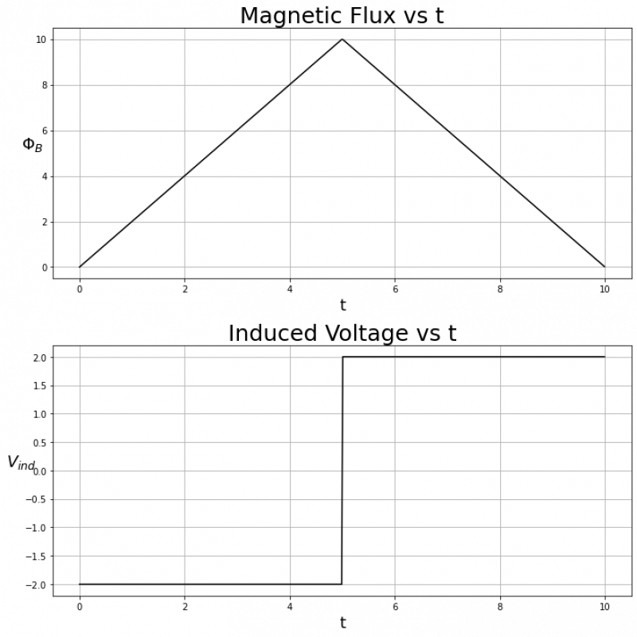
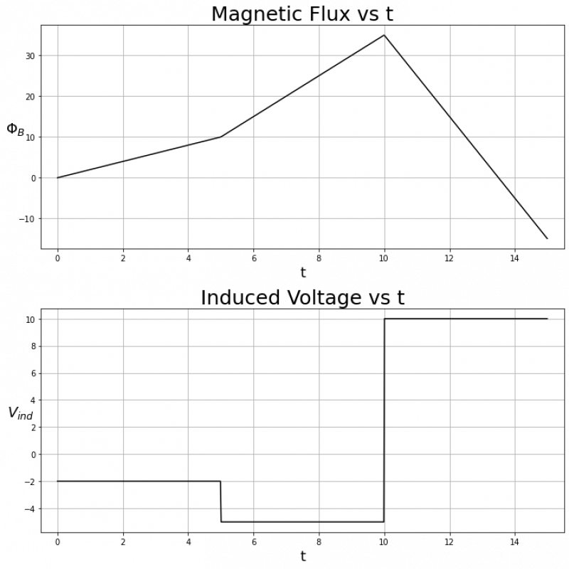
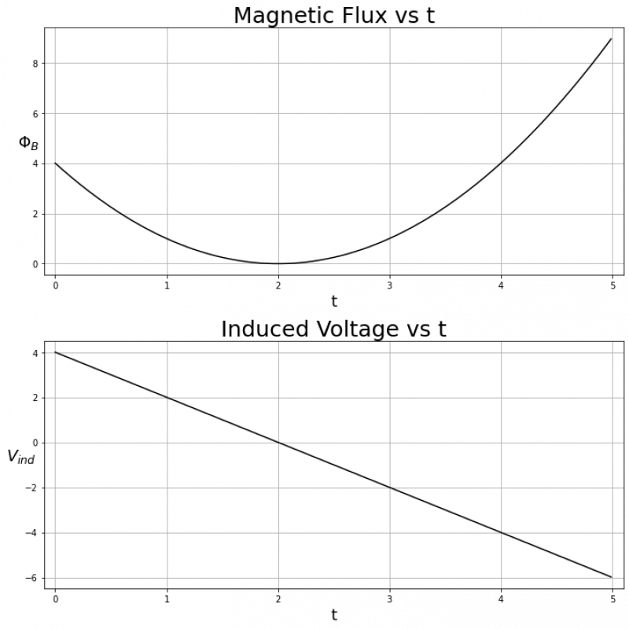

In these notes, we will examine a few examples of changing magnetic fluxes and associated induced voltages. Recall from the previous notes that these are related by **Faraday's Law** which says:

$$
V_{ind} = - \frac{d\Phi_{b}}{dt}
$$

This is saying that the induced current is the **negative slope** of the magnetic flux. In other words, if the magnetic flux is increasing, then $V_{ind}$ will be negative, if the magnetic flux is decreasing, then $V_{ind}$ will be positive, and if the magnetic flux is constant, then $V_{ind} = 0$.

First let's consider when an example where $\Phi_{B}$ rises and falls linearly with the same magnitude of slope:

From $t = 0$ to $t = 5$, $\Phi_{B}(t)$ has a constant positive slope, so $V_{ind}$ will be constant and **negative**. Conversely, from $t = 5$ to $t = 10$, $\Phi_{B}(t)$ has a constant negative slope, so $V_{ind}$ will be constant and **positive**.

Specifically, in this case $\Phi_{B}(t)$ is defined as:

$$
\Phi_{B}(t) = \left\{ \begin{matrix}
2t & \text{if~}0 < t < 5 \\
{-}2t & \text{if~}5 < t < 10
\end{matrix} \right.\ 
$$

Which means $\frac{d\Phi_{B}}{dt}$ is:

$$
\frac{d\Phi_{B}}{dt} = \left\{ \begin{matrix}
2 & \text{if~}0 < t < 5 \\
{-}2 & \text{if~}5 < t < 10
\end{matrix} \right.\ 
$$

Now we can multiply by $- 1$ because of the negative sign in Faraday's law to find $V_{ind}$:

$$
V_{ind} = \left\{ \begin{matrix}
{-}2 & \text{if~}0 < t < 5 \\
2 & \text{if~}5 < t < 10
\end{matrix} \right.\ 
$$

Next, let's consider an example with a few different slopes:

We can see that from $t = 0$ to $t = 10$, $\Phi_{B}(t)$ has a positive slope, so $V_{ind}$ is negative on that time interval. However, $\Phi_{B}(t)$ is steeper from $t = 5$ to $t = 10$, so $V_{ind}$ is **more negative** on that time interval than from $t = 0$ to $t = 5$. From $t = 10$ to $t = 15$, $\Phi_{B}(t)$ has a constant and negative slope, so $V_{ind}$ is constant and positive on that time interval. Specifically we have that:

$$
\Phi_{B}(t) = \left\{ \begin{matrix}
2t & \text{if~}0 < t < 5 \\
5t - 15 & \text{if~}5 < t < 10 \\
{-}10t + 135 & \text{if~}10 < t < 15
\end{matrix} \right.\ 
$$

Which means $\frac{d\Phi_{B}}{dt}$ is:

$$
\frac{d\Phi_{B}}{dt} = \left\{ \begin{matrix}
2 & \text{if~}0 < t < 5 \\
5 & \text{if~}5 < t < 10 \\
{-}10 & \text{if~}10 < t < 15
\end{matrix} \right.\ 
$$

Which finally means that $V_{ind}$ is:

$$
V_{ind} = \left\{ \begin{matrix}
{-}2 & \text{if~}0 < t < 5 \\
{-}5 & \text{if~}5 < t < 10 \\
10 & \text{if~}10 < t < 15
\end{matrix} \right.\ 
$$

Finally, let's look at an example with a non-linear $\Phi_{B}(t)$:

$\Phi_{B}(t)$ looks like a quadratic centered about t = 2. We can see that while $\Phi_{B}(t)$ is decreasing ($0 < t < 2$), $V_{ind}$ is positive, and while $\Phi_{B}(t)$ is increasing ($2 < t < 8$), $V_{ind}$ is negative.

Specifically, in this case we have:

$$
\Phi_{B}(t) = (t - 2)^{2}
$$

Taking a first derivative with respect to time yields:

$$
\frac{d\Phi_{B}}{dt} = 2(t - 2)
$$

Multiplying by $- 1$ to find $V_{ind}$ gives:

$$
V_{ind} = - 2(t - 2)
$$
