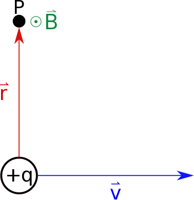
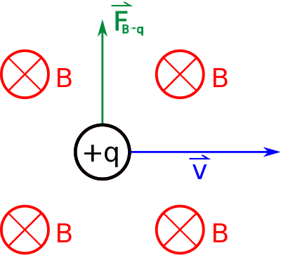
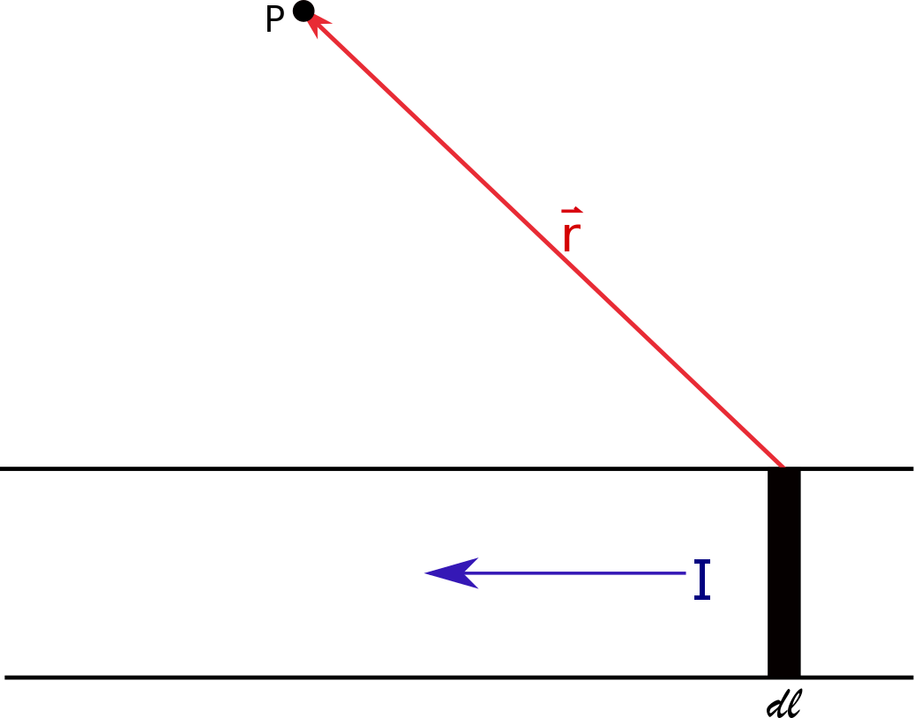
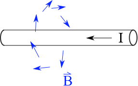
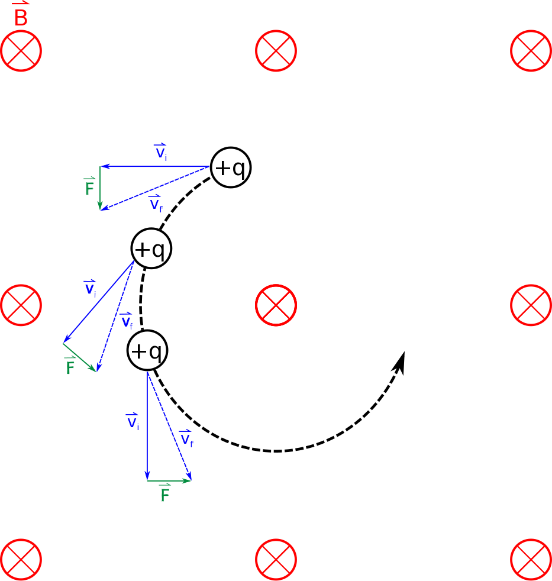

Chapters 17 and 20 of Matter and Interactions (4th edition)

When charges are at rest, they [generate an electric field](/notes/week-14-induction/electric_field/). Set that charge into motion and you have a new observation: **moving charges generate magnetic field**. This field, originally thought to be completely different from the electric field, has its own form of interaction. Like the electric field, the magnetic field also permeates all of space, and it gets weaker as you are further from the source. The magnetic field due to some moving charge has a magnitude and direction at every point in space.



## Model of a moving point charge

<figure>

<figcaption aria-hidden="true">
Magnetic field from a moving point charge
</figcaption>
</figure>

Our introduction to the magnetic field started with [a single moving charge](/notes/week-09-magnetic-field-moving-point-charge/moving_q/). We observe the magnetic field produced by a single moving charge to be,

$$
\overrightarrow{B} = \frac{\mu_{0}}{4\pi}\frac{q\overrightarrow{v} \times \widehat{r}}{r^{2}}.
$$

where the vector $\overrightarrow{r}$ is still the separation vector between the location of the moving charge at a given time and the observation location at the same time – assuming that the charge is moving much more slowly than the speed of light. Again, we cannot derive this equation, it is a model of the point charge magnetic field that fits the data/observation well. Like the electric field of a point charge, this is the starting point for magnetic fields (and, later, electromagnetism, in general).

<figure>

<figcaption aria-hidden="true">
Magnetic force on a moving charge in a magnetic field
</figcaption>
</figure>

If another moving charge is brought into the scene, it will interact with the first moving charge through the magnetic field that the first charge generates. (It will also experience the electric force, but we often limit our discussion at first to the isolated magnetic interaction.) This push or pull that the new moving charge experiences is directly related to the cross product of the velocity of that charge and the magnetic field of the source charge. This [magnetic force](/notes/week-11-sources-of-magnetic-fields/q_b_force/) is simply,

$$
{\overrightarrow{F}}_{B} = q_{test}{\overrightarrow{v}}_{test} \times \overrightarrow{B}.
$$

The direction of the force is determined by the [right hand rule](/notes/week-09-magnetic-field-moving-point-charge/rhr/) and is perpendicular to the plane defined by the vector velocity and magnetic field. This means that a charge will experience no magnetic force if it travels directly along a magnetic field line (or opposite it).

## Collections of moving charges

<figure>

<figcaption aria-hidden="true">
Magnetic field from a line of charge
</figcaption>
</figure>

A single moving charge is certainly not the only kind of situation that we encounter. In fact, it’s quite often that a collection of charges are moving – forming a current. This collection of moving charges or really [current also generates a magnetic field](/notes/week-10-magnetic-field-of-a-wire/b_current/), and, similar to the electric field, the magnetic field obeys superposition. The basic premise is quite similar to the for electric fields,

$$
{\overrightarrow{B}}_{net} = {\overrightarrow{B}}_{1} + {\overrightarrow{B}}_{2} + {\overrightarrow{B}}_{3} + \ldots = \sum_{i}^{}{\overrightarrow{B}}_{i}
$$

This result tells us how the total magnetic field due to a distribution of moving charges works out, but what about when there’s a true current ($I$)? We can treat each little segment of the wire in a way that asks: how much do you contribute to the magnetic field? When we do this we get a little contribution from each segment (length $dl$) and add them up using an integral,

$$
d\overrightarrow{B} = \frac{\mu_{0}}{4\pi}\frac{Id\overrightarrow{l} \times \widehat{r}}{r^{2}}
$$

$$
{\overrightarrow{B}}_{net} = \int d\overrightarrow{B} = \int\frac{\mu_{0}}{4\pi}\frac{Id\overrightarrow{l} \times \widehat{r}}{r^{2}}
$$

We can use this integration technique analytically and computationally to find the magnetic field produce by a distribution of current - either through [a wire segment](/examples/week10_current_segment/), [a very long wire](/notes/week-10-magnetic-field-of-a-wire/b_current/), or [loops of wires](/examples/week10_current_ring/).

## Effects and Applications

The fact that moving charges generate magnetic fields, that they superpose, and that other moving charges experience magnetic forces in the presence of a magnetic field result in a number of different magnetic phenomenon. Some are quite practical. Some of the most important ones are discussed below:

<figure>

<figcaption aria-hidden="true">
Magnetic field around a current carrying wire
</figcaption>
</figure>

### Current-carrying wires

Wires that carry current will produce magnetic fields that circulate around them. This stems from the superposed magnetic fields from all the little charges moving in the wire. This can be quite important because those magnetic fields might disturb other sensitive electronics in a particular electronic device or experiment. Moreover, [pairs of current carrying wires can exert forces on each other](/examples/week12_force_between_wires/) (attractive or repulsive) causing physical stress on the wires or other components.

### Curved motion

<figure>

<figcaption aria-hidden="true">
Motion of a charge moving through a magnetic field
</figcaption>
</figure>

Magnetic fields [cannot change the kinetic energy of charged particles](/notes/week-11-sources-of-magnetic-fields/q_path/). This is because the magnetic force acting on the particle is always perpendicular to motion of the particle. So magnetic fields can change the trajectory of a particle, but are not able to speed up or slow down the motion of the particle. As a result a particle moving in a uniform magnetic field subject to no other forces will execute [uniform circular motion](/notes/week-11-sources-of-magnetic-fields/q_path/). The direction of the orbit (clockwise vs counterclockwise) will depend on the sign of the charge, the direction of the velocity, and the direction of the magnetic field.

This is a very useful result in cyclotron accelerators where a magnetic field is used to force charged particles into a circular path (while an electric field is used to speed up the charged particles). The circular path (made by the magnetic field) helps contain the accelerator to a smaller area. We can also exploit the tendency to have curved trajectories in mass spectrometers, which can be used to determine the charge to mass ratio of a particle, as particles with different charge-to-mass ratios will curve differently. Using electric and magnetic fields together, we can manipulate the trajectories of charged particles in ways that help us select out only certain kinds of particles; this is used in particle accelerators, but also in simpler situations like cathode-ray screens (which used to be in the big square tv’s and computer monitors but have gone out of fashion lately).

### Changing magnetic fields

Much of our study of magnetic fields focused on fields due to steady currents, that is, magnetic fields that didn’t change with time. The field was produced a steady stream of charge carriers that we modeled as moving with the same speed and direction. This doesn’t have to be the case and it’s quite common that it isn’t.

In the case of a [current that changes in time](/notes/week-14-induction/b_flux_t/), we produce a time-varying magnetic field. This kind of magnetic field is observed to generate a curly electric field. This electric field is not due to static charges and, hence, we called it a non-Coulombic electric field. This field has very practical uses, in particular, recent advances in inductive charging (also called wireless charging) uses this approach. A coil produces a magnetic field that varies with time which is used to drive a current in another coil that charges a device without physical contact.
